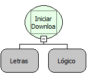

Descrição:

Utilizada para fazer o download de um arquivo passando o endereço do mesmo. O caminho deve ser relativo ao diretório do deploy webrun, e deve começar por "tmp/" ou "download/" ou "upload/" ou "downloads/" ou "uploads

Parâmetros:

1. URL do arquivo que será baixado.

2. Indica se deve ser exibido uma mensagem informativa, com o link do arquivo. Se for verdadeiro aparecerá uma mensagem informando o endereço do arquivo, e iniciará o download. Se for falso apenas iniciará o download do arquivo.

Retorno:

Não possui

Nome Real:

ebfDonwloadStart

Compatibilidade:

Cliente e Servidor
