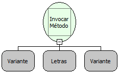

Descrição:

Invoca um método no objeto passado por parâmetro.

Parâmetros:

1. Objeto que contém o método

2. Método a ser executado

3. Lista de parâmetros do método.

Retorno:

Retorna o resultado da execução do método.

Nome Real:

ebfInvokeMethod

Compatibilidade:

Cliente e Servidor
