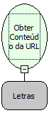

Descrição:

Retorna o conteúdo da URL a partir desta.

Parâmetros:

1. A página web que deseja obter o conteúdo(Letra)

Retorno:

O contúdo da página passada como parâmetro em formato de texto

Exemplo:

Ao passar como parâmetro http://www.softwell.com.br, o retorno será o html da página passado em formato de texto

Nome Real:

ebfGetURLContent

Compatibilidade:

Servidor
