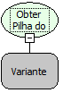

Descrição:

Obtém a pilha de erro do objeto Exception ou nulo caso o objeto passado não seja uma exceção (instância de Throwable).

Parâmetros:

1. Objeto Exception "Throwable" (Variante). Ex: O valor enviado no terceiro parâmetro do fluxo indicado da função "Capturar Exceção".

Nome Real:

ebfExceptionGetStackTrace

Compatibilidade:

Servidor
