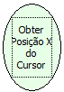

Descrição:

Obtém a posição horizontal (relativa ao formulário atual) do cursor.

Parâmetros:

Não possui.

Retorno:

Posição X do Cursor (Inteiro)

Nome Real:

ebfGetCursorX

Compatibilidade:

Cliente
