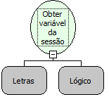

Descrição:

Obtém o conteúdo da variável criada pela função "Definir variável de sessão" passando no 1º parâmetro o nome da variável e no 2ºparâmetro o valor lógico verdadeiro ou falso, indicando se é ou não uma variável global. Para variáveis globais usa-se verdadeiro, para não globais usa-se falso.

Parâmetros:

1. Nome da Variável

2. Valor Lógico.

Retorno:

Retorna o conteúdo da variável passada no primeiro parâmetro caso ela já exista. Caso ela ainda não tenha sido definida, retorna Nulo.

Observações:

1. Para obter uma variável de sessão é necessário antes definir essa variável utilizando a função "Definir variável de sessão" da categoria Utilitários.

2. Para obter uma variável de sessão em um formulário externo, é necessário que o fluxo esteja na camada servidor.

Exemplo:

Assumindo como parâmetros "Contador" (Letras) e verdadeiro (Lógico). Se existir uma variável global com o nome "Contador" o retorno seria o conteúdo dessa variável. Caso não exista, o retorno seria nulo.

Nome Real:

ebfGetSessionAttribute

Compatibilidade:

Cliente e Servidor
