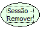

# Sessão - Remover Regra Ao Expirar.

Descrição:

Remove a regra definida para ser executada quando a sessão for expirada.

Observação:

Esta função só remove regra definida na função "Sessão - Definir Regra ao Expirar"

Nome Real:

ebfSessionDestroyRemoveRule.

Compatibilidade:

Servidor.
