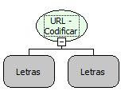

Descrição:

Essa função codifica uma URL passada por parâmetro.

Parâmetros:

1. URL.

2. Charset (Opcional)

Retorno:

Retorna a URL codificada.

Observação:

Caso o 2º parâmetro seja nulo, a função pega o charset utilizado na aplicação.
