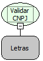

Descrição:

Verifica se um valor é um CNPJ válido. Caso o valor seja vazio, será considerado que o CNPJ é válido.

Parâmetros:

1. Valor a ser avaliado.

Retorno:

Retorna Verdadeiro se for um CNPJ, caso contrário retorna Falso.

Nome Real:

ebfIsCnpj

Compatibilidade:

Cliente
