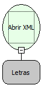

Descrição:

Essa função cria um objeto XML passando como parâmetro o texto no formato em XML. E atribui o objeto criado a uma variável do tipo Letras.

Parâmetros:

1. O texto em XML

Retorno:

Cria o objeto XML. O retorno deve ser armazenado numa variável do tipo Letras.

Observação:

A linguagem XML é definida como o formato universal para dados estruturados na Web. Para saber mais sobre o assunto, pesquise em um site de busca sobre (XML) ou (Extensible Markup Language).

Exemplo:

 Assumindo o 1º parâmetro sendo:

        &lt;?xml version="1.0" encoding="ISO-8859-1"?&gt;

          &lt;CURSO&gt;

               &lt;DISCIPLINA&gt;

                   &lt;OBJETIVO&gt;

                        Ensinar XML

                   &lt;/OBJETIVO&gt;

                   &lt;METODOLOGIA&gt;

                         Laboratório

                   &lt;/METODOLOGIA&gt;

                   &lt;AVALIACAO&gt;

                         3 provas

                   &lt;/AVALIACAO&gt;

               &lt;/DISCIPLINA&gt;

          &lt;/CURSO&gt;

  O retorno será a criação do objeto XML.

Nome Real:

ebfXMLOpen

Compatibilidade:

Cliente e Servidor
