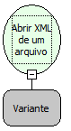

Descrição:

Essa função abre um arquivo XML para um arquivo variável.

Parâmetros:

1. Caminho da onde se encontra o arquivo XML

Retorno:

Variante contendo o XML.

Observação:

A linguagem XML é definida como o formato universal para dados estruturados na Web. Para saber mais sobre o assunto, pesquise em um site de busca sobre (XML) ou (Extensible Markup Language).

Exemplos:

Assumindo o 1º parâmetro sendo:

        C:\Pasta\Arquivo.xml

Retorna a referencia para o Arquivo passado.

Nome Real:

ebfXMLOpenFromFile

Compatibilidade:

Servidor
