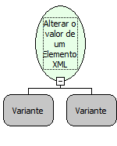

Descrição:

Alterar o valor de um elemento em um documento XML (Existem dois tipos de informação que podem aparecer em um documento. XML: elementos e atributos. Elementos são as informações que são representadas entre as tags  e atributos são informações adicionais que são acrescentadas a uma tag)

Parâmetros:

1. Elemento do XML

2. Valor a ser modificado

Observação:

A linguagem XML é definida como o formato universal para dados estruturados na Web. Para saber mais sobre o assunto, pesquise em um site de busca sobre (XML) ou (Extensible Markup Language).

Exemplo:

Se o Elemento é &lt;TEXTO&gt;MakerFlow&lt;/TEXTO&gt; , então o valor do elemento é MakerFlow

Nome Real:

ebfXMLSetElementValue

Compatibilidade:

Servidor
