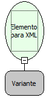

Descrição:

Obtem o Elemento de uma determinada Raiz de um documento XML

Parâmetros:

1. Raiz do XML

Retorno:

A variável de Retorno deverá ser do tipo Letras

Observações:

A linguagem XML é definida como o formato universal para dados estruturados na Web. Para saber mais sobre o assunto, pesquise em um site de busca sobre (XML) ou (Extensible Markup Language).

Nome Real:

ebfXMLGetElementAsXML

Compatibilidade:

Servidor
