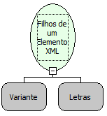

Descrição:

Obtém todos os filhos de um determinado Elemento XML informado.(Os Filhos do Elemento no caso seria então os Sub-Elementos do Elemento.).

Parâmetros:

1. Objeto XML. (Raiz, Nó, etc...)

2. Nome do Elemento.

Retorno:

A variável de Retorno deverá ser do tipo Variante.

Observação:

A linguagem XML é definida como o formato universal para dados estruturados na Web. Para saber mais sobre o assunto, pesquise em um site de busca sobre (XML) ou (Extensible Markup Language).

Exemplos:

Tendo uma XML onde o elemento é

    &lt;TEXTO&gt;

      &lt;SQL&gt;Sequel&lt;/SQL&gt;

      &lt;MAKER&gt;Flow&lt;/MAKER&gt;

    &lt;/TEXTO&gt;

Então o retorno seria o que estive-se dentro do nó &lt;TEXTO&gt;, no caso,  &lt;SQL&gt; e &lt;MAKER&gt;.

Nome Real:

ebfXMLGetChildrenElement

Compatibilidade:

Cliente e Servidor
