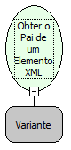

Descrição:

Obtém o Elemento acima do Sub-Elemento

Parâmetros:

1. Objeto XML.

Retorno:

Não possui

Exemplos:

Tendo uma XML onde o Sub-Elemento é  &lt;MAKER&gt;Flow&lt;/MAKER&gt; e acima dele tem um Elemento pai

    &lt;TEXTO&gt;

   &lt;MAKER&gt;Flow&lt;/MAKER&gt;

    &lt;/TEXTO&gt;

    Então o seu Elemento pai é "&lt;TEXTO&gt;"

Nome Real:

ebfXMLGetParentElement

Compatibilidade:

Cliente e Servidor
