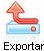
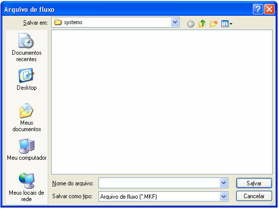

# image106.jpgExportando Fluxo de Ações

Esta opção permitirá que uma regra gerada no Fluxo de Ações possa ser salva em arquivo, com a extensão MKF para que possa ser utilizado por outro usuário.

Para executar a exportação, siga os passos listados:

1. Ative o Editor de Fluxo de Ações e abra a regra que deseja exportar.
2. Na tela do Fluxo, ative o menu Arquivo e deste clique no submenu Exportar - Fluxo, ou clique no botão  e será exibida a seguinte tela:

Observe abaixo as opções da tela:

- Salvar em - permite selecionar o local para a gravação do arquivo;
- Nome do arquivo - utilize este campo para digitar o nome do arquivo que deseja criar;
- Salvar como tipo - informa o tipo do arquivo que será gerado;
- Botão Salvar - confirme a geração do arquivo da exportação logo depois que digitar o nome ou selecionar do painel acima;
- Botão Cancelar - cancele a operação.

Observação: Existem restrições para usuários da versão Standard Edition. Para mais detalhes, acesse o tópico [Recursos e Características das Versões do Maker](../../recursos_e_caracteristicas_das_versoes_do_maker).
