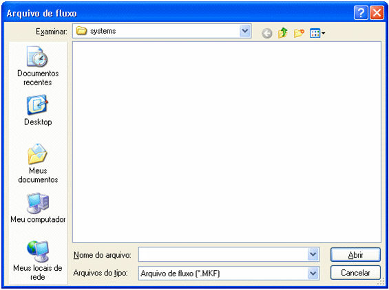

# image105.jpg Importando Fluxo de Ações

O sistema atual permite ler um arquivo com a extensão MKF para que possa ser usado.

Para executar a importação, siga os passos listados:

1. Ative o [Editor de Fluxo de Ações](editor_de_fluxo_de_acoes);
2. Na tela do Fluxo, ative o menu Arquivo e deste clique no submenu Importar... ou clique no botão  e será exibida a seguinte tela:

**

Observe abaixo as opções da tela:

- Examinar - permite selecionar o local para abrir o arquivo;
- Nome do arquivo - utilize este campo para digitar o nome do arquivo que deseja abrir;
- Arquivos do tipo - informam o tipo do arquivo que será importado;
- Botão Abrir - confirme a importação do arquivo, logo depois que digitar o nome ou selecionar do painel acima;
- Botão Cancelar - cancele a operação.

Observação: Existem restrições para usuários da versão Standard Edition. Para mais detalhes, acesse o tópico [Recursos e Características das Versões do Maker](../../recursos_e_caracteristicas_das_versoes_do_maker).
