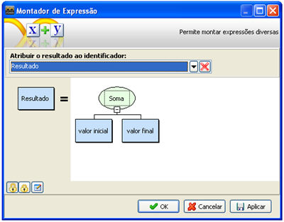
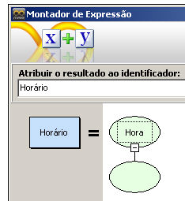
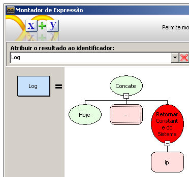
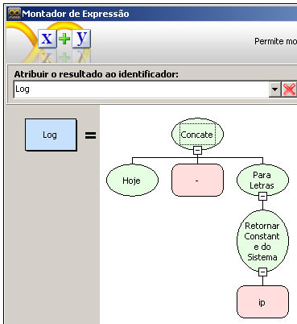
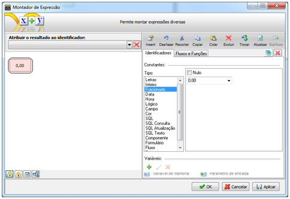
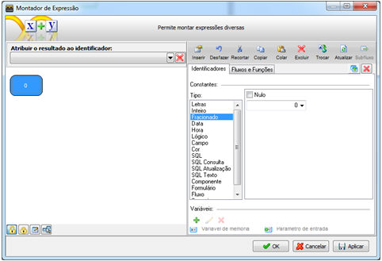

O Montador de Expressão é o local onde montamos a lógica do sistema.

Para acessar o Montador de Expressão:

1. Insira um objeto [Processamento](objeto_processamento) ou um objeto [Decisão](objeto_decisao) (por exemplo);
2. Clique duplo sobre o objeto. É exibida a tela [Montador de Expressão](montador_de_expressoes):

3. Clicando sobre o retângulo em branco (objeto inicial da expressão) ou pressionando a tecla F3 do teclado, é exibida a tela [Propriedades](tela_propriedades_do_montador_de_expressoes);
4. Após definir as propriedades do objeto, clique na área de trabalho do Montador de Expressão;
5. A tela possui o campo Atribuir o resultado ao identificador para atribuir o resultante da expressão a uma variável. Caso queira cancelar a atribuição, utilize o botão  (Excluir).
6. Uma particularidade do uso da tela Propriedades é: quando clicamos sobre uma função da aba Fluxos e Funções, o objeto de montagem da expressão da tela Montador de Expressão modifica automaticamente os parâmetros da função que está sendo selecionada. Para que os objetos da expressão não sejam afetados com esta ação de selecionar uma função, trave a estrutura utilizando o botão  (Travar edição). Para dispor a edição, utilize o botão  (Habilitar edição).
7. O botão  (Descrição da Expressão) permite editar uma descrição sobre os procedimentos desta expresão.
8. Algumas das funcionalidades da tela [Propriedades](tela_propriedades_do_montador_de_expressoes) (seleção de funções ou parâmetros e variáveis, e as ações Desfazer, Inserir Acima, Recortar, Copiar, Colar, Excluir e Trocar Item e SubFluxo) podem ser executadas com um clique com o botão direito do mouse sobre o quadro (ou função selecionada anteriormente) da tela Montador de Expressões.

Observações:

1. Quando a função no Montador de Expressão ficar na cor amarela ou ficar na cor verde sem título, indica que a função não consta mais no sistema ou o nome real da função foi alterado.

**

2. Quando a função no Montador de Expressão ficar na cor vermelha, indica que está ocorrendo um tipo de conversão inválida ou tipos de dados inválidos. Como exemplo: no Montador de Expressão abaixo, temos uma concatenação com três valores: a data, o texto " - " e o retorno da função Retornar constante do Sistema (passado como parâmetro o IP). A função retorna o endereço IP e a função Concatenação espera receber valores letras (texto), porém não sabe o tipo que a função Retornar constante do sistema irá retornar, então a função fica na cor vermelha para informar ao usuário uma possível diferença de dados.

**

3. Para resolver o problema neste caso, inserimos acima da função Retornar constante do Sistema a função Para Letras. Dessa forma, garantimos a função Concatenação de que a função irá receber um valor do tipo letras.

4. Ao definir o valor "0,00" para o tipo Fracionado da aba Identificadores, o valor será modificado para "0", pois os valores são equivalentes.

