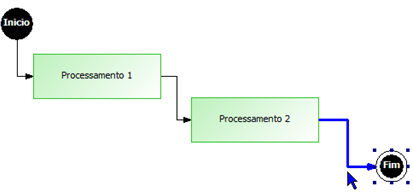
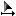
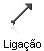
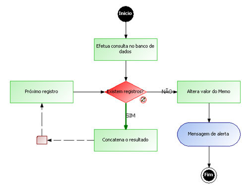
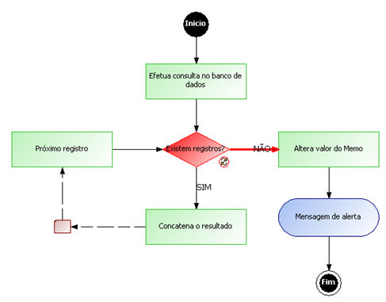

# image193.gif   Objeto Ligação

Ligação é o conector dos objetos inseridos no fluxo, que determina o roteiro de execução das ações.

O conector pode ser selecionado posicionando o ponteiro do *mouse sobre a linha:*

**

Ao clicar com o botão direito do mouse sobre o conector, é acionado um menu pop-up com as seguintes opções:

- Alterar descrição - permite definir um rótulo para o conector. É utilizado para documentar o fluxo. Outra forma de definir um rótulo é dando clique triplo sobre a linha do conector;
- Remover - permite retirar o conector. Bastante utilizado quando a sugestão de direcionamento de fluxo do Maker não corresponde à programação que se deseja executar;
- Adicionar Ponto - insere um ponto no conector permitindo que modifique a trajetória da linha;
- Autorotear - este padrão do Maker fará o roteamento (desenho do curso) automático das linhas que conectam os objetos do fluxo;
- Inverter - esta opção estará visível apenas quando há uma ligação entre o componente Decisão e outro componente qualquer. Serve para trocar o tipo de ligação entre os componentes, ou seja, se era um tipo de ligação Sim, então passará para Não; se era um tipo de ligação Não, então passará para Sim;
- Inserir Aqui - esta opção fica habilitada quando o foco está em um objeto contido na área de trabalho do Editor de Fluxo de Ações, mas que não está ligado a nenhum outro objeto. Sendo assim, é possível adicionar o objeto no local (linha) em que foi efetuado o clique com o botão direito do mouse.

Além dessas opções, existe o recurso de rotear vários objetos:

1. Observe o exemplo abaixo:

**

2. A imagem apresenta vários objetos sem conexão.
3. Execute clique duplo na ferramenta Ligação.
4. Observe que o ponteiro do mouse apresentará na forma de .
5. Clique no objeto Início e depois clique no primeiro Processamento.
6. Clique no segundo Processamento e depois clique em Fim.
7. Já que a ferramenta Ligação permanece ativada, cancele sua função pressionando a tecla Esc ou clique sobre .

## Identificação visual do SIM/NÃO da decisão, independente da descrição

A partir da versão 2.6 do Maker foi criada uma identificação para cada saída de uma decisão, para a saída SIM a cor verde e a saída Não a cor vermelha, como demonstram as figuras abaixo:

**Figura: Sim**

**Figura: Não**
