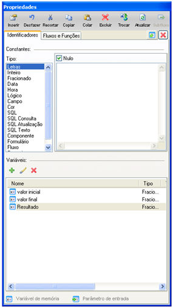
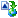
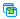
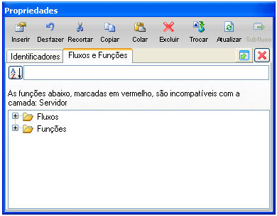
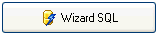
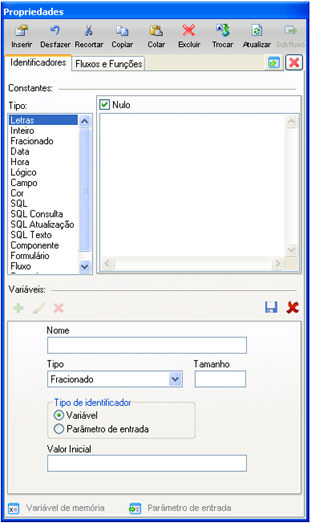

A tela Propriedades é composta basicamente por duas abas: Identificadores, onde é possível definir um valor constante para o objeto (Processamento ou Decisão), escolhendo entre os vários tipos de dados disponíveis. Na aba Fluxos e Funções, pode-se utilizar um fluxo já existente ou uma das funções disponíveis (cadastro de funções).

Logo abaixo, estão as Variáveis já definidas, e é possível adicionar (clicando no botão ), alterar (clicando no botão ) e excluir (clicando no botão ). O detalhamento sobre a criação dessas variáveis encontra-se no tópico [Criando Identificadores (variáveis)](exibir).

Esta tela é muito importante para o [Montador de Expressões](montador_de_expressoes). É o local onde se concentram as funções e variáveis que irão executar a ação da expressão.

## Barra de Ferramentas da tela Propriedades do Montador de Expressões

-  - insere um Fluxo ou Função acima do item selecionado;
-  - desfaz a última ação;
-  - recorta o item selecionado;
-  - copia o item selecionado;
-  - cola o item selecionado;
-  - exclui o item selecionado;
-  - troca o item selecionado;
-  - atualiza os fluxos e funções. Caso fluxos e/ou funções estejam sendo alterados, ao clicar nesta opção, todas as alterações serão consideradas para uso imeditado;
-  - Carrega um subfluxo.
-  - anexa a janela Propriedades a tela do Montador de Expressão;
- - desanexa a janela Propriedade da tela do Montador de Expressão;
-  - Fecha a janela Propriedade.

## Aba Fluxos e Funções

Esta área é composta pelos seguintes componentes:

-  - botão para organizar a lista abaixo, na ordem ascendente;
-  - botão para organizar a lista abaixo, na ordem descendente;
- Campo de pesquisa - ao lado dos botões de ordenação, localiza a função ou fluxo à medida que digita parte no nome do objeto;
- - Existem três formas de efetuar a busca por fluxos e funções, como é mostrado abaixo:
  - - *texto* - pesquisa todos que contenham o texto informado;
    - texto* - pesquisa todos que comecem com o texto informado;
    - * texto - pesquisa todos que terminem com o texto informado.
-  - contém os fluxos do sistema;
-  - contém as funções cadastradas. As funções que apresentarem a descrição em vermelho significam que atuam na camada cliente.

As funções disponíveis estão organizadas em pastas, agrupadas por categorias. Utilize uma função e implemente os parâmetros com as  constantes e variáveis da aba [Identificadores](exibir). A depender da camada (destino) que o fluxo de ação tenha sido direcionado (salvo), o nome das funções não compatíveis fica na cor vermelha.

Observação: Existem restrições para usuários da versão Standard Edition. Para mais detalhes, acesse o tópico [Recursos e Características das Versões do Maker](../../recursos_e_caracteristicas_das_versoes_do_maker).

## Aba Identificadores

Geralmente as Constantes e Variáveis desta área são utilizadas para complementar os parâmetros das funções. Esta área é composta por:

- Constantes - permite acessar variáveis de valor constante. Pela coluna Tipo, selecione:
- - Letras - permite digitar o conteúdo texto da constante;
  - Inteiro - permite digitar o valor inteiro da constante;
  - Fracionado - permite digitar o valor fracionado da constante;
  - Data - permite informar o valor da data e a hora da constante;
  - Hora - permite informar o valor da hora da constante;
  - Lógico - permite informar o valor lógico (Verdadeiro ou Falso) da constante;
  - Campo - permite associar o valor da constante ao conteúdo de um campo da origem de dados.

Observações:

1. Caso informe o nome do [formulário principal de trabalho](parametros_de_entrada), pelo objeto Início, aparecerão todos os campos que fazem parte do [SQL da consulta do formulário](../formulario/propriedade_do_formulario);
2. Caso queira informar um campo que não faça parte da consulta do formulário principal, deverá substituir esta constante por uma função do tipo Abrir consulta ou Abrir conexão (aba Fluxos e Funções).

   1. Cor - permite selecionar uma cor para a expressão.
   2. SQL -permite selecionar entre uma das opções apresentadas ao lado da coluna Tipo. Utilize o botão  para acionar o [Assistente de SQL](../formulario/assistente_sql/iniciando_com_o_assistente_sql);
   3. SQL Consulta - permite executar uma consulta seleção na origem de dados. Utilize o botão  para acionar o [Assistente de SQL](../formulario/assistente_sql/iniciando_com_o_assistente_sql);
   4. SQL Atualização - permite executar uma consulta de alteração de dados (inserção, exclusão ou atualização) na origem. Utilize o botão  para acionar o [Assistente de SQL](../formulario/assistente_sql/iniciando_com_o_assistente_sql);
   5. SQL Texto - permite digitar um SQL na caixa de texto ao lado da coluna Tipo;
   6. Componente - permite associar o valor da constante ao conteúdo de um [Componente](../formulario/componentes/componentes) do formulário principal. Observação: será necessário informar o nome do [formulário principal de trabalho](parametros_de_entrada), pelo objeto Início;
   7. Formulário - permite selecionar um formulário do sistema atual
   8. Procedimento - permite selecionar uma procedure do banco de dados e executá-la. Ao clicar sobre esta opção, aparece, automaticamente, um campo ao lado onde podemos selecionar o procedimento que será executado pelo fluxo.

Observação: Todos os tipos citados acima possuem o campo  como opção padrão.

- Variáveis - permite acessar Identificadores (variáveis) e utilizá-los na expressão. Utilize os controles  (para criar),  (para editar) ou  (para excluir):

Quando entra no modo de adição de variáveis, é exibida a tela os campos:

- Nome- informe o nome da variável;
- Tipo - selecione da lista a opção de tipo que se adequa à variável (Variante, Letras, Fracionado, Inteiro, Data, Hora, Lógico e Tabela).
- Tipo de Identificador - selecione entre as opções Variável ou Parâmetro de Entrada.
- Valor Inicial - permite definir o valor inicial da variável.

Após a criação do Identificador (variáveis), clique em  para salvar ou  para cancelar a operação.

## Aba SQL

As opções desta aba só podem ser utilizadas quando a tela Propriedades for aberta por meio da tela Construtor SQL: Atualização (tela de configuração de uma transação de atualização - após a escolha da constante SQL Atualização para o primeiro parâmetro da função Executar Atualização). Ela é composta pelos componentes:

- caixa de texto Tabela - tabela que foi escolhida na caixa de seleção Tabela da tela Construtor SQL:Atualização;

- caixa de seleção Campos - campos da tabela apresentada na caixa de seleção descrita acima.

Juntamente com os campos da tabela escolhida, podem ser utilizadas funções da camada SQL.

Observação: Apesar de a aba Campo também aparecer na tela Propriedades, quando aberta pela tela Construtor SQL:Inserção/Construtor SQL:Exclusão (tela de configuração de uma transação de inserção/exclusão, respectivamente, nessa ordem - após a escolha da constante SQL Atualização para o primeiro parâmetro da função Executar Atualização), não são suportadas configurações para ela em ambos os casos.

Acesse um dos tópicos de Dicas e Truques que utilizam a tela Propriedades:

- [Criando um Fluxo](../../dicas_e_truques/maker/criando_um_fluxo);
- [Exemplo de utilização de Web Services no Maker](../../dicas_e_truques/maker/exemplo_de_utilizacao_de_web_services_no_maker);
- [Exemplo de utilização de uma Barra de Progresso](../../dicas_e_truques/maker/exemplo_de_utilizacao_de_uma_barra_de_progresso).
