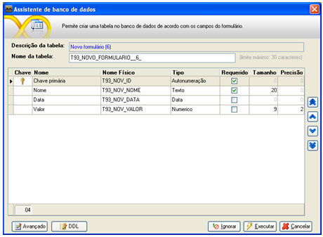
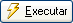
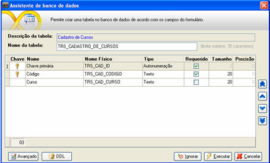
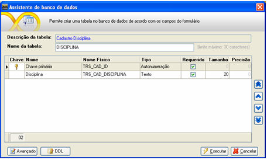
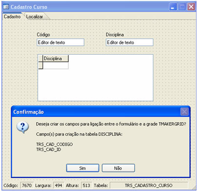
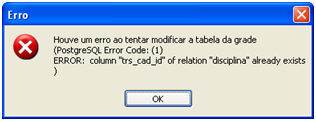

No Assistente de Banco de Dados, é possível criar ou adicionar novos campos à estrutura de uma tabela (tabela do banco de dados sobre o qual o projeto foi criado) a partir de um formulário.

A tela Assistente de Banco de Dados aparece quando é:

- criado um novo formulário que não esteja vinculado a uma tabela, então, no momento do salvamento do formulário, aparece a tela Assistente de Banco de Dados sugerindo a criação de uma tabela, a qual será vinculada ao próprio formulário que está sendo editado e de um campo do tipo Autonumeração, chamado Chave Primária, vinculado à tabela que será criada.

Importante:

- - Caso não conste nenhum componente no formulário ou conste pelo menos um componente, mas que não tenha sido preenchida a propriedade Descrição, a tela Assistente de Banco de Dados aparecerá apenas para a criação do campo de autonumeração;
  - Caso conste pelo menos um componente no formulário e tenha sido preenchida a propriedade Descrição deste componente, então a tela Assistente de Banco de Dados aparecerá sugerindo a criação do campo de autonumeração, além dos demais campos que serão associados aos componentes.
- É adicionado pelo menos um novo componente em um formulário já existente e que esteja vinculado a uma tabela, tendo sido preenchida a propriedade Descrição desse componente. Executado esse passo, então, deve-se clicar com o botão direito do mouse sobre a área em que aparecem as abas do formulário e escolher a opção Criar Tabela.... Em seguida, a tela Assistente de Banco de Dados aparecerá sugerindo a criação de um novo campo, após observar o novo componente contido no formulário.

Na existência de componentes contidos no formulário com a propriedade Descrição idêntica, a tela Assistente de Banco de Dados sugerirá o nome do campo adicionado de um número sequencial, observada a quantidade de componentes que se enquadre na situação.

A primeira visão da tela Assistente de Banco de Dados apresenta:

- Campo Descrição da tabela - apresenta o nome do formulário, que aparecerá na tela "Dicionário de Dados" como a descrição da tabela;
- Campo Nome da tabela - apresenta o nome da tabela que será criada no banco de dados. Esta aparecerá na tela Dicionário de Dados como o nome real da tabela. O nome da tabela está restrito à quantidade de 30 (trinta) caracteres. Após a criação da tabela, não será mais possível alterar o seu nome pela tela Assistente de Banco de Dados;
- Campo Lista de Campos - lista os campos que serão adicionados à tabela no momento de sua criação/edição. Nele constam as colunas:
- - Chave - informa se o campo a ser  criado será campo-chave (primary key) da tabela. Para marcar o campo como campo-chave, deve ser efetuado um clique sobre a tupla posicionada na mesma linha do campo. Executado esse passo, aparecerá a imagem de uma chave na cor dourada na tupla;
  - Descrição (título da coluna na visão somente leitura) ou Nome (título da coluna na visão avançada) - apresenta o conteúdo da propriedade Descrição de um componente contido no formulário, que aparecerá na tela Dicionário de Dados como sendo a descrição do campo da tabela. Para alterar o conteúdo da coluna, basta clicar sobre ela e informar um novo valor;
  - Nome (título da coluna na visão somente leitura) ou Nome Físico (título da coluna na visão avançada) - apresenta o nome real do campo que será criado na tabela e, em seguida, vinculado ao componente contido no formulário. Esse dado aparecerá na tela "Dicionário de Dados" como o nome real do campo da tabela. Para alterar o conteúdo da coluna, basta clicar sobre ela e informar um novo valor;
  - Tipo - informa o tipo do campo que será criado na tabela. Os tipos disponíveis para seleção são Letras, Texto, Inteiro, Numérico, Ponto Flutuante, Data, Data e Hora, Hora, Texto Longo, Binário (Arquivos, Fotos, ...) e Lógico (Verdadeiro/Falso). Para alterar o conteúdo da coluna, basta selecionar um novo tipo;
  - Requerido - informa se o campo a ser criado será identificado como campo obrigatório no momento da gravação de um registro na tabela. Para alterar o conteúdo da coluna, basta clicar sobre ela;
  - Tamanho - informa a quantidade de caracteres que será aceita pelo campo no momento da gravação de um registro na tabela. Para alterar o conteúdo da coluna, basta utilizar as setas de controle contidas nela ou informar manualmente um novo valor;
  - Precisão - informa a quantidade de casas decimais que será aceita pelo campo no momento da gravação de um registro na tabela. Para alterar o conteúdo da coluna, basta utilizar as setas de controle contidas nela ou informar manualmente um novo valor.
- Botão  - ao clicar neste botão, a tela será modificada e a lista de campos se transformará em uma lista editável, oferecendo a possibilidade de modificação das propriedades dos campos; e para confirmar qualquer modificação feita, é necessário pressionar a tela seta para baixo do teclado:

- Botão  - após ter sido selecionado um campo da "lista de campos" e, em seguida, ser efetuado um clique sobre esse botão , o campo selecionado se moverá para o topo da "lista de campos";
- Botão  - após ter sido selecionado um campo da "lista de campos" e, em seguida, ser efetuado um clique sobre esse botão , o campo selecionado se moverá para o lugar do campo imediatamente anterior ao selecionado na "lista de campos";
- Botão  - após ter sido selecionado um campo da "lista de campos" e, em seguida, ser efetuado um clique sobre este botão , o campo selecionado se moverá para o lugar do campo imediatamente posterior ao selecionado na "lista de campos";
- Botão  - após ter sido selecionado um campo da "lista de campos" e, em seguida, ser efetuado um clique sobre esse botão , o campo selecionado se moverá para o fim da "lista de campos";
- Botão  - ao clicar neste botão, aparecerá a aparência padrão (inicial) da tela.
- Botão  - ao clicar neste botão, aparecerá uma área para edição da linguagem de definição de dados que foi utilizada para a criação/edição da tabela.

Observação: As modificações feitas na aba DDL não se repercutem ao navegar para a aba Avançado ou tela normal.

-  - ao clicar neste botão, a tela Assistente de banco de dados fechará, e as sugestões de criação da tabela e de campos para a tabela serão desconsideradas;
-  - ao clicar neste botão, as sugestões de criação da tabela e de campos para a tabela serão executadas;
-  - ao clicar neste botão, todas as atividades que estiverem sendo executadas serão canceladas e a tela fechará automaticamente.

Os tipos de dados sugeridos para cada campo que será criado se baseiam no tipo de componente:

- Imagem - Se houver este componente no formulário, por exemplo, o "Assistente de Banco de Dados" sugerirá que o campo que será criado seja do tipo "Imagem";
- No caso do componente Caixa de Texto:
- - referente à largura definida para o componente - baseando-se na largura definida para o componente, à medida que se aumenta ou diminui essa largura aparece um hint (informativo) alertando a quantidade de caracteres que será associada ao tipo de dado;
  - clicando com o botão direito do mouse no componente, a propriedade Conteúdo sugere a criação de um campo do tipo Texto (opção "Livre", "Maiúsculas" ou "Minúsculas"), Numérico (opção "Número"), Data (opção "Data") ou Número Fracionário (opção "Número com 2 Casas Decimais").

Tipos de dados sugeridos pelo Assistente de Banco de Dados:

- Banco de dados POSTGRESQL:
- - Autoincremento: inteiro;
  - Hora: time;
  - Data e Hora: timestamp;
  - Letras: varchar;
  - Inteiro: integer;
  - Numérico: numeric com duas casas decimais;
  - Ponto Flutuante: Float8;
  - Data: date;
  - Binário: bytea;
  - Texto Longo: text;
  - Lógico: bool.

- Banco de dados ORACLE:
- - Autoincremento: number;
  - Hora: date;
  - Data e hora: date;
  - Letras: varchar2;
  - Inteiro: number;
  - Numérico: number com duas casas decimais;
  - Ponto flutuante: Float;
  - Data: date;
  - Bináro: blob;
  - Texto Longo: clob;
  - Lógico: number.

- Banco de dados FIREBIRD:
- - Autoincremento: inteiro;
  - Hora: time;
  - Data e Hora: timestamp;
  - Letras: varchar;
  - Inteiro: integer;
  - Numérico: numeric com duas casas decimais;
  - Ponto Flutuante: Float;
  - Data: date;
  - Binário: blob;
  - Texto Longo: blob sub_type 1;
  - Lógico: smallint.

- Banco de dados MySQL:
- - Autoincremento: bigint auto_increment
  - Hora: time;
  - Data e Hora: timestamp;
  - Letras: varchar;
  - Inteiro: bigint;
  - Numérico: decimal com duas casas decimais;
  - Ponto Flutuante: Float;
  - Data: date;
  - Binário: longblob;
  - Texto Longo: longtext;
  - Lógico: boolean.

- Banco de dados SQL SERVER:
- - Autoincremento: identity;
  - Hora: DATETIME;
  - Data e Hora: datetime;
  - Letras: varchar;
  - Inteiro: integer;
  - Numérico: numeric com duas casas decimais;
  - Ponto Flutuante: Float;
  - Data: datetime;
  - Binário: varbinary (MAX);;
  - Texto Longo: varchar (MAX);
  - Lógico: bit.

- SQL Server 2005:
- - Autonumeracão = integer;
  - Letras = varchar;
  - Texto = varchar;
  - Inteiro = integer;
  - Numérico = numeric(9,2);
  - Ponto flutuante = float;
  - Data = datetime;
  - Data e hora = datetime;
  - Hora = char(8);
  - Texto longo = text;
  - Binário = image;
  - Lógico = bit.

- SQL Server 2008:
- - Autonumeracao = integer;
  - Letras = varchar;
  - Texto = varchar;
  - Inteiro = integer;
  - Numérico = numeric(9,2);
  - Ponto flutuante = float;
  - Data = datetime;
  - Data e hora = datetime;
  - Hora = datetime;
  - Texto longo = varchar(max);
  - Binário = varbinary(max);
  - Lógico = bit.

Observações:

1. O Assistente de Banco de dados não suporta campos do tipo UUID e GUID.
2. O Assistente de criação de tabelas só suporta nomes de objetos do banco de dados com no máximo 30 caracteres.
3. Ao clicar com o botão direito do mouse sobre o formulário, aparece um menu suspenso. Nesse menu, ao selecionar a opção Edição, pode ser escolhida a opção Salvar (salva todas as modificações feitas no formulário). Se houver um novo componente que não foi associado a nenhum campo, antes do salvamento do formulário, aparecerá a tela Assistente de Banco de Dados, sugerindo a criação do campo;
4. Caso tenha sido associada uma fonte de dados que possui chave primária composta ao formulário, no momento que o Assistente de Criação de Tabelas sugerir a criação da chave primária composta como chave estrangeira composta na fonte de dados que está associada ao formulário vinculado à grade, será mostrada uma mensagem de erro, pois o recurso de criação só suporta a criação de chave estrangeira simples. .

   Foi criado um formulário com chaves primárias compostas:

   

   O outro formulário possuía a chave primária:

   

   Após a arrastar o formulário Cadastro de Disciplina para o Cadastro de Cursos e ao salvar o formulário Cadastro de Cursos, é apresentado a mensagem abaixo:

   

   Após clicar no "Sim", é apresentada a mensagem de erro abaixo:

   
5. Este recurso está disponível apenas para a versão Enterprise.
6. Caso o script de criação da tabela (DDL) seja alterado o Maker não irá vincular a tabela que será criada ao formulário em questão, caso o usuário deseje alterar o nome dos campos, deverá utilizar a aba AVANÇADO da tela.

Assistente de Criação de Tabela - este vídeo exemplifica o Assistente de Criação de Tabelas no banco de dados, ao criar um novo formulário sem fonte de dados.
