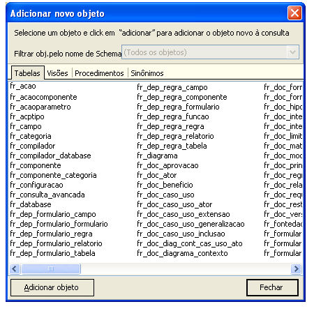
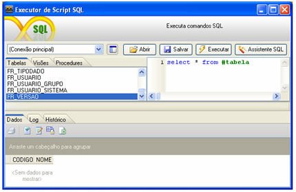

Para adicionar um objeto à consulta, deve ser efetuado um clique com o botão direito do mouse na Área de Construção de Consultas (aba Diagrama da tela Assistente SQL) e, em seguida, selecionada a opção Adicionar Objeto no menu suspenso.

Os objetos são agrupados em abas (Tabelas, Visões, Procedimentos e Sinônimos). Na aba Tabela, o recurso oferecido pelo checkbox Criar as ligações das chaves estrangeiras não é suportado pelo Maker. Além dele, os recursos oferecidos pelas abas Procedimentos e Sinônimos também não suportados pelo Maker.

O usuário pode selecionar um ou mais objetos, basta para isso manter a tecla Ctrl pressionada e clicar sobre os objetos. Para confirmar as escolhas, deve clicar no botão .

Observação: As tabelas temporárias do Microsoft SQL Server 2000/2005/2008 não aparecem na tela do Assistente SQL, mas a exemplificada abaixo é reconhecida pelo Maker.

CREATE TABLE #TABELA(

CODIGO INTEGER,

NOME VARCHAR(255)

);

