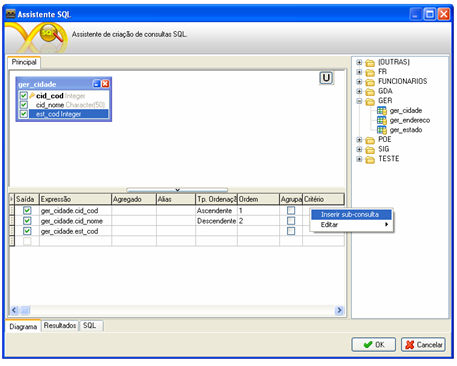

# Adicionando uma subconsulta

As subconsultas podem ser criadas nas colunas Expressão, Critério e Ou... (quando houver mais de um critério de pesquisa). Para criar uma subconsulta:

- clique com o botão direito do mouse sobre uma linha de qualquer das colunas citadas acima e selecione a opção Inserir subconsulta; de imediato aparecerá uma nova aba (canto superior esquerdo da janela do Assistente SQL, ao lado da aba Principal) na qual poderá ser criada a subconsulta:

Adicionando uma SubConsulta - Este exemplo apresenta o recurso de criação de subconsultas no Assistente SQL.
