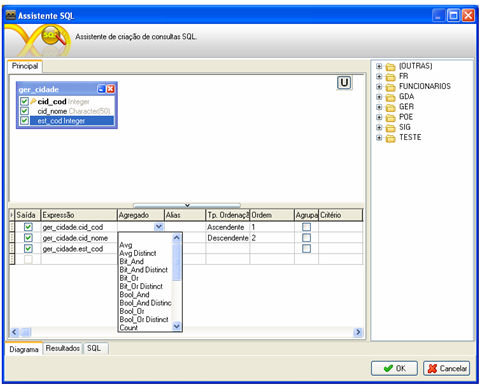

Para agrupar ou vincular uma função a um campo, é necessário definir pelo menos um critério de agrupamento, marcando o quadro contido na coluna Agrupamento relativo ao campo (Painel de Colunas). Também deve ser definido o tipo de agrupamento na coluna Critério:

- Para grupos - ao selecionar esta opção, dois aspectos devem ser considerados. O primeiro diz respeito apenas à criação do grupo, nesse caso, a única ação que deve ser realizada é a da seleção da opção que está sendo explicada nesse parágrafo. O segundo refere-se à criação da cláusula "*having*" (existindo, nesse caso, também deve ser informado no campo Critério o critério de existência que complementa a cláusula.
- Para valores - ao selecionar esta opção, o agrupamento é criado em paralelo com o critério de pesquisa definido no campo Critério (Painel de Colunas):

Na coluna Totalização, apresentam-se as seguintes funções:

- Avg - calcula a média aritmética de um conjunto de valores contidos no campo;
- Avg distinct - calcula a média aritmética de um conjunto de valores distintos contidos em um campo;
- Checksum_agg - calcula o valor da soma da verificação de um grupo de valores contidos em um campo;
- Checksum_agg distinct - calcula o valor da soma da verificação de um grupo de valores distintos contidos em um campo;
- Count - calcula a quantidade de registros resultantes de uma consulta;
- Count Distinct - calcula a quantidade de registros distintos resultantes de uma consulta;
- Count_big - executa o mesmo cálculo da função count. A única diferença é que essa função é específica para um campo que seja de um tipo numérico maior do que o tipo inteiro;
- Count_Big Distinct - executa o mesmo cálculo da função count_big. Essa função é específica para um campo que seja de um tipo numérico maior do que o tipo inteiro;
- Max - verifica o maior valor dentre um conjunto de valores contidos em um campo;
- Max Distinct - verifica o maior valor distinto dentre um conjunto de valores contidos em um campo;
- Min - verifica o menor valor dentre um conjunto de valores contidos em um campo;
- Min Distinct - verifica o menor valor distinto dentre um conjunto de valores contidos em um campo;
- Stdev - calcula o desvio padrão de todos os valores contidos em um campo;
- Stdev Distinct - calcula o desvio padrão de todos os valores distintos contidos em um campo;
- Stdevp - calcula o desvio padrão de todos os valores com base no valor total dos valores contidos em um campo;
- Stdevp Distinct - calcula o desvio padrão de todos os valores distintos com base no valor total dos valores contidos em um campo;
- Sum - calcula a soma do conjunto de valores contidos em um campo;
- Sum_Distinct - calcula a soma do conjunto de valores distintos contidos em um campo;
- Var - estima a variância dos valores a partir de uma amostra de valores contidos em um campo;
- Var Distinct - estima a variância dos valores a partir de uma amostra de valores distintos contidos em um campo;
- Varp - estima a variância dos valores com base no valor total de valores contidos em um campo;
- Varp Distinct - estima a variância dos valores com base no valor total de valores distintos contidos em um campo.

Usando funções predefinidas em consultas (Having) - este vídeo exemplifica a utilização de funções predefinidas nas consultas desenvolvidas pelo Assistente SQL.

Usando funcões predefinidas em consultas (Or) - Este vídeo exemplifica a utilização de operadores lógicos, neste caso, Or

.

Usando funcões predefinidas em consultas (Where) - este exemplo irá demonstrar como adicionar uma função prédefinida e o uso da condição Where.
