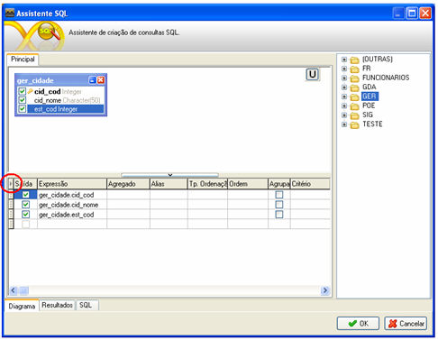
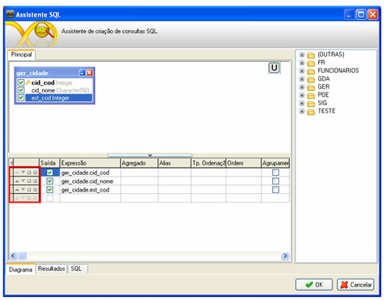

Ao clicar no botão ao lado da primeira coluna da grade (logo à esquerda da coluna ), aparece uma nova coluna contendo duas opções para controlar o posicionamento dos itens e duas opções para controlar a inserção e exclusão de itens:

Controle de posicionamento de itens na grade:

-  - utilizado para mover o campo que estiver com o foco para a posição do campo imediatamente posterior a dele;
-  - utilizado para mover o campo que estiver com o foco para a posição do campo imediatamente anterior a dele;

Controle de inclusão e exclusão de itens da grade:

-  - utilizado para a adição de uma nova linha acima da linha na qual estava o foco no momento do clique no botão;
-  - utilizado para a remoção da linha na qual estava o foco no momento do clique no botão;

