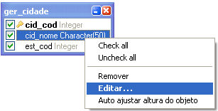
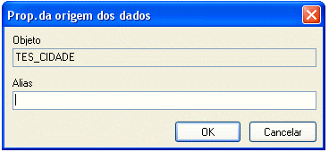

O usuário pode acessar as propriedades do objeto com um clique com o botão direito do mouse sobre o objeto. Executada esta ação, aparecerão as opções:

- Remover - remove o objeto selecionado da área de trabalho do Assistente SQL;
- Editar...: clicando sobre essa opção, aparece uma janela em que é possível dar um apelido ao objeto (caixa de seleção Alias). Também é possível executar esse recurso dando dois cliques sobre o objeto.

Seguindo os passos acima, o sistema exibe a tela Prop. da origem dos dados:

- Autoajustar altura do objeto: redimensionar a altura do objeto ao limite dos campos que o compõem.
