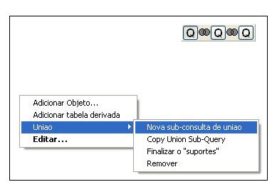
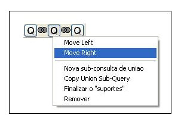
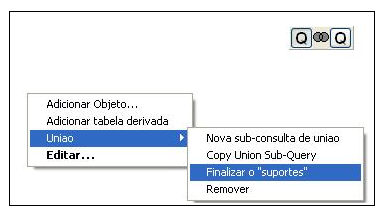
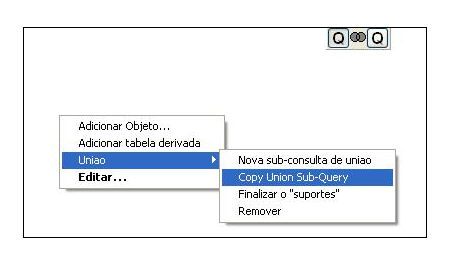
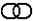
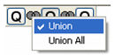

Observação: toda vez que for usada a palavra consulta neste contexto, relacione-a com a imagem .

Há duas formas para se criar uma união:

- clicando com o botão direito do mouse sobre a Área de Construção de Consultas e, em seguida, selecionando o item Nova subconsulta de união (primeira imagem) do menu União;
- clicando com o botão direito do mouse sobre a imagem que representa a consulta na Área de Construção de Consultas, selecionando a opção Nova subconsulta de união.

Em ambos os casos, automaticamente aparecerá uma nova imagem representando a nova consulta que será criada. Quanto à possibilidade de navegação entre as consultas, clique sobre as imagens.

Para modificar o posicionamento de uma consulta em relação à consulta da esquerda ou da direita, clique com o botão direito do mouse e escolha a opção Move Left ou Move Right, respectivamente.

É possível envolver uma consulta entre parênteses de duas formas, são elas (passos):

1. Clicar sobre a consulta para marcá-la, clicar com o botão direito do mouse sobre a Área de Construção de Consultas e selecionar o submenu Incluir parênteses do menu União (aparecerá um parêntese envolvendo a consulta).

2. Clicar com o botão direito do mouse sobre a imagem da consulta, selecionando a opção Finalizar o "suportes".

Os parênteses tem finalidade para uso em agrupamentos ou se desejar outras finalidades. Por exemplo, podemos ter uma sub-consulta baseado no retorno de uma union.

Clicando com o botão direito em Uniao - Copy Union Sub-Query é possível fazer um "Clone" de uma sub-consulta de uniao que você esteja manipulando. Este clone fará uma junção com ele mesmo.

Para a exclusão de uma consulta, basta a efetuação de um clique com o botão direito do mouse sobre a Área de Construção de Consultas e a seleção do submenu Remover do menu União ou clicando com o botão direito do mouse sobre a imagem da consulta e selecionando a opção Remover.

Para a definição do tipo de relação de união entre as consultas, deve-se clicar sobre a imagem  (símbolo de união de conjuntos) que fica entre as consultas. A opção Union faz a união entre as duas consultas, eliminando as linhas idênticas (no momento que ocorrer a execução da consulta). A opção Union All executa a ação inversa.

