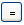
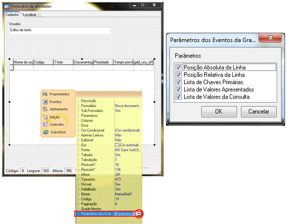

# image123.gif   Grade

É utilizada para relacionar um registro com vários outros. Fazendo uma analogia com as formas normais que regem os bancos de dados relacionais, pode-se dizer que é um componente que atende ao tipo de relação 1:N (relacionamento de um para ene). Alguns componentes podem ser utilizados juntamente com componente grade, são eles: [Caixa de texto](caixa_de_texto), [Lista](lista), [Lista Dinâmica](lista_dinamica), [Botão](botao), [Imagem](imagem) e [Check](check).

Uma Grade é um componente tanto de edição como de consulta de dados, de forma que ela consegue organizar seus resultados, exibindo-os em linhas e colunas. O usuário recebe um conjunto de informações, podendo trabalhar com esses dados de maneira mais eficiente (já que ele possui um maior número de dados à sua disposição). Com esse componente, não precisaremos visualizar todos os campos de uma vez. Como os demais componentes usados, ele possui particularidades que o diferem e o tornam indispensável para determinadas representações.

A grade exibe um volume grande de dados. Consegue de forma fácil e intuitiva, fazer com que o usuário possa ter acesso a todos eles, dando-lhe a possibilidade para consultar informações, alterá-las ou até excluí-las.

A Grade possui algumas propriedades particulares, que serão detalhadas a seguir:

- Propriedade Formulário - nessa propriedade indicaremos o formulário que alimentará os dados da Grade.
- Propriedade SubFormulário - nessa propriedade pode ser habilitada ou não a chamada do formulário, cadastrado na propriedade Formulário.
- Propriedade Parâmetros - é nesta propriedade que indicamos um ou mais campos de ligação entre o formulário principal e a Grade. Esta propriedade serve de filtro para os dados.

Selecione o Campo do formulário detalhe que irá relacionar com o Campo do formulário master e clique no botão  (equivalente). Mais abaixo, defina o Tipo de ligação, informando:

- - Padrão (AND) - a ligação entre os dados é verdadeira quando forem iguais;
  - Ignorar Nulo - a ligação será verdadeira mesmo que os dados do formulário detalhe sejam nulos;
  - União (OR) - a ligação será verdadeira contendo valores do formulário detalhe ou apenas do formulário master.
- Propriedade Colunas - nesta propriedade indicamos um ou mais campos que serão exibidos como colunas da Grade;
- Propriedade Editável - as grades podem ser classificadas em editáveis ou não editáveis (informe Sim ou Não).

Na grade não editável, as suas colunas são definidas pela propriedade Colunas, onde escolhemos os campos (mesmos campos do formulário origem da Grade). Nesse tipo de grade, pode-se vincular um formulário à ela. Sendo assim, quando precisar alterar um campo da grade, será chamado um formulário no qual serão feitas as alterações.

Já na grade editável, todas as suas colunas são herdadas do formulário com que ela está ligada. Essas colunas vão se encontrar na mesma ordem e com o mesmo tipo definidos no formulário de origem. Observar que, com a grade sendo editável, a opção de chamar um novo formulário a partir dessa grade não funciona. Quando clicamos duas vezes na grade, ela irá disponibilizar a alteração de registros. Para que uma grade editável chame um formulário, a sua origem deve possuir um botão com a chamada Ao Clicar apontando para um formulário. Observe um exemplo apresentado na dica Criando uma Grade com botão que aciona formulário.

A grade, no modo de execução, editável ou não editável, permite a ordenação dos dados com a combinação da tecla SHIFT + &lt;clique duplo&gt; sobre o título da coluna.

Quando criado um formulário e nele agregar-se uma Grade Editável, a barra de edição da grade só ficará visível, se houver informações na fonte de dados principais do formulário.

Todos os componentes possuem Propriedades e Eventos. Para conhecê-los [clique aqui](../propriedades_e_eventos).

Eventos não funcionais do componente Grade

Nem todos os eventos são funcionais no componente Grade, alguns estão desabilitados para o mesmo. Abaixo consta a lista de eventos não funcionais:

- Ao Entrar
- Ao Sair

Eventos não funcionais ao formulário da Grade:

- Ao Entrar
- Ao Navegar
- Ao Sair

Observações:

1. Caso a Grade possua no formulário vinculado a ela, algum componente(exceto CheckBox) que esteja utilizando um evento em comum com a grade (Ex: Ao Clicar), ao executá-lo será disparado primeiramente a regra vinculada ao evento do componente e em seguida a regra vinculada ao evento da grade.
2. Caso o evento Ao Duplo Clicar seja definido, a grade não entrará em modo de edição com o clique duplo. Caso queira executar o evento e a ação de edição, defina o [Parâmetro Avançado](../../propriedades_e_eventos_da_area_de_trabalho) GradeExecutarApenasDuploClicar como false. O padrão deste é true;
3. O evento Ao Duplo Clicar não funcionará quando a grade estiver desabilitada, entretanto funcionará normalmente caso esteja Apenas Leitura;

## Comportamento do componente Grade

O componente grade possui alguns comportamentos específicos. São eles:

- Ao desabilitar uma grade através de fluxograma, utilizando a função Habilitar Componente, caso ela possua um checkbox, o mesmo não é desabilitado. Para desabilitar será necessário utilizar a função Atualizar Componente.

- O componente Grade não mais permite customizações de usuário, quando:
- 1. O usuário não estiver logado em um perfil;
  2. A propriedade avançada Grade:DesabilitarCustomizarUsuario estiver ativa.

- No navegador Chrome as colunas que estejam ligadas a componentes com tamanho 0, não irão aparecer na grade logo quando carregada, mas caso o componente grade esteja em modo de inserção ou edição pelo menos uma vez, a coluna poderá ser exibida porém  com tamanho reduzido.
- Por padrão, a largura das colunas é de acordo com a respectiva largura do componente. Para que se tenha a largura da coluna desejada, é necessário reajustar a largura do componente correspondente.

- A propriedade Descrição não possui efeitos visuais no Webrun para o componente Grade.

- O tipo de formatação escolhida na propriedade Fonte da grade reflete tanto para o conteúdo quanto para números das linhas e títulos de colunas da mesma.

- Alterações realizadas na propriedade fonte dos componentes, tais como, Fonte, Estilo da Fonte, Tamanho dentre outras não se aplicam quando o formulário é exibido em forma de grade, para isso existe a propriedade fonte do componente Grade;
- Existindo um formulário com a grade editável e contendo o componente Lista Dinâmica vinculado ao outro formulário, ao editar a grade e selecionar o componente Lista Dinâmica, pressione F5 para abrir o formulário que foi vinculado ao componente;
- O scroll do mouse não funciona no browser Mozilla Firefox para movimentar-se na barra de rolagem desse componente;

- Não é possível filtrar o componente grade pelas propriedades Parâmetros e Grade Mestre simultaneamente.
- Quando a Grade for editável, será respeitada a tabulação do formulário de origem. Quando for não editável, seguirá a ordem de tabulação da propriedade de coluna do componente;

- Ao pressionar no teclado as setas direita ou esquerda, e a grade estiver em modo:
- - de inclusão ou alteração e o foco do cursor estiver em uma tupla dela, o cursor se moverá entre os caracteres;
  - normal, a grade será paginada (propriedade Paginação).

- Existe uma área reservada acima do componente grade editável ou não editável, portanto caso seja posicionado algum componente nesta área o mesmo não poderá ser acessado.

- O tamanho da lista não pode exceder o tamanho da grade, caso isso ocorra não será mostrado o inicio do valor do componente lista.
- Algumas teclas de atalho podem ser utilizadas no componente Grade. São elas:

- a seta para cima - grava um registro que esteja sendo inserido ou alterado;
- a seta para baixo, a combinação de teclas CTRL + Insert" ou CTRL + I, exceto se o foco do cursor estiver sobre um componente Lista Dinâmica (contido na Grade), muda o estado do componente Grade para o modo de inserção. Caso o componente Grade já esteja em modo de inserção ou alteração, o registro é gravado e o componente volta para o modo de inserção;
- a combinação de teclas CTRL + E altera o modo normal do componente para o modo de alteração;
- a combinação de teclas CTRL + D exclui o registro que estiver com o foco do cursor no componente;

- Ao selecionar uma linha de uma Grade mestre e atualizar seu conteúdo, o foco relacionado a linha selecionada sumirá e retornará a primeira linha da grade.

## Parâmetros automáticos do componente Grade

Todo fluxo de ação, uma vez vinculado ao evento Ao Clicar, Ao Duplo Clicar ou Ao Modificar do componente Grade, recebe 2 Parâmetros automáticos por padrão, mas é possível extende-lo até 5 parâmetros. Para que esses parâmetros sejam obtidos corretamente pelo fluxo de ação, quando executado no Webrun, é necessária a criação de cinco Parâmetros de Entrada: o primeiro parâmetro chamado de Linha Real (nome opcional - correspondendo ao valor geral da linha da tabela que é salva na memória principal para, em seguida, ser mostrada na Grade); o segundo parâmetro chamado de Linha da Grade (nome opcional - que corresponde ao valor da linha que é mostrada em cada paginação da Grade), o terceiro parâmetro chamado de Lista de Chaves Primárias (nome opcional – que corresponde a Lista de chaves primárias que é determinado ao selecionar uma linha da grade), o quarto parâmetro chamado de Lista de valores apresentados (nome opcional – que corresponde a Lista de valores apresentados que é determinado ao selecionar uma linha da grade) e o quinto e último parâmetro chamado de Lista de Valores da Consulta (nome opcional – que corresponde a Lista de Valores da Consulta que é determinado ao selecionar uma linha da grade) estes parâmetros deverão ser respectivamente dos tipos inteiro, inteiro, variante, variante e variante.

Como foi citado no parágrafo anterior, por serem parâmetros passados automaticamente pelo Webrun, estes não devem ser associados a campo ou componente. Caso se queira associar, é necessária a criação de um novo parâmetro, tendo este que ser criado como sexto parâmetro de entrada do fluxo de ação.

Exemplo: Caso tenho sido informado o valor 2 para a propriedade Paginação do componente Grade, e esta tenha quatro registros para serem mostrados, então dois registros serão exibidos na primeira paginação e os dois últimos na segunda paginação. Se for utilizado o evento:

- Ao Clicar e Ao Duplo Clicar, assim que:
- - o primeiro registro recebe um clique ou duplo clique, o valor recebido pelo Parâmetro de Entrada Linha Real do fluxo será o valor 0 ,  o valor recebido pelo parâmetro de entrada Linha da Grade do fluxo também será o valor 0, o valor recebido pelo parâmetro de entrada Lista de Chaves Primárias será uma lista com as chaves primárias da linha selecionada, o valor recebido pelo parâmetro de entrada Lista de Valores Apresentados será uma lista com os valores da linha selecionada e o valor recebido pelo parâmetro Lista de Valores da Consulta  será uma lista de valores da consulta efetuado na linha selecionada;
  - o segundo registro recebe um clique ou duplo clique, o valor recebido pelo Parâmetro de Entrada Linha Real do fluxo será o valor 1 , o valor recebido pelo parâmetro de entrada Linha da Grade do fluxo também será o valor 1 , o valor recebido pelo parâmetro de entrada Lista de Chaves Primárias será uma lista com as chaves primárias da linha selecionada, o valor recebido pelo parâmetro de entrada Lista de Valores Apresentados será uma lista com os valores da linha selecionada e o valor recebido pelo parãmetro Lista de Valores da Consulta  será uma lista de valores da consulta efetuado na linha selecionada;
  - o terceiro registro recebe um clique/duplo clique, o valor recebido pelo parâmetro de entrada Linha Real do fluxo será o valor 2,  o valor recebido pelo parâmetro de entrada Linha da Grade do fluxo será o valor 0, o valor recebido pelo parâmetro de entrada Lista de Chaves Primárias será uma lista com as chaves primárias da linha selecionada, o valor recebido pelo parâmetro de entrada Lista de Valores Apresentados será uma lista com os valores da linha selecionada e  o valor recebido pelo parâmetro Lista de Valores da Consulta  será uma lista de valores da consulta efetuado na linha selecionada;
  - o quarto registro recebe um clique ou duplo clique, o valor recebido pelo parâmetro de entrada Linha Real do fluxo será o valor 3, o valor recebido pelo Parâmetro de entrada Linha da Grade do fluxo será o valor 1, o valor recebido pelo parâmetro de entrada Lista de Chaves Primárias será uma lista com as chaves primárias da linha selecionada, o valor recebido pelo parâmetro de entrada Lista de Valores Apresentados será uma lista com os valores da linha selecionada e  o valor recebido pelo parãmetro Lista de Valores da Consulta  será uma lista de valores da consulta efetuado na linha selecionada;

- Ao Modificar, assim que:

- o primeiro registro recebe um clique, o valor recebido pelo parâmetro de entrada Linha Real do fluxo será o valor 1, o valor recebido pelo parâmetro de entrada Linha da Grade do fluxo será o valor 0, o valor recebido pelo parâmetro de entrada Lista de Chaves Primárias será uma lista com as chaves primárias da linha selecionada, o valor recebido pelo parâmetro de entrada Lista de Valores Apresentados será uma lista com os valores da linha selecionada e  o valor recebido pelo parâmetro Lista de Valores da Consulta  será uma lista de valores da consulta efetuado na linha selecionada;
- o segundo registro recebe um clique, o valor recebido pelo parâmetro de entrada Linha Real do fluxo será o valor 2,  o valor recebido pelo parâmetro de entrada Linha da Grade do fluxo também será o valor 1, o valor recebido pelo parâmetro de entrada Lista de Chaves Primárias será uma lista com as chaves primárias da linha selecionada, o valor recebido pelo parâmetro de entrada Lista de Valores Apresentados será uma lista com os valores da linha selecionada e  o valor recebido pelo parãmetro Lista de Valores da Consulta  será uma lista de valores da consulta efetuado na linha selecionada;
- o terceiro registro recebe um clique, o valor recebido pelo parâmetro de entrada Linha Real do fluxo será o valor 3, e o valor recebido pelo parâmetro de entrada Linha da Grade do fluxo será o valor 0, o valor recebido pelo parâmetro de entrada Lista de Chaves Primárias será uma lista com as chaves primárias da linha selecionada, o valor recebido pelo parâmetro de entrada Lista de Valores Apresentados será uma lista com os valores da linha selecionada e  o valor recebido pelo parâmetro Lista de Valores da Consulta  será uma lista de valores da consulta efetuado na linha selecionada;
- o quarto registro recebe um clique, o valor recebido pelo parâmetro de entrada Linha Real do fluxo será o valor 4, o valor recebido pelo parâmetro de entrada Linha da Grade do fluxo será o valor 1

Para mais detalhes sobre a configuração da Grade, acesse o tópico Propriedades e Eventos.

Observações:

1. Caso a propriedade Grade Mestre esteja definida, a propriedade Parâmetros será ignorada.

2. Ao utilizar mais de um subformulário ou grade num mesmo formulário master, não deverá existir mais de um componente (subformulário ou grade) vinculado ao mesmo formulário detalhe.
3. A partir da versão 2.5.0.42a do Webrun o procedimento correto para obter a linha da grade, no evento Ao clicar é utilizando o 2º [Parâmetro automático](grade#parametros_automaticos_componente_grade) do próprio componente.
4. No mesmo computador, caso o usuário abra mais de uma instância de um mesmo formulário, ambos compartilharão da mesma fonte de dados (a que foi associada ao formulário). Sendo assim, para exemplificar, se for executada uma consulta em um formulário, a restrição dos dados oriunda da consulta se replicará nos demais formulários. Essa informação vale para todas as formas possíveis de abertura do mesmo formulário;
5. Valor Real da linha da Grade - a primeira linha da Grade corresponde ao valor 0 (zero) a segunda corresponde a um e assim sucessivamente;
6. Redimensione a coluna da grade no Modo Normal do Webrun, pois no Modo Gerente o redimensionamento não será salvo, voltando à configuração anterior na atualização

Propriedades

- Colunas

Clicando sobre o botão  (Construtor) nessa opção (Colunas), aparece a tela Colunas disponibilizando para seleção os campos da fonte de dados do formulário escolhido na propriedade Formulário. Para alterar a ordem de apresentação dos campos selecionados que aparecerão na grade, marque o campo desejado e, mantendo pressionada a tecla CTRL, use as teclas do teclado Page Up (a coluna fica mais à esquerda na grade) ou Page Down (a coluna fica mais à direita na grade). Assim que concluída a configuração desejada, clique em OK para confirmar.

Considerando que o usuário tenha definido o valor Não para a propriedade Editável do componente:

- Se não for selecionada nenhuma coluna (campos) nesta propriedade, serão exibidos todos os campos contidos no Assistente de Consulta da tela Definições do Formulário;
- Se forem selecionadas algumas colunas (campos) nesta propriedade, apenas elas serão exibidas.

Lembrando que se houverem componentes associados aos campos, a propriedade Tabulação de cada um dos componentes será considerada para efeito de posicionamento das colunas quando apresentadas na Grade.

- Cor Condicional

Clicando sobre o botão  da opção Cor Condicional, aparece a tela Editor condicional de cores para grade. Para criar condições, utilize a barra de navegação e edição superior (execute a mesma atividade para criar, na grade inferior, registros que serão vinculados ao registro (posicionados na grade superior) que estiver em foco no momento da criação do registro inferior. Assim que as configurações nesse formulário estiverem, o usuário deve clicar no botão OK para confirmar. São operações para que o usuário possa criar uma condição:

1. Clicar no botão  da coluna Condição (grade superior) e na tela que se abre, a tela Montador de Expressões, informe a expressão condicional. São componentes/agrupamentos da tela:

   1. O campo Condição (em estado editável), local no qual aparece a expressão montada;
   2. O agrupamento Operandos, local no qual constam: botões representando números, caixa de texto contendo os campos oriundos da fonte de dados vinculada ao formulário que simula a grade e o botão Adicionar;
   3. O agrupamento Operadores Aritméticos, local no qual constam botões representando operadores aritméticos;
   4. O agrupamento Operadores Lógicos, local no qual constam botões representando operadores lógicos;
   5. O agrupamento Operadores Relacionais, local no qual constam botões representando operadores relacionais;
   6. O agrupamento String, local no qual constam botões representando aspas simples e duplas e;
   7. O botão Testar, que é usado para verificar se a estrutura da condição está correta. Após um clique no botão, caso a condição esteja certa, aparece a mensagem "Ok! Expressão Correta", caso contrário, aparece a mensagem "Não é uma expressão lógica".
2. Clicar no botão da coluna Cor para abrir a tela também chamada de Cor e, nessa última tela, selecionar a cor que aparecerá no fundo do componente vinculado ao campo selecionado (item abaixo). Para confirmar a escolha, clique no botão OK, caso contrário, clique em Cancelar;
3. Selecionar os campos que serão o foco da condição.

Observações:

- 1. Para que esta propriedade possa ser utilizada, a propriedade Formulário deve ser configurada anteriormente.
  2. O componente grade, ao utilizar a propriedade cor condicional, realizará uma atualização(refresh) após cada edição ou inserção de dados. Sendo assim, componentes vinculados a grade que não estão ligados a banco poderão não ter seus dados persistidos.
- Editável

Ao selecionar a opção Sim, quando o usuário for incluir ou editar qualquer registro no componente grade, o formulário que está vinculado a ela se abre para que ocorra a ação desejada. Vale ressaltar também que todos os componentes do formulário que estão vinculados à grade aparecerão independente de terem sido escolhidos na propriedade Colunas. Selecionando a opção Não, qualquer inclusão ou edição de registro será executada no próprio componente, aparecendo apenas às colunas selecionadas na propriedade Colunas.

- Grade Mastre

Permite que trabalhe com dois componentes Grade em que, um é identificado como Mestre e outro de Detalhe. A grade mestre irá definir o valor filtrado para a grade detalhe.

Caso esta propriedade esteja definida, a propriedade Parâmetros será ignorada.

- Paginação

Este parâmetro permite que, dado determinado valor, a grade pagine os registros ao atingir o valor determinado. O valor-padrão desta propriedade é 0(zero) e, se for mantido esse valor, o componente mostrará os 100 (cem) primeiros registros nas colunas selecionadas (propriedade Colunas do menu suspenso);

- Subformulário

Ao selecionar a opção Sim, será possível abrir o formulário configurado na propriedade Formulário. Para abrir o formulário, a grade deve estar configurada como Editável=Não e o usuário deve clicar duas vezes sobre o componente.

Eventos

- Ao Dluplo Clicar

O evento é executado quando o usuário executa duplo clique com o botão esquerdo do mouse sobre o componente. O fluxo executado neste parâmetro deverá ter obrigatoriamente dois parâmetros de entrada que serão enviados automaticamente pelo Webrun. Estes parâmetros representam a linha real e a linha absoluta da grade.

Propriedades

- Ajuda

Ver descrição da propriedade Dica.

- Altura

Esta propriedade determina a altura do componente/formulário.

- Apenas Leitura

Ao selecionar a opção Sim, o componente aparece somente em modo de leitura, não podendo ser editado. Por padrão esta propriedade vem configurada como Não.

Esta propriedade não se aplica aos componentes Subformulário, Botão, Árvore e Moldura.

- Campo

Esta propriedade representa a coluna da tabela selecionada como fonte de dados do formulário. São disponibilizados para seleção todos os campos da fonte de dados vinculada. Quanto ao componente:

- [Imagem](imagem) - O campo no banco de dados deve ser de um tipo que dê suporte à imagem ou de um tipo texto (campo que suporte alta precisão). Utilizando a primeira opção, o byte da imagem será gravado no campo da tabela vinculada ao formulário; já na segunda opção, o Webrun copiará a imagem para a pasta C:\Arquivos de programas\Softwell Solutions\Maker 2.6\Webrun 2\tomcat\webapps\&lt;contexto do Webrun&gt;\files, guardando o caminho do arquivo no campo. VERIFICAR NECESSIDADE DE POR ESTA INFORMAÇÃO.

Esta propriedade não se aplica aos componentes Lista Dupla, Botão, Árvore, Subformulário, Gráfico e Moldura.

- Código

Aplicado a todos os componentes e formulário. Esta propriedade representa o identificador do objeto, seja ele componente ou formulário. É utilizado para armazenar as propriedades de cada objeto no banco de dados. Esta propriedade é gerenciada automaticamente pelo Maker.

- Cor

Esta propriedade altera a cor de fundo do componente/formulário. São disponibilizadas várias cores para que o usuário possa alterar a cor de fundo-padrão (branco) do objeto desejado.

Observações:

1. Os componentes [Caixa de Texto](caixa_de_texto), [Grade](grade), [Lista dinâmica](lista_dinamica), [Lista](lista), [Texto Longo](texto_longo), [Árvore](arvore) e [Texto](texto) aplicam a cor de fundo selecionada independente da propriedade Habilitado (de cada componente) estiver marcada como Sim ou Não. Já os componentes [Lista dupla](lista_dupla), [Check](check), [Opções](opcoes) e [Botão](botao) só aplicam a cor de fonte selecionada quando a propriedade Habilitado estiver marcada como Sim.
2. Especificamente para o componente Texto, fica definido que o valor -1 na propriedade definirá Transparente para cor de fundo. Dessa forma, o componente não ficará com fundo cinza.

Esta propriedade não se aplica aos componentes Subformulário, Árvore, Imagem e Botão.

- Descrição

Esta propriedade aplica uma legenda que aparece sobre  o componente para identificar (resumidamente) qual a sua função.

Esta propriedade não se aplica aos componentes Árvore, Grade, Moldura, Imagem e para o objeto formulário.

Ao selecionar um campo, o Maker sugere uma descrição obtida no dicionário de dados e, caso o usuário deseje deixar o campo da descrição em branco basta apagá-lo e clicar fora do componente.

- Dica

Esta propriedade permite que seja configurada uma mensagem com explicação sobre a finalidade do componente/formulário. Clicando sobre o botão   nessa opção (Dica/Ajuda), aparece uma janela para que o usuário possa descrever qual a função do componente/formulário. No Webrun, para visualizar a descrição, o usuário deve selecionar o componente com um clique sobre ele e pressionar a tecla F1.

Esta propriedade não se aplica ao componente Subformulário.

- Fonte

Aplicada aos componentes [Botão](botao), [Caixa de Texto](caixa_de_texto), [Check](check), [Grade](grade), [Lista](lista), [Opções](opcoes), [Texto](texto) e [Texto Longo](texto_longo) - clicando sobre o botão  nesta opção, aparece a janela Fonte para que o usuário possa editar as configurações relativas à fonte que aparece no componente. São elas:

- - a Fonte - lista todos os tipos de fonte passíveis de escolha;
  - o Estilo da fonte - lista todos os tipos de layout que podem ser selecionados;
  - o Tamanho - espaço para especificação do tamanho da fonte;
  - o agrupamento Efeitos - a opção Riscado insere uma linha horizontal no meio da fonte; a opção Sublinhado insere uma linha horizontal sob a fonte; e a caixa de seleção Cor, na qual é possível modificar a cor da fonte;
- Os componentes [Botão](botao), [Check](check), [Lista Dinâmica](lista_dinamica), [Lista](lista), [Lista Dupla](lista_dupla) e [Opções](opcoes) aplicam a cor de fonte selecionada quando a propriedade Habilitado (de cada componente) estiver marcada como Sim.
- - o Exemplo - local que permite a pré-visualização das configurações adotadas;
  - o Script - convenções de grupos de fontes adotadas por continentes e/ou países para expressar sua língua na forma escrita.

Observações:

1. Os componentes [Caixa de Texto](caixa_de_texto), [Grade](grade), [Texto Longo](texto_longo), [Árvore](arvore) e [Texto](texto) aplicam a cor de fonte selecionada independente da propriedade Habilitado (de cada componente) estiver marcada como Sim ou Não.
2. Para confirmar as alterações, o usuário deve clicar no botão OK, caso contrário, deve clicar no botão Cancelar.

- Formulário:

Esta propriedade permite a seleção de um formulário que poderá ser aberto dentro de uma situação pré-determinada. É aplicada aos componentes Botão, Grade, Lista Dinâmica e Subformulário - Quando selecionada a opção:

- [Botão](botao) - selecionando o nome de um formulário nesta opção, em seguida, deve-se utilizar a propriedade Parâmetro. O formulário abre de acordo com a configuração feita no item citado;
- [Grade](grade) - selecionando o nome de um formulário, em seguida, deve-se utilizar a propriedade Parâmetro. O formulário selecionado será apresentado em formato de colunas (componente vinculado a um campo da fonte de dados do formulário) na grade. Alguns componentes podem não aparecer na grade devido à configuração feita na propriedade Editável;
- [Lista Dinâmica](lista_dinamica) - selecionando o nome de um formulário nessa opção, aparece o botão  (Acessar Formulário) ao lado do campo (no Webrun). Para acessar o formulário o usuário deve clicar sobre o botão;
- [Subformulário](subformulario) - selecionando o nome de um formulário nesta opção e, em seguida, deve-se utilizar a propriedade Parâmetro. Este formulário deverá conter apenas uma aba, caso o mesmo possua mais de uma será(ão) exibido(s) o(s) componente(s) de todas as  abas sobrepostos.

- Habilitado

Ao selecionar a opção Sim, o componente aparece habilitado para poder ser editado ou manipulado.

Observação: Os componentes [Caixa de Texto](caixa_de_texto), [Grade](grade), [Lista dinâmica](lista_dinamica), [Lista](lista), [Texto Longo](texto_longo), [Árvore](arvore) e [Texto](texto) aplicam a cor de fundo selecionada independente da propriedade Habilitado (de cada componente) estiver marcada como Sim ou Não. Já os componentes [Lista dupla](lista_dupla), [Check](check), [Opções](opcoes) e [Botão](botao) só aplicam a cor de fonte selecionada quando a propriedade Habilitado estiver marcada como Sim.

Esta propriedade não se aplica aos componentes [Gráfico](grafico) e [Moldura](moldura).

- Imagem

Aplicada aos componentes [Botão](botao) e [Imagem](imagem) ao objeto formulário

- Lista

Aplicada aos componentes [Lista](lista) e [Opções](opcoes)

- Nome

Esta propriedade é utilizada para identificar/nomear o componente/formulário.  O Maker sugere um nome diferente dos nomes dos componentes existentes no formulário para evitar que mais de um componente possua o mesmo nome.

- Paginação

Aplicada aos componentes Grade e Lista Dinâmica

- Parâmetros

Aplicada aos componentes Árvore, Botão, Grade, Lista Dupla e Subformulário - para que seja possível configurar essa propriedade, é necessário, antes, executar a configuração explicada na propriedade Formulário, e em seguida, acesse o tópico [Campos de Ligação](../opcoes_comuns_para_os_objetos_em_um_formulario/campos_de_ligacao).

- Posição X

Aplicada a todos os componentes, exceto ao objeto formulário - determina a posição do componente em relação à esquerda do formulário.

- Posição Y

Aplicada a todos os componentes, exceto ao objeto formulário - determina a posição do componente em relação ao topo do formulário.

- Quebra Automática...

Aplicada aos componentes [Texto](texto) e [Texto Longo](texto_longo)

- Subformulário

Aplicada aos componentes [Grade](grade) e [Lista Dinâmica](lista_dinamica)

- Tabulação

Esta propriedade indica a ordem de tabulação do componente em relação aos outros que compõem a aba do formulário na qual está posto. Essa ordem pode ser observada quando o usuário altera o estado do formulário/grade para o modo de inclusão ou edição e navega entre os componentes/campos usando a tecla Tab.

Esta propriedade não se aplica aos componentes Texto e Moldura e ao objeto formulário.

- Tabular

Ao selecionar a opção Sim, quando o usuário estiver navegando entre os componentes, como foi descrito no item anterior, o componente receberá foco (observada a ordem de tabulação).

Esta propriedade não se aplica aos componentes Texto e Moldura e ao objeto formulário.

Observação: A propriedade Tabular dos componentes [Botão](botao) e [Opções](opcoes) tem como valor padrão a opção Não, quanto aos demais componentes aos quais a propriedade se aplica, o valor padrão é Sim.

- Tamanho

Determina a largura do componente ou formulário.

- Tipo

Aplicado aos componentes [Caixa de Texto](caixa_de_texto), [Check](check), [Grade](grade), [Lista](lista), [Opções](opcoes) e [Texto Longo](texto_longo) - permite escolher um tipo de dado para se aplicar uma máscara. Caso o campo não esteja ligado ao banco, ela deverá ser usada junto com a propriedade Conteúdo.

Esta propriedade não se aplica aos componentes Texto, Grade, Subformulário, Imagem, Árvore, Gráfico e Moldura.

Observação: A propriedade Tipo aplicada ao componente Lista Dinâmica está depreciada.

- Visível

Permite ocultar/exibir um componente. Selecionando a opção Não, o componente não aparecerá no formulário.

Esta propriedade não se aplica ao componente Moldura e ao formulário.

Eventos

Todos os componentes/formulários possuem Eventos vinculados a eles. Para configurar um evento de um componente/formulário, clique com o botão direito do mouse e no menu suspenso que se abre e escolha qualquer um dos eventos disponíveis em Eventos.

- Ao Clicar

Aplicado a todos os componentes, com exceção do [Sub-Formulário](subformulario), da [Lista Dupla](lista_dupla) e do objeto formulário - o evento é executado assim que o usuário efetua um clique com o botão esquerdo do mouse sobre o componente ou quando o componente for um botão, pressionando a tecla Enter.

Para o componente [Árvore](arvore) - o evento ocorre entre o momento em que o usuário clica sobre a pasta ou sobre um item de uma pasta (nó).

Observações:

1. Ao utilizar este evento no componente Grade, ou em um componente Botão dentro de uma Grade, com a função Grade - Obter Linha Selecionada, sempre irá obter a linha anteriormente marcada. Este comportamento ocorre devido a ação de focar a linha ser executada depois da ação do fluxograma executado, ou seja, primeiro o fluxo que obtém o valor da linha é executado e depois a linha é focada.
2. Os símbolos "+" (mais) e "-" (menos) são utilizados para mostrar e ocultar os itens ou pastas de uma pasta, respectivamente nesta ordem.
3. O evento Ao Clicar é anulado nos componentes [Check](check), [Opções](opcoes), [Imagem](imagem), [Texto Longo](texto_longo) (HTML Básico) e [Texto Longo](texto_longo) (HTML Avançado) quando os mesmos estão com a propriedade Apenas Leitura marcada como SIM.

- Ao Entrar

Aplicado aos componentes [Caixa de Texto](caixa_de_texto), [Grade](grade), [Lista](lista), [Lista Dinâmica](lista_dinamica) e [Texto Longo](texto_longo) e ao objeto formulário - no caso de um:

- [Componente](componentes) - o evento é executado assim que o usuário efetua um clique com o botão esquerdo do mouse sobre o componente ou quando o componente recebe o foco;
- [Formulário](../definicao_de_formulario) - o evento é executado assim que o usuário abrir o formulário.

Observação: Caso este evento contenha uma ação com intuito de alterar, substituir ou desfazer o conteúdo, contido no componente [Texto Longo](texto_longo), este com a propriedade HTML Básico ou HTML Avançado, é necessário fazer esta alteração a partir de um fluxo chamado pela função Agendar Execução de Fluxo.

- Ao Modificar

Aplicado aos componentes [Grade](grade), [Caixa de Texto](caixa_de_texto), [Check](check), [Lista Dinâmica](lista_dinamica), [Imagem](imagem), [Lista](lista), [Opções](opcoes) e [Texto Longo](texto_longo) - o evento é executado assim que o usuário efetua qualquer modificação no valor contido no componente e também quando navega entre os registros, desde que o valor contido no componente em um registro difira do valor contido no componente para o qual o usuário navegar: o próximo registro ou o registro anterior.

- Ao Pressionar Tecla

Aplicado aos componentes [Caixa de Texto](caixa_de_texto), [Texto Longo](texto_longo), [Lista Dinâmica](lista_dinamica), e ao objeto formulário. O fluxo de ação associado a este evento deve possuir cinco parâmetros de entrada (três do tipo Lógico, um do tipo Inteiro e um do tipo Letras, respectivamente nesta ordem), os quais são preenchidos automaticamente pelo Webrun no momento da execução do fluxo. Por padrão (opcional), sugere-se para os nomes dos parâmetros de entrada Alt, Crtl,e Shift para cada tipo Lógico, Código da Tecla para o tipo Inteiro e Caracter da Tecla para o tipo Letras.

Observações:

1. O evento é disparado quando QUALQUER tecla for pressionada. Isso não vale para as teclas Alt, Ctrl e Shift, pois elas são capturadas quando executadas em conjunto com outra tecla. Exemplo: Ctrl + S.
2. O evento não detecta o disparo das teclas Tab, Enter, Backspace e Setas de Navegação uma vez que essas teclas possuem o efeito de tabulação e acesso para o próximo componente. Logo, caso queira que ocorra algo quando essas teclas sejam pressionadas, deve ser utilizado no evento Ao Sair.
3. Caso o evento Ao Pressionar Tecla associado a um componente retorne CANCELEVENT, o evento não será propagado, ou seja, poderá ser criada uma verificação em um fluxo que a depender do resultado, permite impedir que um determinado conteúdo não vá diretamente para o componente. Exemplo:

   1. Caso o usuário tecle a letra "a", podemos verificar, no fluxo, caso o caractere tenha sido "a" retornamos "CANCELEVENT" (Letras) e desta forma o caractere "a" não será escrito no componente.

- Ao Sair

Aplicado aos componentes [Caixa de Texto](caixa_de_texto), [Lista](lista), [Lista Dinâmica](lista_dinamica), [Texto Longo](texto_longo) e ao objeto formulário. No caso de um:

- [Componente](componentes) - o evento é executado assim que o componente perde o foco;
- [Formulário](../definicao_de_formulario) - o evento é executado assim que o usuário clica com o botão esquerdo do mouse sobre o botão Sair do formulário.
