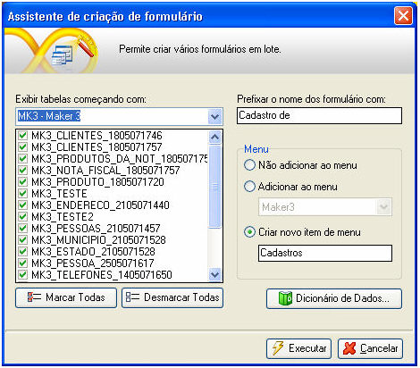
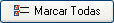

Este recurso ativa o Assistente de Criação de Formulário o qual possibilita a criação de vários formulários a partir das tabelas do banco de dados no qual está inserido o projeto.

Para acessar esse recurso, ative o menu Utilitários e, dentro da opção Assistentes, clique em Criação de Múltiplos Formulários:

Observe os itens da tela e suas funções:

- No campo Exibir tabelas começando com - são listados os projetos contidos na base de dados na qual consta o projeto que está sendo editado, além da  opção "(Todas)". Ao selecionar:

  - um projeto aparece no componente que sucede todas as tabelas que tenham como prefixo no nome a sigla do projeto;
  - a opção "(Todas)", aparece no componente que sucede todas as tabelas do banco de dados.
  - Ao digitar um texto no campo, o assistente realizará uma busca incremental na lista de tabelas.
- Há um checkbox no lado esquerdo de cada tabela listada no componente que mostra todas as tabelas disponíveis no banco de dados no qual está inserido o projeto, marcando-o, então a tabela será considerada no processo de criação de formulários. Há ainda o botão , que marca todos os checkboxes, e o botão , que desmarca todos os checkboxes;
- O campo Prefixar o nome dos formulários com - campo utilizado para definição do prefixo que nomeará o formulário que será criado. Exemplo: se o nome da tabela for "FUNCIONARIO" e o prefixo definido for "Cadastro de ", então o nome do formulário será "Cadastro de Funcionario". Como lembrete, sempre que for criado o prefixo, o recomendado é que seja inserido um espaço após o último caracter (para evitar que o último caracter fique junto do nome da tabela). Utilize o botão  para ter acesso ao Dicionário de Dados.
- Em Menu, selecione entre as opções:

  - Não adicionar ao menu - cria apenas os formulários, sem associá-los aos menus do projeto;
  - Adicionar ao menu - para selecionar em que menu o(s) formulário(s) gerado(s) será(ão) inserido(s);
  - Criar novo item de menu - será criado um novo menu e adicionados nele itens que apontem para os formulários que serão criados.
- Clique no botão  para iniciar o processo de execução da criação dos formulários ou clique no botão  para ignorar a execução e fechar a tela.

Criação de múltiplos formulários - este vídeo demonstra a criação de múltiplos formulários utilizando assistente.
