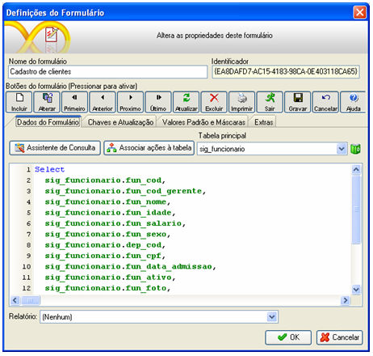
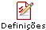
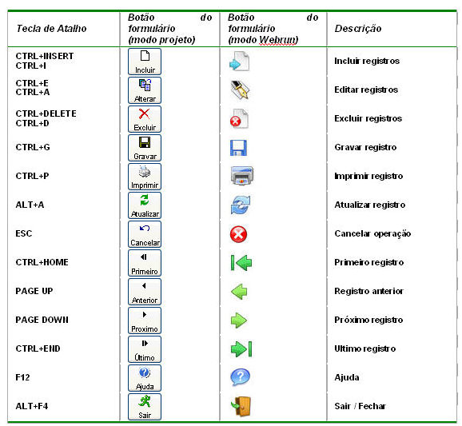
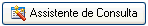
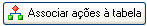

Nesta seção, são definidas as características do formulário, envolvendo:

- As construções SQL's (consultas dos dados para o formulário) que serão empregadas no banco vinculado ao sistema. Recomenda-se apenas a escolha daqueles campos que serão utilizados no formulário, pois a quantidade de campos selecionada influencia no tempo de processamento de construção do formulário no Webrun;
- Configurações aplicadas ao formulário;
- Campos-chave e de atualização;
- Valores padrão e aplicação de máscaras.

Com um formulário aberto, clique em , botão na paleta Objetos.

Essa tela é composta pelos seguintes componentes:

- Campo Nome do Formulário - determine o nome do formulário neste campo;
- Campo Identificador - este é o código que identifica o formulário no banco de dados. Este código é utilizado em algumas rotinas de fluxos onde o Webrun o interpreta. Saiba mais sobre GUID....

Editando projetos e visualizando na web - este vídeo demonstra a capacidade de desenvolvimento e visualização imediata do projeto na Web.

## Botões da Barra de Ferramentas do Formulário

- Ícones que formarão parte da Barra de Ferramentas do Formulário:

Observação: Caso algum botão pertencente a barra de navegação do formulário seja desabilitado através da tela de Definições do Formulário, a funcionlidade é removida do formulário. Exemplo: Caso o botão de Incluir esteja desabilitado, não será possível entrar em modo de Inserção no formulário, mesmo através de funções que o façam.

## Aba Dados do Formulário

Nesta aba, encontram-se os seguintes elementos:

- botão  - acessa a tela do [Assistente SQL](assistente_sql/iniciando_com_o_assistente_sql);
- botão  - recurso disponível para projetos sobre todos os bancos de dados homologados para o Maker, com exceção do **MYSQL. A**cessa a tela [Associação de Ações](associacao_acoes);

- Campo Tabela Principal - campo em que é selecionada a entidade que será foco das transações (inclusão, alteração, exclusão e seleção) feitas no formulário. As entidades listadas neste campo são originárias da configuração feita na tela Assistente SQL (botão Assistente de Consulta);
- Consulta do Formulário - área que apresenta o SQL do formulário. Não é editável;

- Campo Relatório - permite associar um relatório ao formulário, criando um botão de impressora no mesmo,no qual servirá para fazer a chamada do relatório.
- Botão  - este botão aciona a tela [Dicionário de Dados](../dicionario_de_dados/dicionario_de_dados).

Na área do Select do formulário, executando um clique com o botão direito do mouse, ativa-se um menu pop-up, com as seguintes opções:

- Copiar - copia o Select do formulário para a Área de Transferência;
- Testar - verifica a integridade do Select do formulário;
- Apagar - apaga o Select do formulário.

## Aba Chaves e Atualização

Esta aba é composta por duas colunas:

- Campos-Chave - coluna para definir os campos que são chave primária da fonte de dados do formulário. Selecione manualmente ou utilize o botão  para que o Maker faça por você;

Observação: É recomendado informar um campo como chave para melhor funcionamento de inserção, alteração e deleção de dados no Webrun. Caso o desenvolvedor não informe o campo chave, o Webrun irá considerar todos os campo como chave.

- Campos obrigatórios - obriga o cadastramento do campo no formulário. Existindo uma regra de banco de dados para a entrada de dados, o Maker tratará, reduzindo assim o tráfego com o banco.

## Aba Valor Padrão e Máscaras

Esta aba é composta por três colunas:

- Campos - lista os campo da fonte de dados do formulário;

- Valor Padrão - área utilizada para a definição do valor que será atribuído ao campo (por conseguinte, ao componente associado ao campo) no momento em que o usuário efetuar um clique sobre o botão Novo da barra de navegação do formulário no Webrun. Pode ser definido um valor fixo (quando esse valor for um valor numérico que seja constituído de casas decimais, que devem ser separadas por ponto, por exemplo 0.00) ou, considerada a linha (tupla) sobre a qual o usuário efetuar um clique com o botão direito do mouse para a definição do valor predefinido, escolher as opções:
- - SQL - ao selecionar esta opção, será aberta a tela [Assistente SQL](assistente_sql/iniciando_com_o_assistente_sql), a partir da qual poderá ser construído um comando de seleção que terá como resultado apenas um registro (por conseguinte, apenas um campo);
  - Funções -  ao selecionar esta opção, são listadas inúmeras [funções predefinidas](funcoes_predefinidas). É necessário apenas a escolha de uma delas;
  - Sem valor padrão - ao selecionar esta opção, o valor padrão que havia sido atribuído ao campo na coluna Valor Padrão será apagado;
  - Sem máscara - ao selecionar esta opção, a máscara que havia sido atribuída ao campo na coluna Máscaras será apagado;

Há ainda a possibilidade de ser definida uma expressão que será interpretada pelo Webrun como um gerador de valores autoincrementais (identificadores numéricos únicos em tabelas, geradores - generators - ou sequências numéricas - sequences), a qual será composta pelo caracter "@" (arroba) concatenado com o nome do objeto autoincremental do banco de dados (exemplo: @nomedasequencia), exceto nos projetos criados no banco de dados Microsoft SQL Server. Quando o projeto tiver sido criado no banco de dados:

- Microsoft SQL Server - poderá ser utilizado o comando SQL("SELECT IDENT_CURRENT('NOME_DA_TABELA') + 1"), o qual retorna o valor do campo da tabela que foi configurado como identidade (identity) para ela acrescido de uma unidade;
- Postgresql / Oracle / MySQL - poderão ser utilizados objetos sequences (sequências);
- Firebird - poderão ser utilizados objetos generators (geradores).

- [Máscara](../mascaras) - a máscara é uma expressão que definirá a aparência dos dados apresentados nos campos do formulário e é composta por dois campos, separados por ponto e vírgula. A primeira parte é a máscara propriamente dita e, na segunda parte, utiliza-se 0 ou 1 para determinar se os caracteres fixos devem ser ou não salvos com a máscara. Saiba como definir máscaras para os dados dos campos, pelo tópico Máscaras.

Aba Extras

Aba utilizada para a definição de mensagens personalizadas de violação de chave primária ou chave estrangeira da tabela que está associada ao formulário, as quais se sobreporão às mensagens emitidas pelo banco de dados. São campos desta aba:

- Mensagem para erro de chave primária - campo no qual deve ser informada a mensagem personalizada para a ocorrência de uma violação de acesso do tipo chave primária;
- Mensagem para erro de chave estrangeira - campo no qual deve ser informada a mensagem personalizada para a ocorrência de uma violação de acesso do tipo chave estrangeira.

Observação: Caso a mensagem retornada ainda seja a original do banco de dados, será necessário efetuar algumas alterações no arquivo databases.xml:

1. Abra o arquivo databases.xml que se se encontra em C:\Arquivos de programas\Softwell Solutions\Maker 2.7\Webrun 2\config.
2. No grupo do banco que queira configurar, adicione nos seguintes parâmetros ExceptionPrimaryKey (para chave primária) e ExceptionForeignKey (para chave estrangeira) um valor com uma parte da mensagem do banco que será retornada, por exemplo:

&lt;item&gt;

&lt;item-name&gt;ExceptionPrimaryKey&lt;/item-name&gt;
&lt;item-param&gt;Violation of PRIMARY&lt;/item-param&gt;
&lt;item-param&gt;duplicate key&lt;/item-param&gt;
&lt;item-param&gt;UNIQUE KEY&lt;/item-param&gt;
&lt;item-param&gt;PARTE DA MENSAGEM RETORNADA&lt;/item-param&gt;

&lt;/item&gt;

3. Após feita as configurações, reinicie o Tomcat.
