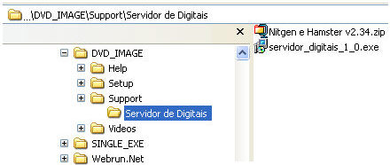

Para utilizar o recurso de Biometria, é necessário instalar o Servidor de Digitais e o Driver do dispositivo. Esses dois recursos estão disponíveis para uso em um sistema operacional Windows 2000 ou superior e podem ser obtidos no diretório ..\DVD_IMAGE\Support\Servidor de Digitais do DVD de Instalação do Maker 2.7.

Os modelos de identificador biométrico homologado atualmente é o Nitgen FingKey Hamster I, II, III e DX. Para maiores informações, acesse o site do fabricante:

[http://www.nitgen.com.br/Produtos/HamsterI.aspx](http://www.nitgen.com.br/produtos/18-fingkey-hamster-dx)

As etapas a serem seguidas para a instalação são:

1. Instale o  na mesma máquina onde se localiza o servidor de banco de dados utilizado no projeto.
2. Abra o arquivo compactado .
3. Selecione a pasta Software.
4. Execute o arquivo .
5. Siga os passos do assistente de instalação.
6. Repita os procedimentos do passo 2 ao 5 em todas as máquinas cliente.
7. Reinicie as máquinas para que a instalação surta efeito.

Observações:

1. Os arquivos Digital.FDB, Digital.FID e DB.INI, que ficam contidos no diretório do servidor de digitais, devem ser assegurados por backups constantes, de preferência diário. Isso é responsabilidade do usuário. Lembramos que esses arquivos contém informações da digital que é associada a um número (é o mesmo número que é armazenado no campo selecionado na propriedade Impressão Digital do componente [Imagem](../formulario/componentes/imagem) quando este é utilizado para obtenção de impressão digital).
2. Lembramos que o Servidor de Digitais deve ser instalado no mesmo Servidor de Banco de dados utilizado no projeto.

Instalando Servidor Biométrico - Este vídeo demonstra como instalar o servidor biométrico.
