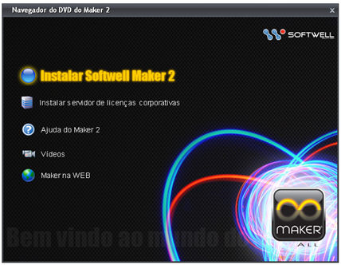
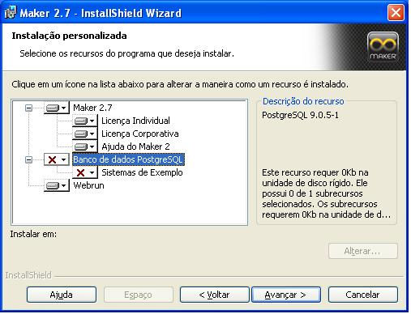
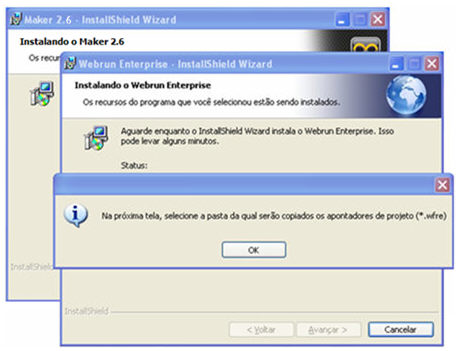
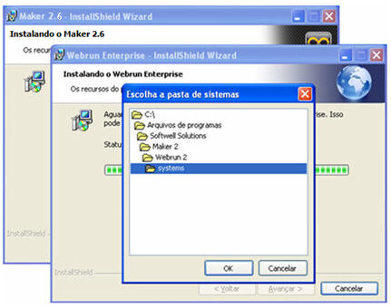
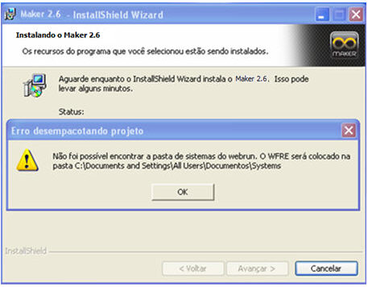

# Instalação do Maker

Insira o DVD de Instalação do Maker no Leitor de CD/DVD e o processo de instalação iniciará automaticamente.

As opções oferecidas no Menu são:

As opções da tela são:

- Instalar Softwell Maker 2 - Inicia o instalador do Maker, do Webrun e do banco de dados PostgreSQL 9.0;
- Instalar servidor de licenças corporativas - Inicia o instalador do Servidor de Licenças para execução corporativa (grupo de usuários acessando um servidor);
- Ajuda do Maker 2 - Ativa o Help do sistema;
- Vídeos - Apresenta um painel com algumas opções de videoaulas. Selecione o vídeo desejado com clique duplo sobre a imagem:
- Maker na WEB - Provê acesso automático ao site que contém informações técnicas do Maker: &lt;http://www.softwell.com.br&gt;.

Para a instalação do Maker e do banco de dados PostgreSQL, será necessário um computador que tenha, no mínimo, a seguinte configuração:

- Computador 1 Ghz ou superior;
- 1Gb de Memória RAM;
- HD com 606 Mb ou mais de espaço livre;
- Resolução 1024 × 768 ou superior;
- Sistema Operacional Microsoft Windows XP/Vista/Seven.
- DVD-ROM.

Para a execução do Webrun (serviço do produto), considerando que ele interpretará um sistema de pequeno porte, são requisitos mínimos:

- Computador 1 Ghz ou superior;
- 512MB de Memória RAM;
- HD com 384 Mb ou mais de espaço livre;
- Resolução 1024 × 768 ou superior;
- Sistemas Operacionais Homologados (Windows ou Linux, que possua interface gráfica)

A Softwell Solutions garante que o produto Webrun é compatível com o sistema operacional Linux. Vários clientes utilizam Linux, mas devido à existência de variadas distribuições e por se tratar de um ambiente não muito intuitivo e que exige profundo conhecimento do desenvolvedor, informamos que não fornecemos suporte a Linux.

Observe os passos da instalação:

1. O Assistente de instalação prepara a instalação
2. É exibido no painel o conteúdo da instalação. O botão  permitirá visualizar a capacidade das unidades de disco do seu micro. O botão  permitirá mudar o diretório de instalação. Clique no botão.

São itens da instalação:

1. Maker 2.7 - instala os arquivos da ferramenta na pasta padrão (C:\Arquivos de programas\Softwell Solutions\Maker 2.7) ou em uma pasta especificada pelo usuário:

   1. Licença individual - Versão individual do Maker;
   2. Licença corporativa - Versão corporativa do Maker;
   3. Ajuda do Maker 2.7 - Adiciona na pasta de instalação o arquivo de Ajuda;
   4. Tutoriais - videoaulas.

2. Banco de dados PostgreSQL - Instala o serviço e o gerenciador padrão do banco de dados (o nome do usuário master é postgres e a senha é Maker@1). São disponibilizados dois sistemas. Exemplo: Sistema de Controle de Estoque e Sistema de Chat ([também disponível no site da Softwell](http://www.softwell.com.br)), será possível visualizar pelo nome de usuário master e a senha 1 (um). A mesma identificação e senha são usadas para os novos projetos desenvolvidos no Maker.

3. Webrun - Instala o servidor de aplicações do Maker 2.7. Todos os sistemas são interpretados pelo Webrun por meio de um navegador WEB.

Observações:

1. Caso o usuário possua o PostgreSQL instalado, deve ser desabilitado o item Banco de dados PostgreSQL.
2. É necessário que o sistema de arquivos da partição no qual será instalado PostgresSQL seja NTFS.
3. Para usuários de rede cuja identificação contenha espaços ou acentos, ocorrerá erro de acesso ao Gerenciador de Banco de Dados PostgreSQL.
4. Para obter informações sobre todas as senhas utilizadas, acesse o tópico [Senhas Padrão](senhas_padrao).
5. [Para usuários que utilizem o SQLServer 2005/2008, deve habilitar o protocolo TCP / IP e definir o valor 1433 para a porta TCP](../../dicas_e_truques/banco_de_dados/como_configurar_conexao_remota_sqlserver2005);
6. Usuários que utilizam o Windows 2000 SP4 devem extrair o pacote  na pasta do Maker ou na pasta system32 (dentro da pasta Windows). Esse pacote encontra-se no diretório ...\DVD_IMAGE\Support do DVD de Instalação do Maker.

3. Na próxima tela, o usuário inicia a instalação.

4. Por fim, clique no botão .

## Observações importantes sobre a instalação

Ao instalar o Maker 2.7, um novo diretório será criado. O Diretório padrão será "C:\Arquivos de programas\Softwell Solutions\Maker 2.7", dessa forma, caso o usuário tenha o Maker 2.6 instalado, o diretório da versão anterior não será afetado.

O Webrun por, padrão, utiliza as seguintes portas:

&lt;Server port="8012" shutdown="SHUTDOWN"&gt;
&lt;Connector port="8087" protocol="HTTP/1.1"&gt;
&lt;Connector port="8016" protocol="AJP/1.3" redirectPort="8443" /&gt;

Considere os procedimentos que indicamos abaixo:

**Figura 1**

Cenário 1: Você já tem instalada na sua máquina a versão 2.6 e o PostgreSQL (todos os SO's):

Caso no procedimento de instalação da versão anterior (2.6) do Maker/Webrun também tiver sido instalado o serviço do banco de dados PostgreSQL, ou o computador no qual será instalada a nova versão já tiver instalado o serviço do banco de dados PostgreSQL, é necessário efetuar uma instalação personalizada, desconsiderando a instalação de um novo serviço para o banco de dados PostgresSQL (Figura 1). Neste caso, os sistemas de exemplo disponibilizados na pasta "support\Sistemas de Exemplo" do DVD de Instalação do Maker/Webrun deverão ser desempacotados manualmente.

Se já existir a versão (2.6) do Maker/Webrun no computador em que será instalada a nova versão (2.7) do Maker/Webrun, ao tentar desinstalar a versão anterior, pode ocorrer de alguns arquivos necessários para o funcionamento da nova versão do Maker/Webrun também serem desinstalados. Sendo assim, o recomendado é que a versão anterior do Maker/Webrun seja desinstalada antes da instalação da nova versão.

Cenário 2: Você já tem instalada na sua máquina a versão 2.6 e o PostgreSQL (Windows vista):

Se a nova versão do Maker/Webrun for instalada no sistema operacional Windows Vista, durante o procedimento de instalação pode ocorrer de o sistema operacional enviar uma mensagem informativa (Figura 2), a qual informa que será aberta uma tela para escolha da pasta que contém os apontadores dos projetos (*.wfre) já salvos no computador (Figura 3), para trás da tela que mostra o andamento da instalação do Webrun. Neste caso, efetue um clique na borda da mensagem informativa (Figura 2) para que ela venha para a frente da tela de instalação do Webrun e, em seguida, efetue um clique sobre o botão OK.

**Figura 2**

**Figura 3**

2. Descompactar na pasta "C:\Arquivos de programas\Softwell Solutions\Maker-2.7" ou na pasta "C:\WINDOWS\system32" os arquivos contidos no arquivo gdiplus_dnld.exe disponível na pasta support do DVD de Instalação do Maker/Webrun.

Cenário 4: Usando o instalador da nova versão do Maker/Webrun, você quer instalar apenas o Maker e o PostgreSQL e, em um segundo momento, instalar o Webrun (todos os SO's):

Para a instalação manual de cada um dos produtos, exceto o Maker, devem ser utilizados os instaladores disponíveis na pasta support\Instaladores Individuais do DVD de Instalação do Maker/Webrun. Para a instalação do Maker e do PostgreSQL em conjunto, deve-se utilizar o instalador normalmente, desconsiderando a instalação do Webrun. Durante esse processo, aparecerá por três vezes a mensagem "Não foi possível encontrar a pasta de sistemas do Webrun. O WFRE será colocado na pasta pública de todos os usuários, normalmente C:\Documents and Settings\All Users\Documentos\Systems" (Figura 4); efetue clique no botão OK em todas elas.

Erro: Não foi possível encontrar a pasta de sistemas do webrun. O WRFE será colocado na pasta C:\Documents and Settings\All Users\Documentos\Systems

**Figura 4**

3. Após a conclusão do processo de instalação do Webrun, é necessário copiar a pasta Systems referenciada na mensagem apresentada no parágrafo anterior para a pasta "C:\Arquivos de Programas\Softwell Solutions\Webrun Enterprise" (pasta sugerida para a instalação do Webrun, quando instalado pelo instalador individual).

Ao tentar desinstalar todos os produtos instalados pela nova versão do Maker/Webrun, o instalador só identificará a instalação do Maker, os demais produtos (PostgreSQL e Webrun Enterprise) devem ser desinstalados manualmente pelos instaladores disponíveis na pasta "support\Instaladores Individuais" do DVD de Instalação do Maker/Webrun, ou através do utilitário do "Adicionar ou Remover Programas" (Windows 2000 Professional/XP) ou "Programas e Recursos" (Windows Vista), ambos disponíveis em "Painel de Controle".

Observação: Todas as novas funcionalidades foram testadas à exaustão, porém, podem ocorrer combinações de alta complexidade, as quais a equipe de testes não tenha identificado. Estaremos sempre à disposição para resolvê-las. Para isso você deve manter contato com nosso suporte pelos meios: e-mail, telefone, chat.

## Chave de acesso ao Maker

No kit de Instalação do Maker consta uma chave de acesso que possui o registro de uso da ferramenta para uma das versões:

- Enterprise.
- Professional.
- Standard Edition.

A forma de liberação do Maker é definida no ato da aquisição do produto. Uma tabela comparativa entre as versões, está disponível no tópico [Recursos e Características das Versões do Maker](../../recursos_e_caracteristicas_das_versoes_do_maker).

IMPORTANTE:

Essa chave deverá estar conectada em uma porta USB para que o Maker possa funcionar. Esse componente que acompanha o Kit de Instalação do Maker é de total responsabilidade do proprietário adquirente. Em caso de perda, ele mesmo deverá adquirir uma nova licença de uso do Maker.

## Atualizações e Suporte do Maker

Ocorrerá sempre uma checagem pelo Atualizador Automático, localizado na Bandeja de Sistemas do Windows, nos casos de computadores conectados na Internet e com o comando ativo na tela [Configurações](../configuracao_das_conexoes/configuracoes).

Para executar a atualização do Maker manualmente, consulte o item [Atualizações do Maker](../atualizacoes_maker/atualizacoes_maker).
