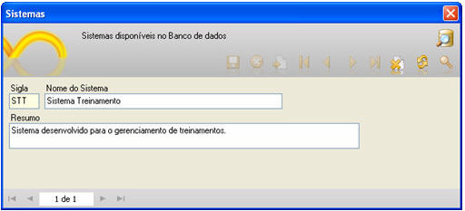
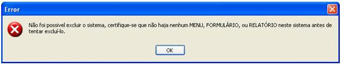

Lista os projetos contidos no banco de dados em que se encontra o projeto que estiver sendo editado. Esta tela pode ser aberta pelo item Lista de Sistemas do menu Projeto.

Observações:

1. Para a exclusão de um projeto, é pré-requisito ter excluído anteriormente todos os seus menus, formulários e relatórios. Caso contrário, será exibida a mensagem de erro apresentada abaixo.

Erro: Não foi possível excluir o sistema, certifique-se que não haja nenhum MENU, FORMULÁRIO, ou RELATÓRIO neste sistema antes de tentar exclui-lo

2. Um sistema excluído pode ser acessado pelo *.wfre (apontador) e seu registro será recriado nesta tela.
3. Não é possível excluir um projeto estando no próprio projeto. Para poder excluí-lo, deve estar em um outro projeto contido na mesma base de dados do projeto que se quer excluir.
