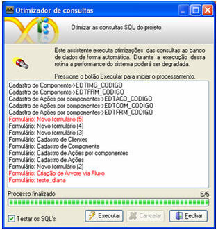
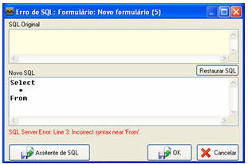
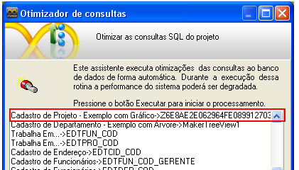

O Otimizador de Consultas verifica as consultas (fontes de dados da Conexão Principal e de Conexões Adicionais) associadas a formulários e componentes, Caixas de seleção por exemplo, objetivando melhor performance da estrutura de seleção.

Para acessar este recurso, ative o menu Utilitários e clique em Otimizador de consultas...:

A tela é composta apenas por duas opções fundamentais:

-  - para checar todos os comandos SQL relacionados com o projeto;
- Botão  - inicia o processo de otimização.

Após clicar no botão , encontrando inconformidades, as consultas serão sinalizadas em vermelho.

Para ajustes, selecione a consulta executando clique duplo sobre o nome. A tela Erro de SQL: &lt;nome do objeto&gt; é acionada:

O usuário que estiver analisando o problema detectado poderá resolver de dois modos: utilizando o botão  para que o Maker corrija automaticamente ou manualmente por meio do .

Observação: Existindo o componente [Gráfico](../formulario/componentes/grafico) no formulário, ao pressionar Executar, aparecerá na lista um hash ao invés de aparecer o nome do Gráfico.

