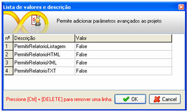

Clicando com o botão direito do mouse na tela principal do Maker, é exibida a lista de Propriedades, Eventos e Preview da área de trabalho.

## image12.gif Propriedades

- Exibição de Imagem - define como a Imagem Principal será exibida. Podendo ser: Estender (alonga a imagem), Centralizar (centraliza a imagem), Repetir (repete a imagem proporcionalmente à tela), Repetir na Horizontal ou Vertical (possui a mesma definição de Repetir podendo ser horizontal ou verticalmente).
- Imagem Principal - seleciona uma imagem para ser exibida como o plano de fundo do sistema criado. A imagem deve existir primeiramente no [Cadastro de Imagens](cadastro_de_imagens/catalogo_de_imagens).
- Símbolo da Empresa - Esta função não tem mais funcionalidade no Maker 2.X. Será removido nas próximas versões do Maker.
- Requer Autenticação - marcando essa propriedade como Sim, ao acessar o sistema pelo Webrun, será necessário um login de usuário e uma senha para ter acesso ao sistema.
- Formulário Principal - permite selecionar um formulário como principal de trabalho, ou seja, aparece maximizado na área de trabalho do sistema.
- Formulário do Serial - permite definir um formulário que irá representar a tela de solicitação do serial de registro do projeto;
- Conexão - abre a tela de [Configurações](configuracao_das_conexoes/configuracoes) do projeto. Deve-se observar que a chamada dessa tela através deste atalho apresentará a aba Versionamento desabilitada.
- Conexões Adicionais - permite criar [Conexões Adicionais](configuracao_das_conexoes/conexoes_adicionais) para o projeto.
- Categorias - ativa a tela Categoria, tela mais simples para associar as categorias já cadastradas ou para criar uma nova rapidamente. Ao abrir a tela, é possível utilizar teclas de atalho: ALT + N para criar uma nova categoria; ALT + O para confirmar as alterações e ALT + C para cancelar as alterações. Para uma edição mais completa, acesse o [Cadastro de Categorias do Sistema](categorias_do_sistema/categorias_do_sistema).
- Dados da Entidade - recurso utilizado para identificar uma empresa usuária do projeto. Recurso utilizado para controle de liberação de uso do projeto por registro. Na tela do Assistente SQL, aponte para uma tabela e campo onde está o nome da entidade.
- Data-Limite - recurso utilizado para identificar a data de expiração do projeto. Recurso utilizado para controle de liberação por registro. Na tela do Assistente SQL, aponte para uma tabela e campo onde está a data de expiração do projeto.
- Informações - na tela do Assistente SQL, aponte para uma tabela e campo que contenha um comentário que será impresso na barra de mensagens (rodapé da tela), sobre o projeto.
- Idiomas - todos os idiomas marcados nesta propriedade serão listados na caixa de seleção Traduzir para da tela [Tabelas de Tradução](tradutor/tradutor). Caso nenhum idioma seja marcado, todos os idiomas contidos nesta propriedade serão listados.
- IdiomaBase - deve ser selecionado o idioma que foi utilizado durante a construção do projeto (títulos de formulários e descrição de componenetes de formulários, por exemplo).
- Skin - o suporte para esta propriedade será disponibilizado nas próximas versões.
- Avançado - permite configurar parâmetros avançados para o projeto atual. Há outros parâmetros globais que podem ser configurados por meio do Webrun (consulte o tópico [Parâmetros de Configuração](../webrun_2/parametro_configuracao/parametro_configuracao)). A diferença é apenas a interface:

Defina na coluna Descrição a propriedade e na coluna Valor o parâmetro:

- AbrirCursorPorPagina - determine true ou false para habilitar ou não o cursor. Este recurso tem como objetivo efetuar uma consulta com o banco, obter uma parte do resultado da consulta e fechar o cursor. Dessa forma, caso seja necessário navegar por mais registros, a consulta é refeita buscando os próximos registros.
- AutenticacaoCentralizada - Defina S/N para habilitar ou não a função: Ao utilizar subentidades, por padrão, a autenticação e autorização é feita pelo banco do destino. Este parâmetro de configuração avançado permite que a autenticação e autorização seja centralizada, obedecendo a autenticação do banco matriz (O banco principal). O banco principal é aquele cujo apontador se encontra na pasta system. Para mais informações sobre Multiplos sistemas, [clique aqui](../dicas_e_truques/webrun/carregando_multiplos_sistemas_webrun).
- AutoDeploy – Por padrão o Webun compila todo sistema na primeira carga inicial. Para evitar isso fazendo com que a inicialização do sistema fique mais rápida informe esse parâmetro passando o valor 1.
- **CarregarFormularioPorDemanda -** Quando configurados como true, ao carregar o sistema os formulários são carregados por demanda, ou seja, à medida que são acessados os menus. O padrão é false.
- CompatibilidadeCamposRequeridos - referente a campos de um formulário; se um campo estiver marcado como obrigatório (na lista em [Definições do formulário](formulario/propriedade_do_formulario) coluna Campos Obrigatórios), ele será obrigatório pela interface, caso contrário, não. Para persistir o legado, essa propriedade deve ser criada tendo como parâmetro o valor 1, a fim de que a função de obrigatoriedade seja habilitada, e o valor 2 para a definição do inverso.
- DesabilitarAtalhos - se for colocado 0 (zero) no campo Descrição, o recurso de criação de  atalhos será habilitado e o valor 1 desabilita os atalhos da Área de Trabalho do Webrun.

- DesabilitarCarregando - quando definimos o valor 1, essa propriedade desabilita a imagem  dos formulários.
- DesabilitarScript - quando definimos o valor 1, essa propriedade desabilita o recurso de execução de scripts ou tags HTML em todos os componentes. Servindo essa também para a aba localizar. Funcionalidade disponível a partir da versão 2.6.2.8 do Webrun.
- DesabilitarScriptAbaLocalizar - quando definimos o valor 1, essa propriedade desabilita o recurso de execução de scripts ou tags HTML na aba Localizar.
- DesabilitarScriptGrade - quando definimos o valor 1, essa propriedade desabilita o recurso de execução de scripts ou tags HTML no componente Grade. Funcionalidade disponível a partir da versão 2.6.2.8 do Webrun.
- DesabilitarScriptTexto - quando definimos o valor 1, essa propriedade desabilita o recurso de execução de scripts ou tags HTML no componente Texto com quebra de linha automática. Funcionalidade disponível a partir da versão 2.6.2.8 do Webrun.
- ExcluirTodosDetalhesSeInvisivel - informa ao Webrun para excluir o conteúdo de todos os subformulários, caso eles estejam invisíveis, independentemente dos valores selecionados na propriedade Excluir se Invisível. Defina o valor S como parâmetro para habilitar a função e o valor  N define o inverso.
- ExecutarAoEntrarEventoClick - esta propriedade informa ao Webrun para executar automaticamente os eventos Ao Clicar dos componentes Lista, Lista Dinâmica e Check ao entrar em formulário.
- FormularioDeGrupos - esta propriedade avançada possibilita ao usuário criar seu próprio formulário de grupos substituindo o existente. Defina a guid do formulário que substituirá o de grupos.
- FormularioDeImportacao - esta propriedade avançada possibilita ao usuário criar seu próprio formulário de Importação substituindo o existente. Defina o guid do fomulário que substituirá o de Importação.
- FormularioDeLog - esta propriedade avançada possibilita ao usuário criar seu próprio formulário de Log substituindo o existente. Defina o guid do formulário que substituirá o de Log.
- FormularioDeSenha - esta propriedade avançada possibilita ao usuário criar seu próprio formulário de Senha substituindo o existente. Defina o guid do formulário que substituirá o de Senha.
- FormularioDeUsuarios - esta propriedade avançada possibilita ao usuário criar seu próprio formulário de Usuario substituindo o existente. Defina o guid do formulário que substituirá o de Usuario.

- Grade:CorCondicional:ManterOrdem - esta propriedade avançada ao ser definida como true, manterá a ordem das condições da cor condicional da grade definida no Maker ;
- Grade:DesabilitarCustomizarUsuario – Por padrão o Webrun permite que usuários logados no sistema personalizem a grade. Para desabilitar informe esse parâmetro atribuindo o valor 1;
- GradeDesabilitarSelecaoDuranteEdicao - desabilita a seleção das linhas do componente Grade, durante a edição. Desabilita a seleção com as teclas Seta para cima, Seta para baixo, Page Down e Page Up durante a edição do componente. Esta propriedade recebe um parâmetro para ativá-lo, que poderá ser: S, V, T, true, verdadeiro, verdade, yes ou sim e não é case sensitive;
- GradeExecutarApenasDuploClicar - a grade não entrará em modo de edição com o clique duplo, caso exista um evento Ao duplo clicar associado. Defina o valor como false para que as duas ações ocorram. O padrão é true;

- Grade:ExecutarEventosCheck - Quando configurada como false, o componente Grade em modo normal, não executará os eventos do checkbox. Valor padrão: true ;
- Grade:OtimizarComponentes – Componentes Imagem e Botão com eventos associados geram um código grande no componente Grade. Para ativar o parâmetro fazendo com que o código fique menor, informe o parâmetro atribuindo o valor 1;

- Grupos:PermissaoPadrao - esta propriedade possibilita inverter a permissão quando um usuário está associado a mais de um grupo. Ao ser definido como false, o comportamento fica invertido, ou seja, se um dos grupos não possuir a permissão o usuário não terá permissão;
- ImportarTodosScriptsJS - quando configurado como false, são carregados somente os scripts dos componentes utilizados no Formulário. Quando configurado como true, são carregados todos os scripts dos componentes para o Formulário (independentes de serem utilizados ou não no Formulário). Por default, este parâmetro vem configurado como true;

- MostrarHoraZerada - Quando configurada como  0(Zero), o Webrun omitirá a hora quando a mesma for 00:00:00. Valor Padrão: 0(zero)

- ImportarFluxoClienteDinamicamente - Ao ativar esta propriedade, os fluxos da camada cliente serão importados sob demanda. Ou seja, caso o formulário não utilize um determinado fluxo, este não será importado para o formulário. Defina o valor 1 para ativar e 0 para desativar;
- ListaDinamica:TipoFiltroInicial - possibilita a modificação do tipo de busca inicial do componnete Lista Dinâmica. Pode ,inclusive, ser definido de forma geral. Tipos de Filtro (1,2,3,4):
- - 1 - Igual
  - 2 - Contendo
  - 3 - Iniciando com (PADRÃO)
  - 4 - Terminando com
- LookupLimparChaveNaDependencia - determine 1 ou 0 para ativar ou não a limpeza de chaves na dependência. Exemplo: Caso seja utilizado Lista Dinâmica filtrando outra Lista Dinâmica e posteriormente seja selecionado um valor nulo na lista, será limpada a chave e, caso obtenha o valor do componente, será retornado nulo;
- MaximoPaginasPorConsulta - define a quantidade de páginas que será retornada por consulta. Por padrão, cada página retorna 100 registros;

- MostrarMensagemComoAlert - Este parâmetro faz com que a mensagem exibida através do componente Interação, existente no editor de fluxos, possua o formato do alerta do navegador, simulando a função Alertar aguardando OK. Para ativar este parâmetro, informe o valor 1;
- PermitirRelatorioListagem - se for colocado false não será permitido emitir  Listagem;
- PermitirRelatorioHTML - se for colocado false  não será permitido emitir  Exportar para HTML;
- PermitirRelatorioXML - se for colocado false não será permitido emitir  Exportar para XML;
- PermitirRelatorioTXT - se for colocado false não será permitido emitir  Exportar para TXT;
- PermitirOrdenarGrade - se for colocado false não será permitido ordenar a grade;
- PermitirRemoverOrdenacaoGrade - se for colocado false no campo Valor não será permitido Remover ordenação do grid;
- PermitirImportarDados - se for colocado false não será permitido  Importar arquivos;
- PermitirRelatoriosPadroes - caso queira que todas as opções descritas nos itens PermitirRelatorioListagem. PermitirRelatorioHTML, PermitirRelatorioXML e PermitirRelatorioTXT sejam desativadas ao mesmo tempo, basta colocar a propriedade no campo Descrição e N no campo Valor;

- Relatorio:ConexaoAdicional:UsarDaMemoria - permite abrir um relatório com uma conexão que tenha sido alterada na memória. Ao ser definida como true, todas as conexões adicionais serão salvas no disco antes da geração do relatório, impactando no tempo de abertura dos relatórios;
- Seguranca:Formulario:RemoverNomeBD - sua função é impedir a exibição do nome real de qualquer campo que esteja associado a um componente no código-fonte do formulário (html). Além do uso dessa propriedade avançada, recomenda-se também a modificação das propriedades Descrição e Nome do componente, haja vista que, no momento da criação do componente no formulário, o nome do campo (nome real) é utilizado para compor o valor definido para as propriedades citadas. Outro aspecto que deve ser considerado é o relacionado com o uso de fluxos de ações utilizados na camada Cliente, os quais contenham funções que obtenham valores de componentes (tenham como parâmetros o identificador Campo) que não funcionaram. Para ativar a propriedade, defina o valor true ou 1 para ela; para desativá-la, defina o valor false ou 0 (zero);
- Seguranca:Formulario:ValidarAcaoNavegador - sua função é a de impedir que possam ser utilizadas as teclas de atalho disponíveis para uso quando a barra de navegação do formulário estiver ativa (propriedade Navegação do formulário). Além disso, será criado um bloqueio no servidor (computador no qual foi instalado o Webrun) para que não possam ser utilizados scripts mal intencionados, os quais tenham como função editar os dados do formulário. Para ativar a propriedade, defina o valor true ou 1 para ela; para desativá-la, defina o valor false ou 0 (zero);
- Seguranca:Permissao:RemoverCamposInvisiveis - sua função é evitar a inclusão de códigos-fonte no código-fonte do formulário, os quais estejam relacionados com qualquer componente que tenha sido definido como invisível pela definição das permissões dos grupos no Webrun (Modo Gerente). Para ativar a propriedade, defina o valor true ou 1 para ela; para desativá-la, defina o valor false ou 0 (zero);
- Seguranca:Upload:PastasPermitidas - Sua função é definir uma lista de pastas permitidas para upload de arquivos no Servidor. Exemplo: "C:\webrun_upload". Assim, apenas essa pasta aceitaria upload. Caso seja informado uma pasta que não conste na lista definida neste parâmetro ou o valor seja vazio ou "*" ou ainda o parâmetro não esteja definido, o comportamento antigo será mantido, ou seja, todas as pastas permitirão upload.

- Seguranca:Upload:ExtensoesBloqueadas - Sua função é permitir ou bloquear o envio de arquivos com extensões pré-definidas(exe, com, bat, dll, so, bin, jsp, jsf e jws). Para adicionar informe a extensão do arquivo desejada, separando por ';'. Para permitir todas as extensões, configure o valor para '*'.
- UsarMultiplicaçãoComAltaPrecisãoDecimal - quando configurado como true, a multiplicação é forçada a utilizar o pacote java.BigDecimal, tendo mais precisão nos cálculos. Por padrão, esse parâmetro vem configurado como false.

- VersaoSeguranca - Este parâmetro ativa as implementações de segurança para o Webrun. Tais implementações incluem: bloqueio de alguns tipos de arquivo, visualização do conteúdo da pasta Upload e configuração de pastas permitidas para Upload. Para ativá-lo, informe o valor 1. [Saiba mais!](../dicas_e_truques/webrun/como_aumentar_a_seguranca_de_sua_aplicacao)

Observações:

1. Ao ser utilizada a propriedade Formulário Principal, todo os eventos que pertecem ao sistema deixam de pertencer ao mesmo e passa a pertencer ao formulário que está setado como Formulário Principal.
2. Ao marcar o valor do parâmetroImportarTodosScriptsJS como False, não será possível criar componentes dinâmicamente.
3. Para que as alterações executadas em propriedades tenham efeito, será necessário reiniciar o sistema no Webrun.
4. Caso as seguintes propriedades avançadas FormularioDeGrupos, FormularioDeImportacao, FormularioDeLog, FormularioDeSenha e FormularioDeUsuarios não entrem em vigor, será necessário os seguintes passos:
   1. Pare o serviço do Tomcat;
   2. Remova a pasta saved, contida em c:\Arquivos de programas\Softwell Solutions\Maker 2.7\Webrun 2\Config;
   3. Inicie o Tomcat;
5. A propriedade avançada CarregarFormularioPorDemanda funciona somente para sistema no modo interpretado.
6. Ao definir um formulário para as seguintes propriedades avançadas FormularioDeGrupos, FormularioDeImportacao, FormularioDeLog, FormularioDeSenha e FormularioDeUsuarios a Guid deve estar entre chaves. Ex: FormulariodeGrupos=&#123;A0F6462D-9B4B-44E8-89E6-57258A6E38EF&#125;.

## Suporte a Pool de Conexões

A utilização de um Pool de Conexões permite a uma aplicação reusar conexões que existem em um pool a invés de repetidamente fechar e criar novas conexões. Isto pode aumentar significativamente o desempenho e a escalabilidade das aplicações, pois permite que uma quantidade menor de conexões atenda as requisições por conexões de uma aplicação visto que todas as conexões já estão prontas e criadas no pool a espera de serem utilizadas. Assim que o primeiro usuário efetua o login em um sistema no Webrun, a conexão estabelecida com o banco de dados é mantida em memória. Dessa forma, outros usuários que acessem o mesmo sistema utilizarão a mesma conexão.

Por padrão, um sistema se inicia com pool de conexões desabilitado, porém, foi adicionado suporte às seguintes propriedades avançadas do sistema:

- pool (S/N) - ativa ou desativa o pool de conexões. Padrão "N";
- pool.initialSize (inteiro) - define o tamanho inicial do pool (quantidade de conexões alocadas). Padrão "-1";
- pool.maxActive (inteiro) - define o máximo de conexões concorrentes do pool. Se ultrapassar o valor especificado, o requisitante ficará em espera. Caso utilize o valor "-1", será ilimitado a quantidade conexões concorrentes. Padrão "-1";
- pool.maxIdle (inteiro) - define o máximo de conexões inativas, que são as conexões que estarão em estado de espera (aguardando requisitante) no pool. O valor "-1" define sem limite. Padrão "-1";
- pool.minIdle (inteiro) - define o mínimo de conexões inativas, que são as conexões que estarão em estado de espera (aguardando requisitante) no pool, sem uma extra ser criada. O valor "0" não cria nada. Padrão "20";
- pool.maxWait (inteiro) - define o tempo máximo (em milissegundos) de espera por uma conexão, se este intervalo de tempo for excedido, ocorrerá uma exceção. Se definido "-1" a espera será indefinida.  Padrão "-1".

Observação: Existem restrições para usuários das versões Standard Edition e Professional. Para mais detalhes, acesse o tópico [Recursos e Características das Versões do Maker](../recursos_e_caracteristicas_das_versoes_do_maker).

## image19.gif Eventos

- Ao Autenticar - executa um evento/ação para autenticar o usuário da sessão. A interceptação da autenticação ocorre com o evento e o fluxo associado continua recebendo Usuário e Senha como parâmetros. O retorno do fluxo é tratado:
- - Inteiro 0 - continua normalmente com a autenticação do Webrun;
  - Inteiro -1 - gera erro na autenticação;
  - Inteiro -9 - autentica o usuário com privilégios de administrador;
  - Inteiro &gt;0 - autentica o usuário no grupo com o código retornado;
  - &lt;string&gt; - autentica o usuário com o Login e Senha da string retornada. Ex.: retorno "master" autentica com usuário e com o login.
  - - Observação: Não é possível utilizar a função Definir variável de sessão no evento Ao Autenticar, pois no momento da autenticação, a sessão ainda não foi definida.
- Ao Entrar - executa um evento/ação após entrar no projeto. Caso a propriedade Requerer Autenticação for igual a Não, o evento / ação é executado automaticamente. Caso contrário, só ocorre se a autenticação estiver correta.
- Ao Mudar Senha - executa um evento/ação ao alterar a senha de acesso ao sistema. Observação: Este evento, quando utilizado, o desenvolvedor ficará encarregado na modificação da senha via fluxograma, deixando de lado a responsabilidade do webrun. O fluxo, quando associado a este evento, receberá dois parâmetros automáticos do tipo letras, que correspondem à senha atual e a nova senha.
- Ao Sair - executa um evento/ação após clicar na opção Sair (ambiente Web).
- Ao Verificar Serial - executa um evento / ação para certificar o serial de uso do projeto.

Observações:

1. Caso seja associado um fluxo de ação ao evento Ao Autenticar do sistema, o botão de inicialização da autenticação biométrica que aparece na tela Login do Webrun, ficará oculto.
2. Quando utilizado o evento "Ao Autenticar" com parâmetro de saída -9 a autenticação passa a ser interceptada pelo evento. Sendo assim o sistema entende que o gerenciamento de usuários e grupos passará a ser administrada pelo desenvolvedor do sistema e não mais pelo Webrun.

Eventos da Área de Trabalho - Ao Autenticar - este vídeo exemplifica a utilização do evento Ao Autenticar.

## image793.gif Preview

Selecionando qualquer uma das opções de browsers disponíveis (Mozilla Firefox ou Internet Explorer), a tela do browser será carregada com o endereço (url) apontando para o sistema que está sendo editado no Maker. A mesma ação poderá ocorrer com a combinação de teclas "Ctrl" + "F9").

Observações:

1. Configurações feitas na [Área de Trabalho do Maker](propriedades_e_eventos_da_area_de_trabalho) (plano de fundo do projeto, formulários associados a fontes de dados de conexões adicionais, dentre outras) não são consideradas na pré-visualização, sendo necessário que o usuário reinicie o sistema para que passem a ser consideradas.
2. Se a pré-visualização não estiver com o idioma correspondente ao atual, o usuário deve limpar o cache do navegador.
3. A relação de nomes dos browsers depende da sua instalação.
4. Conheça a opção de Preview de formulário, acessando o tópico [Opções comuns para objetos - Edição](formulario/opcoes_comuns_para_os_objetos_em_um_formulario/edicao).
