Para começarmos a montar um relatório, devemos clicar na aba Dados, no menu Arquivo e selecionar a opção Novo.

O menu Arquivo é composto dos submenus:

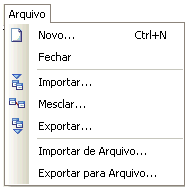

- Novo... - cria uma nova fonte de dados;
- Fechar - ao selecionar esta opção, a tela do "Gerador de Relatórios" é fechada;
- Importar... - ao selecionar esta opção, aparece a tela "Abrir", a qual oferece suporte à importação de fontes de dados de relatório contidas em um arquivo que foi salvo no banco de dados. Todas as fontes de dados já existentes no relatório serão excluídas;
- Mesclar... - ao selecionar esta opção, aparece a tela "Abrir", a qual oferece suporte à importação de fontes de dados de relatório contidas em um arquivo que foi salvo no banco de dados. Além das fontes de dados importadas, todas as fontes de dados já existentes no relatório serão mantidas;
- Exportar... - ao selecionar esta opção, aparece a tela "Salvar Como", a qual oferece suporte ao salvamento da fonte de dados do relatório que está aberto no banco de dados;
- Importar de Arquivo... - ao selecionar esta opção, aparece a tela "Abrir", a qual oferece suporte à importação de uma fonte de dados de relatório contida em um arquivo no computador (exemplo: fonte.dtm) para o banco de dados;
- Exportar para Arquivo... - ao selecionar esta opção, aparece a tela "Salvar Como", a qual oferece suporte à exportação da fonte de dados de um relatório para um arquivo no computador (exemplo: fonte.dtm).

Após a seleção do submenu Novo..., foi selecionado o tipo de relatório "[Relatório em Branco](usando_o_assistente_de_criacao_de_relatorio)". Devemos clicar na guia de Dados, no menu Arquivo e selecionar a opção Novo....

Ao abrir a tela Novos Itens, selecionando a opção Maker SQL e clicar em OK.

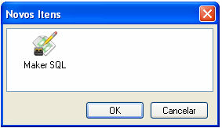

Na janela Maker SQL, selecione a(s) tabela(s) que fará(ão) parte do relatório na Árvore de Entidades Agrupadas (1):

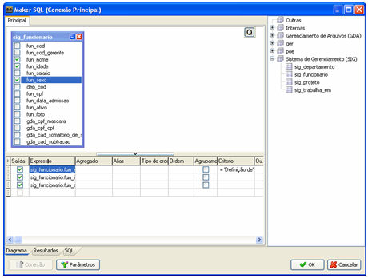

Observe que a grade de configuração da aba Diagrama é idêntica com à tela [Assistente SQL](../formulario/assistente_sql/iniciando_com_o_assistente_sql).

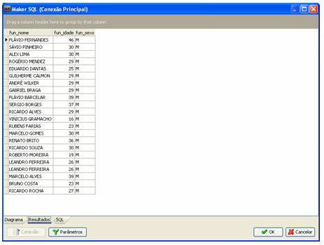

A aba Resultados apresentará o resultado da consulta.

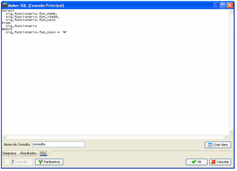

A aba SQL apresentará o contexto da consulta, permite nomear a consulta e criar uma View a partir de um clique no botão .

## Usando Filtros

Para a definição de um filtro de pesquisa, deve-se colocar na coluna Critério, levando em consideração o campo em que se quer aplicar a expressão: FiltroDePesquisa (o sinal : (dois-pontos) concatenado com o nome do filtro de pesquisa) e, em seguida, clicar no botão :

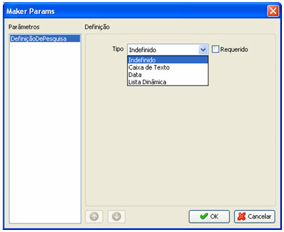

A tela contêm:

- Parâmetros - contendo todos os filtros de pesquisa definidos na tela "Maker SQL";
- Definição - ao selecionar o filtro de pesquisa na área "Parâmetros", são habilitados vários componentes nesta área. São eles:
- - Tipo - o qual contém as opções de filtro de pesquisa disponíveis. São elas:
  - - Indefinido - o filtro de pesquisa não será considerado no momento da geração do relatório;
    - Caixa de Texto - o filtro de pesquisa será informado por meio de um componente "caixa de texto". Quando esta opção é selecionada, habilita os componentes:

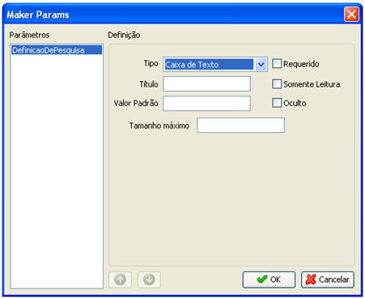

Figura 4 - Tipo Caixa de Texto

1. Título - determina o título do componente que é definido para ser o filtro de pesquisa;
2. Valor Padrão - determina o valor que será utilizado automaticamente para filtragem do relatório, caso não seja informado nenhum valor;
3. Tamanho máximo - pelo qual é possível definir o valor máximo do filtro de pesquisa que será informado;
4. Validação de Entrada - contém uma lista de validadores previamente definidos, os quais serão observados no momento da informação do filtro de pesquisa.
5. Requerido - marcando esta opção, torna-se obrigatório o preenchimento do filtro de pesquisa;
6. Somente Leitura - marcando esta opção, o componente ficará em modo não editável (o usuário não poderá informar nenhum valor para o filtro de pesquisa);
7. Oculto - marcando esta opção, o filtro de pesquisa será aplicado internamente (automaticamente), não aparecendo para que o usuário o defina.

- Data - automaticamente é criada uma caixa de texto contendo um calendário no qual é possível a seleção da data pelo mouse:

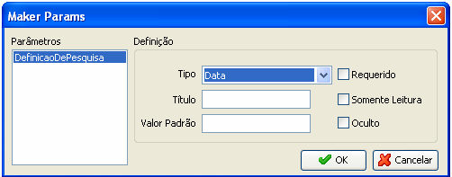

Figura 5 - Tipo Data

1. Título - determina o título do componente que é definido para ser o filtro de pesquisa;
2. Valor Padrão - determina o valor que será utilizado automaticamente para filtragem do relatório, caso não seja informado nenhum valor.
3. Requerido - marcando esta opção, torna-se obrigatório o preenchimento do filtro de pesquisa;
4. Somente Leitura - marcando esta opção, o componente ficará em modo não editável (o usuário não poderá informar nenhum valor para o filtro de pesquisa);
5. Oculto - marcando esta opção, o filtro de pesquisa será aplicado internamente (automaticamente), não aparecendo para que o usuário o defina.

- Lista Dinâmica - o filtro de pesquisa será selecionado por meio de um componente "Lista Dinâmica":

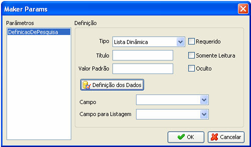

Figura 6 - Tipo Lista Dinâmica

1. Título - determina o título do componente que é definido para ser o filtro de pesquisa;
2. Valor-Padrão - determina o valor que será utilizado automaticamente para filtragem do relatório, caso não seja informado nenhum valor;
3. 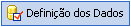 - efetuado um clique sobre este botão, aparece a tela Maker SQL, por meio da qual é possível a criação de uma consulta que servirá de fonte de dados para o componente (deve ser selecionado pelo menos um campo na consulta criada);
4. Campo - em que o valor vinculado ao campo selecionado será utilizado como filtro de pesquisa do relatório;
5. Campo para Listagem - na qual aparecerá a descrição (representação entendível) que explica o valor do "campo-chave";
6. Requerido - marcando esta opção, torna-se obrigatório o preenchimento do filtro de pesquisa;
7. Somente Leitura - marcando esta opção, o componente ficará em modo não editável (o usuário não poderá informar nenhum valor para o filtro de pesquisa);
8. Oculto - marcando esta opção, o filtro de pesquisa será aplicado internamente (automaticamente), não aparecendo para que o usuário o defina.

Observação:

1.  - Botões de ordenação serão exibidos quando se utilizar mais de um parâmetro:

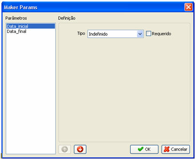

- 2. Conexões - O suporte ao uso de [Conexões Adicionais](../configuracao_das_conexoes/conexoes_adicionais) foi disponibilizado a partir da versão 2.5.1.21 do Maker. Sendo assim, para que o relatório seja emitido com êxito pela versão 2.5.0.10 (ou superior) do Webrun, é necessário descompactar todos os arquivos contidos dentro do arquivo compactado WFRReports2.zip na pasta reports do Webrun (C:\Arquivos de programas\Softwell Solutions\Maker 2.5\Webrun 2\reports). O botão Conexão só fica habilitado se houver conexões adicionais configuradas na tela Conexões Adicionais. Ao clicar nele, aparece uma lista com todas as conexões adicionais configuradas, inclusive a principal (selecionada por padrão ao abrir a tela Maker SQL). Tendo sido selecionada qualquer uma das conexões, serão apresentadas as entidades (parte superior direita) relativas à base de dados representada pela conexão. São considerações sobre o uso deste recurso:
  3. se a janela do Gerador de Relatórios estiver aberta no momento em que foi feita a configuração da Conexão Adicional, é necessário fechar e voltar a abri-la, a fim de que seja reconhecida;
  4. tendo sido selecionada pelo menos uma entidade de uma conexão, ao mudar a conexão-base do relatório, então aparece uma mensagem questionando ao usuário se ele deseja realmente modificar a conexão, pois todas as entidades selecionadas serão retiradas (parte superior esquerda da tela). Esse procedimento só não ocorre quando todas as entidades que haviam sido selecionadas anteriormente à alteração da conexão também constam no banco de dados representado pela conexão selecionada;
  5. a conexão que estiver ativa (principal ou adicional) fica identificada na barra de título da tela Maker SQL.

  Concluída a criação de uma fonte de dados, então ela aparece na área da aba "Dados":

  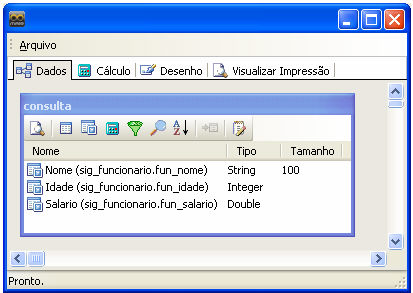

  Figura 8 - Fonte de dados

  A fonte de dados é composta por opções disponíveis ao clicar com o botão direito do mouse sobre sua área:

   Visualização - ao clicar neste botão, é possível visualizar e navegar pelos dados resultantes da consulta criada na fonte de dados;

   Tabelas - ao clicar neste botão, abre-se a tela Maker SQL;

   Campos - ao clicar neste botão, abre-se a tela Maker SQL;

   Cálculos - ao clicar neste botão, abre-se a tela Maker SQL;

   Agrupar - ao clicar neste botão, abre-se a tela Maker SQL;

   Localizar - ao clicar neste botão, abre-se a tela Maker SQL;

  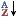 Classificação - ao clicar neste botão, abre-se a tela Maker SQL;

   Código SQL - ao clicar neste botão, aparece a tela "Maker SQL";

   Apagar - ao clicar nesta opção, a fonte de dados é apagada;

   Ligação - havendo mais de uma fonte de dados na aba "Dados", este botão fica habilitado. Ele suporta o recurso de interligação de fonte de dados por meio dos campos selecionados na consulta contida na fonte de dados. Durante todo o tempo em que a ligação entre as fontes de dados for mantida, os campos também deverão ser mantidos selecionados em suas fontes de dados de origem. Ao clicar neste botão, aparece a tela Ligação &lt;nome da fonte de dados que recebeu o clique&gt; como Detalhe:

  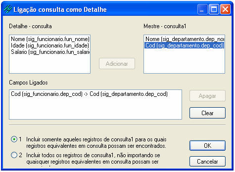

  A tela é composta de:
- Mestre - lista todos os campos selecionados na fonte de dados escolhida como "Mestre";
- Detalhe - lista todos os campos selecionados na fonte de dados em que foi efetuado um clique no botão "Ligação" ("Detalhe");
- Campos Ligados - lista todos os campos ligados entre as fontes de dados "Mestre" e "Detalhe";
- Botão Adicionar - depois de selecionados os campos das fontes de dados "Mestre" e "Detalhe", ao clicar neste botão, ambos os campos serão listados relacionados na área "Campos Ligados";
- Botão Apagar - depois de selecionado um dos campos relacionados listados na área "Campos Ligados", ao clicar neste botão, a ligação será desfeita;
- Botão Clear - ao clicar neste botão, todas as ligações dos campos relacionados listados na área "Campos Ligados" serão desfeitas;
- Botão OK - ao clicar neste botão, todas as configurações feitas serão confirmadas e a tela fechará;
- Botão Cancelar - ao clicar neste botão, todas as configurações feitas serão desconsideradas e a tela fechará.
- Opção:
- - "1 Incluir somente aqueles registros de consulta para os quais registros equivalentes em &lt;nome da fonte de dados Mestre&gt; e registros equivalentes em &lt;nome da fonte de dados Detalhe&gt; possam ser encontrados". Selecionando essa opção, apenas os valores dos campos de ligação das fontes de dados que coincidam (registros) serão considerados no momento da impressão do relatório;
  - "2 Incluir todos os registros de &lt;nome da fonte de dados Mestre&gt;, não importando se quaisquer registros equivalentes em &lt;nome da fonte de dados Detalhe&gt; possam ser encontrados.": Selecionando essa opção, todos os registros contidos na fonte de dados "Mestre" serão considerados no momento da impressão do relatório, independentemente de haver ou não, entre os campos de ligação das fontes de dados, valores que coincidam.

Observações:

1. A lista de campos somente é atualizada na transição de componentes. Caso seja adicionado algum, na aba Desenho; o mesmo não será listado imediatamente para componentes já existentes na tela. A lista será atualizada quando um novo componente for adicionado ou a estrutura de dados seja atualizada.
2. Para atribuir o valor de uma variável de sessão em um filtro do relatório, a mesma deve possuir o seguinte escopo "REPORT_FILTER_&lt;nome do filtro&gt;".
3. Não é possível ter acesso a procedure no assistente SQL do Report Builder 10.
4. Para filtrar um relatório por um determinado registro corrente do formulário, é necessário que o parâmetro de filtro do relatório possua o mesmo nome do campo que será filtrado.
5. Nos processos de Importação e Exportação de fontes de dados não são considerados os filtros de pesquisa definidos, apenas as estruturas de seleção das fontes de dados;
6. Caso exista mais de uma fonte de dados na aba Dados do relatório e tenha sido definido um filtro de pesquisa com o mesmo nome nas diversas fontes de dados, este será considerado como um único filtro de pesquisa (escopo global), inclusive as configurações feitas. Assim, no momento em que o usuário digitar um valor para o filtro de pesquisa com nome idêntico, o valor será replicado para todas as fontes de dados que estiverem usando o filtro de pesquisa.
7. Caso queira utilizar o critério de pesquisa Between (entre), os parâmetros devem possuir o mesmo nome-base e devem ser sufixados com _inicial e _final. Exemplo: Between (:Data_inicial) And (:Data_final).
8. Acesse o tópico [Filtrando Lista Dinâmica  utilizando de outra Lista Dinâmica em Relatório](../../dicas_e_truques/componente/utilizando_dois_filtros_de_pesquisa_lista_dinamica_em_relatorio).
9. Caso um relatório possua duas fontes de dados sem ligação uma com a outra, os parâmetros que uma possua interferem na outra. Exemplo: Caso uma fonte de dados do relatório possua filtro e uma outra não possua, mesmo que queiramos visualizar os dados da segunda, será necessário preencher os filtros da primeira.
