# Novas funcionalidades para o Editor de relatórios(Report Builder 14)

Neste guia vamos conhecer as novas implementações, os novos componentes do Editor de relatórios e como fazer uso dos mesmos. Estas funcionalidades estão disponíveis a partir da versão do Maker 2.7.0.10 e facilitarão o desenvolvimento de relatórios. Veja abaixo.

##

Grupos

Foram adicionadas novas funcionalidades conforme listadas abaixo:

• Iniciar na página ímpar: Essa propriedade forçará o grupo a iniciar sempre em uma página ímpar, com isso os usuários poderão gerar relatórios frente e verso.

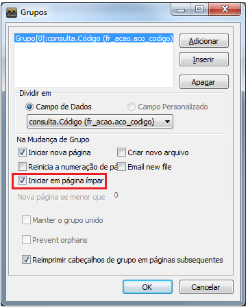

- Criar novo arquivo: Essa propriedade vai gerar cada grupo em um arquivo separado. Por padrão cada arquivo vai ser prefixado com o nome do arquivo definido e vão terminar com o valor de quebra de grupo. O prefixo e sufixo serão separados por um sublinhado.

Ex: MeuRelatório_100.pdf; Meu Relatório_200.pdf.

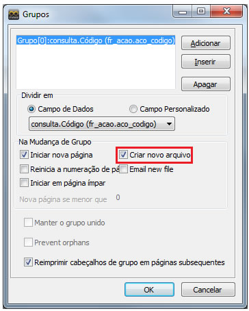

- Reinicia a numeração de páginas: Essa propriedade reiniciará a contagem de páginas para cada novo grupo.

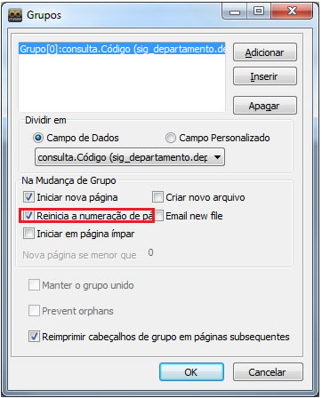

- Email new file(Email Novo arquivo) - Essa propriedade irá criar um novo arquivo de email para cada grupo existente no relatório.

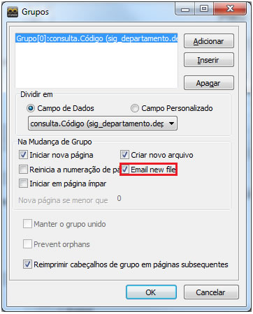

- Prevent orphans(Evitar orfãos) - Essa propriedade possui basicamente duas funções, são elas:
  - Evitar o cabeçalho do grupo que não possua nenhum detalhe na parte inferior da página;
  - Evitar o rodapé do grupo que não possua nenhum detalhe no topo da página.

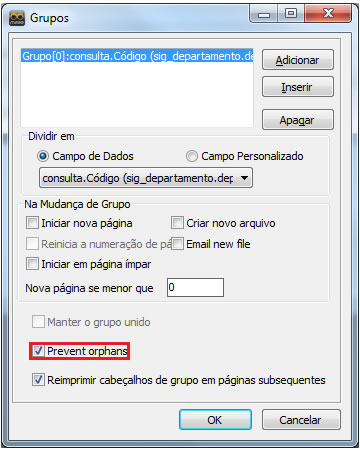

####

Arquitetura de Arquivos

Vamos falar agora das arquiteturas de arquivos que foram modificadas:

- PDF: Essa arquitetura foi redesenhada para suportar fontes incorporadas e fornecer alta qualidade na impressão de “Texto Formatado”, “Gráfico”, “Código de Barra” e o “PaintBox”.
- Texto: Essa arquitetura foi aprimorada para dar suporte a sub-relatório, tabelas de referência cruzada, texto longo.

###

Propriedade e Componentes

Neste tópico vamos falar das novas propriedades e dos novos componentes adicionados.

- HyperLinks: Para configurar é necessário utilizar a propriedade “HiperLinkColor” do componente “Texto”, para que o valor digitado no componente possa ser exibido na visualização do relatório, PDF, e na visualização web. A propriedade “Label. Caption” pode detectar automaticamente os endereços web e email.

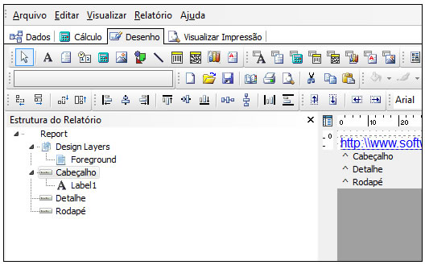

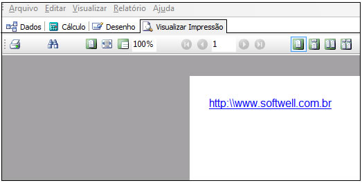

- PaintBox: Esse componente deve ser utilizado para desenhar diretamente para uma tela. Os comandos são armazenados internamente como um metarquivo que podem ser prestados a tela de impressora. A arquitetura PDF pode converter metarquivos para gráficos nativos do PDF resultando assim em renderização de alta qualidade do conteúdo do componente “PaintBox”.

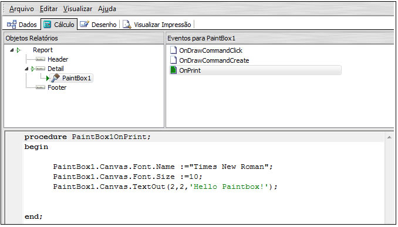

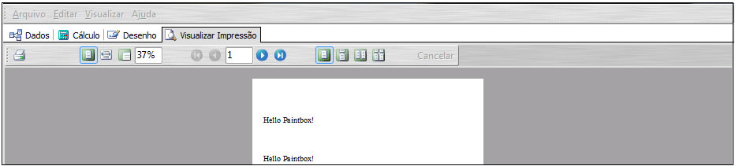

- Banda Sumário: Foi adicionado uma nova propriedade “SummarBand. AlignToBottom” vai controlar a banda de resumo impresso na parte inferior da banda, como um rodapé. Quando as propriedades “FooterBand.Visible” ,“PrintOnLastPage” e “AlignToBotto” estiverem verdadeiras, os resultados do resumo vão aparecer logo acima da banda rodapé. Caso contrario, quando não estiver presente no rodapé, o resumo vai aparecer na parte inferior da página.
- Imagem: O componente tem novas propriedades “AlignHorizontal” e “AlignVertical” que vai controlar o alinhamento da imagem na horizontal e vertical.
- Linha: O componente tem novo suporte para linhas diagonais.
- Código de Barras: O componente tem uma nova propriedade “AlignBarCode” que controla a posição horizontal do código de barras.
- Texto Formatado: Contém várias melhorias, como suporte para “FullJustification”, “LeftMargin”, ”Transparente” e fonte padrão. Foi adicionada uma nova propriedade “RichText. Paragrhaph”, utilizada para formatação de parágrafos, alinhamento, o recuo, numeração e guias.
- LeftMargen: Utilizada no componente “Texto Formatado”, vai especificar uma margem interna para tornar o texto dentro da margem esquerda do controle.
- Design Layers: Esse componente vai criar uma página no relatório, onde vamos poder criar designer para o relatório, podemos importar design de um relatório para outro evitando fazer um trabalho que já está feito.

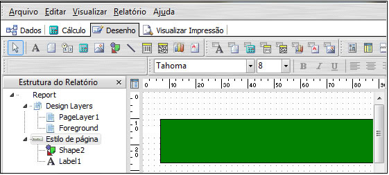

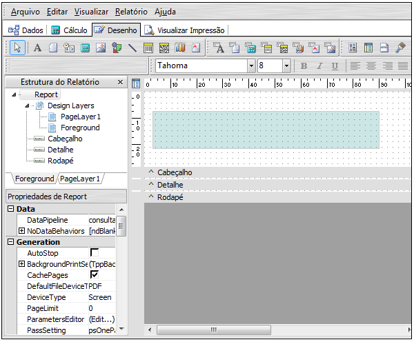

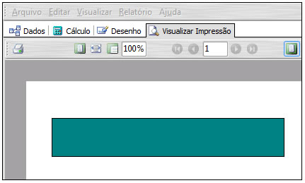

###

Eventos

Abaixo estão listados os Novos eventos disponíveis na aba “Calculo”:

• TppGroup.OnGetFileSuffix: Esse evento dará a opção para usuário trocar o nome do sufixo gerado pela propriedade “Criar novo arquivo” da propriedade “grupos”.

• PaintBox.Canvas: Utilizando o evento “OnPrint” será possível acessar o método “PaintBox.Canvas” para desenhar textos, linhas, imagens e etc.

• RichText.Font: Controlar a fonte padrão utilizada pelo componente.

Observação: Lembramos que ao atualizar a versão do Editor de Relatórios, não vai ser possível visualizar o mesmo com versões antigas. Caso tente visualizar o relatório em uma versão anterior vai ocorrer o seguinte erro:

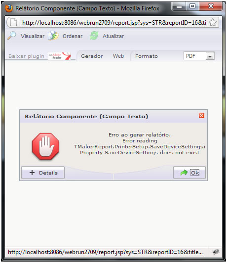
