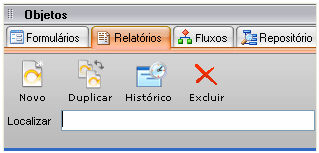
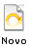
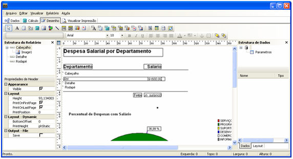

Este objeto é utilizado para a impressão de conteúdos do banco de dados e pode ser acionado pela  [Paleta Objetos](../paleta_objetos), clicando na aba Relatórios. A relação de relatórios existentes no projeto encontra-se logo abaixo do campo de pesquisa chamado Localizar.

Para a criação de um relatório, a partir da [Paleta Objeto](../paleta_objetos), clique na aba  e depois clique no botão . Caso utilize a [Barra de Menus do Maker](../barra_de_menus_do_maker), acesse Objetos e deste a opção Novo objeto - Relatório.

Observação: Opção "Visualizar", ao clicar com o botão direito do mouse sobre um relatório na barra de ferramentas "Objetos", só estará disponível para relatórios criados em "Gerador de Relatórios".

O que você deseja saber sobre a criação de um relatório?

- [Usando o Assistente de Criação de Relatório](usando_o_assistente_de_criacao_de_relatorio)
- [Aba Dados - Definindo os dados para um relatório](aba_dados_-_definindo_dados_para_relatorio)
- [Aba Cálculo - codificando em Object Pascal](aba_calculo/aba_calculo_-_codificando_object_pascal)
- [Aba Desenho](aba_desenho)
- [Barras de Ferramentas em Relatórios](barras_ferramentas_relatorios)
- [Aba Visualização](aba_visualizacao_visualize_imprima_relatorios) - visualize e imprima relatórios
- [Visualização do relatório no Webrun](../../webrun_2/relatorio/configuracoes_exibicao)

Relatório - Este exemplo demonstra a criação de um relatório.
