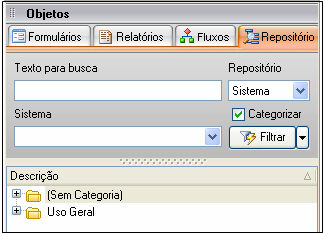

O Repositório de Objetos é o local em que é possível reutilizar objetos (formulários, fluxos de ações e relatórios) existentes no projeto que está sendo editado e na base de dados que foi configurada como Repositório Externo.

Para acessar o repositório, clique no aba . Apresentará a tela abaixo:

A aba é composta pelos componentes:

- Texto para busca - local em que é digitada a expressão que se quer procurar. Pode ser utilizado o caractere "%" (por cento) para simular uma procura com a cláusula contendo.
- Caixa de seleção Repositório:
- - Sistema - escolhida esta opção, serão listados todos os objetos contidos na base de dados para a qual aponta o projeto que está sendo editado. Quando for executada uma pesquisa, não serão retornados fluxos de ações no retorno da pesquisa, haja vista que os fluxos de ações estão disponíveis para todos os projetos contidos na base de dados a que se refere este repositório.
  - Externo - escolhida esta opção, serão listados todos os objetos contidos na base de dados para a qual aponta o Repositório Externo que foi configurado. Quando a versão do Maker for diferente da Enterprise, esta opção não estará disponível.

- Caixa de seleção Sistema - contém a lista de todos os projetos que tenham sido criados no repositório escolhido no item Reposítório;
- Categorizar - quando marcado, os objetos passam a aparecer listados em grupos de categorias.
- Botão  - efetua pesquisa observando os valores escolhidos/selecionados nos componentes anteriores. Ao clicar em , delimita o Filtro:

- Descrição - efetua pesquisa pela propriedade Descrição de todos os componentes de todos os formulários.
- Campo físico - efetua pesquisa pela propriedade Campo de todos os componentes de todos os formulários.
- Formulários - efetua pesquisa pela propriedade Descrição de todos os formulários.
- Fluxos - efetua pesquisa pelo nome de todos os fluxos de ações.
- Relatórios - efetua pesquisa pelo nome de todos os relatórios.

- Descrição - é possível focar um dos objetos e consultá-lo por meio da digitação (combinação);

Todos os objetos listados nesta aba podem ser reutilizados no projeto que está sendo editado. Quando o objeto for um:

- Formulário - se o formulário for arrastado (botão do mouse pressionado sobre o nome do formulário) da aba Repositório para:
- - Um outro formulário que esteja aberto na [Área de Trabalho do Maker](../tela_de_trabalho_do_maker), a ação que também pode ser executada a partir da aba [Formulários](../formulario/definicao_de_formulario) da barra de ferramentas "Objetos", aparecerá um menu suspenso que oferece as opções de criação de um componente baseado no formulário reutilizado:
  - - Lista Dinâmica - após a escolha deste componente, no momento do salvamento do formulário, aparecerá a tela Assistente de Banco de Dados, sugerindo a criação de um novo campo com o nome do campo preenchido para a propriedade Campo-Chave descrita abaixo. Para preenchimento automático de algumas das propriedades deste componente, será observada a estrutura no banco de dados da tabela principal contida na fonte de dados ("select") do formulário reutilizado (inclusive suas propriedades). São elas:
    - 1. Campo-Chave - campo-chave da tabela.
      2. Campo Lista - primeiro campo do tipo "texto" da tabela;
      3. Campo - campo com o mesmo nome do campo preenchido para a propriedade "Campo-Chave";
      4. Descrição / Formulário - propriedade Descrição do formulário reutilizado;
      5. SQL - estrutura de seleção contendo os campos atribuídos para as propriedades Campo-Chave e Campo Lista, juntamente com o nome da tabela principal da fonte de dados do formulário reutilizado.
    - Grade - após a escolha por este componente, no momento do salvamento do formulário, aparecerá uma tela de confirmação sugerindo a criação dos campos-chave da tabela principal associada à fonte de dados do formulário aberto, na tabela principal associada à fonte de dados do formulário reutilizado. Ademais, a propriedade Formulário é preenchida automaticamente com o valor da propriedade Descrição do formulário reutilizado.
    - SubForm - após a escolha desse componente, a propriedade Formulário é preenchida automaticamente com o valor da propriedade "Descrição" do formulário reutilizado.
    - Botão - é atribuído às propriedades Descrição e Formulário deste componente o valor contido na propriedade Descrição do formulário reutilizado.

- Área de trabalho do Maker, se o formulário escolhido for o repositório:
- - Externo - aparecerá um menu suspenso com as opções Adicionar cópia ao sistema. Caso seja efetuado um clique sobre esta opção, uma cópia do formulário que foi arrastado será adicionada ao projeto que está sendo editado.
  - Sistema - além da opção citada no tópico acima, também será possível o vínculo de um formulário oriundo do Repositório Externo por meio da opção "Vincular formulário ao sistema" (de outros projetos que tenham sido criados no mesmo banco de dados do projeto que está sendo editado).

Observações:

1. Caso existam campos coincidentes entre as fontes de dados do formulário reutilizado (criado como SubForm, Botão e Grade) e do outro formulário que estava aberto, a propriedade Parâmetros do componente também será preenchida automaticamente. Esta mesma observação vale para a colagem dos componentes SubForm, Botão ou Grade no formulário diretamente, sendo necessária, para a realização da observação, a seleção da propriedade Formulário do componente.
2. Qualquer formulário que estiver envolvido em outro formulário externo (pelo componente Grade ou SubForm) deverá estar marcado como externo.
3. Todo formulário que esteja envolvido em um formulário externo (por uma [Grade](../formulario/componentes/grade) ou um [Subform](../formulario/componentes/subformulario)) também deve está marcado como externo.
4. Quando um formulário for arrastado da aba Repositório e for externo, é necessário excluir o SQL contido nas [Definições do Formulário](../formulario/propriedade_do_formulario). Para excluir o SQL da consulta do formulário, abra as definições na aba Dados do Formulário, clique com o botão direito no campo que apresenta a consulta e selecione a opção Apagar.
5. Relatório / Fluxo de Ação: se for arrastado (botão do mouse pressionado sobre o nome do objeto) da aba  para a área de trabalho do Maker, caso seja útil, poderá ser salvo para que faça parte do projeto que está sendo editado.

Observações:

1. Ao tentar obter um formulário de outro sistema através do Repositório de Objetos, os fluxos vinculados ao mesmo perderão sua referência.
2. Para remover um sistema selecionado no campo sistema é necessário apertar a tecla Delete.
3. Ao passar o mouse sobre um formulário, na aba repositório, é apresentado um "hint" com informações sobre o mesmo. (Caso o formulário esteja selecionado o "hint" não será apresentado).
4. O Maker não permite a criação de objetos (relatórios e fluxos de ações) com o mesmo nome, exceto Formulários.
5. O recurso de  possui restrições para usuários da versão Standard e Professional:estes só poderão utilizar o Repositório local. Para mais detalhes sobre as versões do Maker, acesse o tópico [Recursos e Características das Versões do Maker](../../recursos_e_caracteristicas_das_versoes_do_maker);
6. Quando criado um Relatório legado, ele não estará disponível para a aba [Repositório](repositorio_objetos).
7. Ao configurar um repositório externo, é necessário salvar o projeto, fechar o projeto e acessar o projeto novamente.
8. Ao clicar com o botão direito em cima do objeto repositório, arrastando-o até a área de trabalho do Maker vão aparecer a seguintes opções:

   1. Vincular - vincula um formulário ao sistema. Caso sejam feitas modificações no formulário, as alterações irão valer para todos os sistemas onde contém o mesmo;
   2. Copiar - copia o formulário para outro sistema.

Utilizando o Repositório - Esse exemplo demonstra a utilização do Repositório para acesso a objetos externos.
