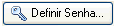
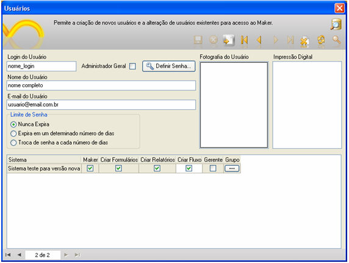
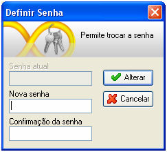
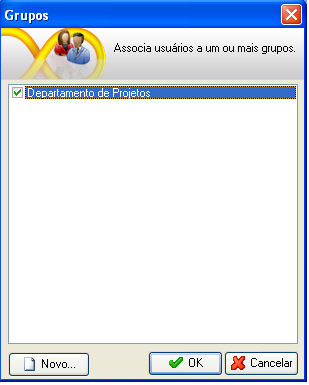
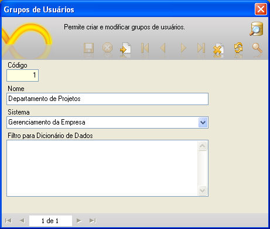
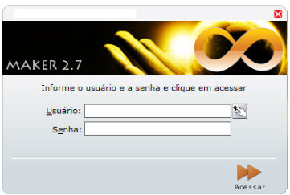
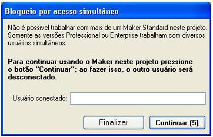

Sua função principal é a configuração das permissões do usuário, quanto ao acesso ao Maker, às áreas restritas no Webrun e à criação de objetos.

Esta opção é acessível por meio do submenu Controle de Acesso do menu Projeto, apenas para usuários que estejam configurados como Administrador Geral ou Gerentes (quando possuem permissão de acesso ao Maker).

Os requisitos mínimos para cadastrar um usuário são: informar o Login do Usuário, o Nome do Usuário e sua senha e, com o botão  (item descrito a seguir), definir o Grupo ao qual esse novo usuário pertence e definir o Sistema e os itens que poderão ser editados pelo usuário.

A tela usuários possui uma [Barra de Ferramentas da Tela](../formulario/barra_de_ferramentas_da_tela) na parte superior, que é composta de opções que possibilitam a inclusão, navegação e edição dos registros cadastrados. Na tela, temos os seguintes campos:

- Login do Usuário -  nesta caixa de texto deve ser informada a identificação do usuário que será utilizada para acesso ao Maker e ao Webrun. Poderá ser utilizado ainda o usuário cadastrado na implementação AD (Active Directory) de serviço de diretório no protocolo LDAP (exemplo: dominio.local\&lt;usuário cadastrado no AD&gt;) para acesso ao Maker, mas, caso a quantidade de caracteres informada nesta caixa de texto exceda à quantidade de 20 caracteres, é necessário aumentar o tamanho da quantidade de caracteres aceita pelo campo USR_LOGIN da tabela FR_USUARIO (no banco de dados no qual está inserido o projeto), o qual está associado a esta caixa de texto. No momento da efetuação do login no Maker, caso o usuário opte por:
- - utilizar apenas o usuário cadastrado no Maker, deve informar o login a senha definidos nesta tela;
  - utilizar o usuário cadastrado no Maker e na implementação AD (autenticação integrada), deve informar o login definido nesta tela e a senha utilizada para login no domínio (senha da rede).
- Nome do Usuário - nesta caixa de texto, deve ser informado o nome completo do usuário.
- E-mail do Usuário - nesta caixa de texto, deve ser informado o e-mail do usuário para facilitar a comunicação entre usuários, desenvolvedores e administradores dos sistemas.
- Limite da Senha - nesse agrupamento, entre outras funções, é possível delimitar o tempo de acesso do usuário ao Maker e ao Webrun, sendo subdivido em:
- - Nunca Expira - selecionando este item, o usuário terá acesso ilimitado às opções que forem habilitadas para ele;
  - Expira em um determinado número de dias - marcando esta opção, ficam habilitadas as caixas de texto "Dias para Expiração" e "Data de Referência". No primeiro componente, deve ser informada a quantidade de dias que será acrescida à data de referência informada no segundo componente, delimitando assim o período de acesso do usuário;
  - Troca de Senha a Cada Número de Dias - informados os mesmos parâmetros do item anterior, o usuário fica obrigado a alterar sua senha dentro de um determinado número de dias.
- Administrador-Geral - marcando esta opção, o usuário passa a ter poder de criação, edição e exclusão de usuários, grupos de usuários e objetos. Também se torna possível o vínculo entre usuários, sistemas e grupos disponíveis.
- Botão Definir Senha - chama a tela de mudança e definição de nova senha para um usuário. Além dos campos citados acima, também temos a Fotografia do Usuário e Impressão Digital, que permitem identificar um usuário do sistema:

- Quando for executado clique com o botão direito do  mouse:
- - sobre o campo Fotografia do Usuário - podemos escolher no menu pop-up as opções Selecionar imagem ou Remover foto;
  - sobre o campo Impressão Digital - podemos escolher no menu pop-up as opções Capturar impressão digital ou Remover digital.
  - Grade de Permissões nos Sistema - nesta grade constam as colunas:

  - Sistema - lista todos os sistemas criados no banco de dados no qual está inserido o projeto que está sendo editado;
  - Maker - opção obrigatória para qualquer tipo de usuário. Quando marcada apenas esta opção, o usuário estará habilitado para acessar o Maker mais com certas restrinções, tais como: no menu Projeto, ficarão desabilitados os itens [Funções](../fluxos_e_acoes/cadastro_de_funcoes), [Lista de Sistemas](../lista_de_sistemas/lista_de_sistemas), [Empacotar Projeto](../empacotando_projetos/empacotando_projetos); em Controle de Acesso, não poderá definir Usuários ou Grupos; no menu Objetos, só ficará desabilitado o item [Exportação](../importacao_e_exportacao/exportacao); e no menu Utilitários, os itens desabilitados são: [Otimizador de Cosultas](../otimizador_consultas/otimizador_consultas), [Executor de Scripts SQL](../executor_scripts_sql/executor_scripts_sql) e [Exportar Relatório Para o Jasper](../exportar_para_jasper/exportando_relatorios_para_jasper) (também não é possível usar qualquer atalho para as funções aqui relacionadas);
  - Criar Formulários - quando marcada esta opção, o usuário estará habilitado para criar formulários;
  - Criar Relatórios - quando marcada esta opção, o usuário estará habilitado para criar relatórios;
  - Criar Fluxo - quando marcada esta opção, o usuário estará habilitado para criar fluxos de ações;
  - Gerente - quando marcada esta opção, o usuário estará habilitado para criar novos usuários no sistema no qual ele é gerente, exceto administradores-gerais e também não poderá acessar a tela [Lista de Sistemas](../lista_de_sistemas/lista_de_sistemas);
  - Grupo - quando efetuado um clique sobre o botão contido nesta coluna, será aberta a tela Grupos (explicada abaixo).

## Definir Senha

Por meio dessa opção o administrador do sistema permite o cadastramento de senhas para novos usuários ou também a alteração de senhas para usuários já existentes. Caso o usuário seja criado sem a definição de uma senha, automaticamente está disponível o acesso ao Maker pela senha softwell.

A Figura acima permite definir uma nova senha para os usuários. Para refletir estas alterações, é preciso preencher os campos de Nova Senha, Confirmação da Senha e clicar no botão Alterar.

Acessando o recurso pelo menu Projeto, Controle de Acesso, Alterar Senha, o usuário, independentemente de suas características de permissão e acessos, poderá modificar a sua senha criada pelo administrador.

Observação: Caso não seja definida uma senha para o novo usuário, o próprio Maker traz como padrão a senha "softwell".

## Grupos de Usuários

Para criar e/ou associar ao usuário um novo grupo, deve-se efetuar um clique sobre o botão  para que seja aberta a tela Grupos. Nessa tela constam os componentes:

- área de Grupos - lista todos os grupos criados até então. À esquerda de cada um dos grupos, consta um componente checkbox, a partir do qual se pode associar um usuário a um grupo de um sistema;
- botão Novo - ao receber um clique, aparece a tela Grupos de Usuários (esta tela também é acessível pela combinação das teclas de atalho Ctrl + G ou pelo item Grupos do submenu Controle de Acesso do menu Projeto), na qual podem ser cadastrados novos grupos. A tela Grupos de Usuários é formada  pelos componentes:

- caixa de texto Código - código do grupo. No momento da criação do grupo, o valor para esse componente é gerado automaticamente pelo Maker;
- caixa de texto Nome - componente em que deve ser informado o nome do grupo;
- caixa de seleção Sistema - componente em que deve ser selecionado o sistema ao qual ficará associado o grupo.

- Área Filtro para Dicionário de Dados:

- uso do caracter ! (exclamação) antes do nome da entidade - desta forma a entidade não aparecerá em nenhuma das telas citadas acima (exemplo: !fr_acao);
- uso do caracter * (asterisco) no início ou no fim do nome da entidade - desta forma aparecerá a entidade que tiver como parte de seu nome a expressão definida pelo usuário (exemplo: fr_*);
- nome exato da entidade - desta forma aparecerá apenas a entidade definida (exemplo: fr_acao).

Observações:

1. apenas uma entidade por linha nesta área deve ser definida, e é necessário utilizar uma quebra de linha para definir mais de uma entidade;
2. esta área aparece automaticamente na tela Grupos de Usuários, caso o projeto (inclusive o banco de dados) tenha sido criado pela versão 2.5.1.21 ou superior do Maker. Para o suporte desse recurso em projetos criados em versões inferiores, o usuário deve criar um campo chamado GRP_FILTRO_DICIONARIO na tabela FR_GRUPO do banco de dados associado ao projeto, definindo texto longo (varchar) de tamanho 2000 (dois mil) como tipo de dado para o campo. Por fim, é necessário fechar o projeto e voltar a abri-lo para que o componente apareça.

Este vídeo demonstra a criação de grupos e usuários para acessar o Maker e desenvolver projetos.

## Troca de Usuários

Pode-se acessar este recurso pelo menu Projeto, Controle de Acesso, Troca de Usuário. Utilize este recurso para logar no Maker com um outro nome.

Observações:

1. Ao ser selecionada a opção "troca de usuário" no menu controle de acesso, ao ser apresentada a tela solicitando o usuário e senha, caso o usuário não complete o preenchimento dos campos e clicar em acessar o Maker manterá a sessão estabelecida anteriormente.
2. Na tela acima, é possível utilizar teclas de atalho. Para acessar o campo "Usuário", utilize Alt+U e, para o campo Senha, Alt+E. Se pressioar a tecla ENTER, acessará o sistema;
3. Usuário com permissão somente de Acesso ao Maker não pode acessar as telas: Usuários, Grupos, Funções, Listas de Sistemas, Empacotar Projeto, Exportação, Otimizador de Consultas, Executor de Scripts SQL e Exportar Relatório Para o Jasper;
4. O número de usuários acessando o Maker é limitado de acordo com a versão que foi adquirida. A versão Standard Edition limitará o acesso ao projeto apenas para um usuário. Porém, se dois usuários acessarem o projeto, terão cinco chances para efetuar as alterações. Para cada alteração, as chances serão decrementadas e, ao final, fechará o projeto, permanecendo apenas um acesso aberto;
5. O usuário master será recriado, caso ele seja excluído por engano e não haja outros usuários no cadastro;
6. Exibição de mensagem de alerta informando ao usuário que a licença de uso da versão Standard Edition é monousuária, caso mais de um usuário acesse um projeto (inclusive a base de dados) que tenha sido feito para essa versão:

Erro: Bloqueio por acesso simultâneo

O nome do usuário logado será demonstrado no campo Usuário conectado.

1. Desabilitação de todos os itens do submenu Controle de Acesso do menu Projeto na versão Standard Edition.
2. O usuário com perfil de Administrador ou Gerente pode executar qualquer ação em formulário bloqueado por qualquer usuário, e somente o Administrador poderá desbloquear qualquer restrição criada pelo usuário.
3. Login de acesso automático a projetos desenvolvidos pela versão Standard Edition;
4. Caso o usuário esteja utilizando o Maker no Sistema Operacional Windows Vista e for o administrador da máquina, recomenda-se que abra o executável do Maker com clique direito do mouse e escolha Executar como administrador.
5. Quando um usuário é promovido do *status* de usuário comum, ícones que deveriam aparecer após a promoção não aparecem. Para resolver o problema, basta reiniciar o **Tomcat**. Após reiniciar, alguns ícones poderão ser exibidos sobrepostos, portanto será necessário teclar "F4" para reorganizar os ícones.
