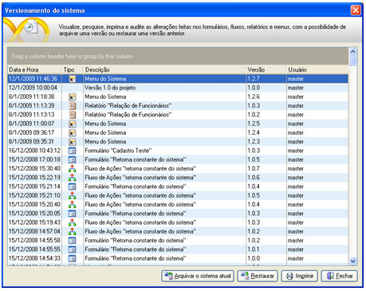
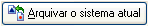
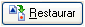
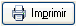
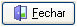

Nesta tela é possível auditar as versões dos formulários, fluxos, relatórios e menus. Por essa tela, é possível restaurar versões desses objetos ou mesmo versionar todo o projeto.

A grade da tela traz as seguintes informações:

- Data e Hora - exibe a data e a hora em que o objeto foi atualizado;
- Tipo - exibe os ícones representativos de cada objeto. Os tipos são:
- -  Formulário;
  -  Fluxo;
  -  Relatório;
  -  Menu;
  - Sem ícone - representa o versionamento do sistema completo.

- Descrição - exibe uma descrição sobre o objeto, identificando com o tipo e o nome entre aspas.
- Versão - exibe a quantidade de vezes em que o objeto foi atualizado. Essa quantidade é determinada na aba [Versionamento](../configuracao_das_conexoes/configuracoes#versionamento) da tela [Configurações](../configuracao_das_conexoes/configuracoes);
- Usuário - identifica o usuário que atualizou o objeto.

A tela traz as seguintes opções:

-  - Ao clicar nesse botão, será gerada uma versão do projeto, com todos os objetos (formulários, relatórios, fluxos, menus). Após clicar no botão, defina uma descrição na tela Descrição da Versão;
-  - Restaura uma versão selecionada na grade;
-  - Exibe e permite imprimir um relatório listando o versionamento dos objetos do projeto;
-  - Fecha a tela Versionamento do sistema.

Observações:

1. Os objetos do Maker so serão versionados,quando salvos pela segunda vez, pois é necessário criar um versionamento base para os próximos versionamentos.
2. O versionamento do sistema do Maker 2.6.2.75 inclui as entidades do
   projeto
3. Clicando com o botão direito do mouse sobre um registro da grade da tela Versionamento do sistema, é exibido um menu pop-up com as seguintes opções:
4. a. Restaurar - possui a mesma função do botão descrito anteriormente;
5. b. Renomear - permite redefinir a descrição;
6. c. Salvar como arquivo de exportação (*.FRZ) - gera um arquivo que pode ser utilizado com a função [Importar](../importacao_e_exportacao/importacao);
7. d. A tela Versionamento do sistema possui teclas de atalho, onde:

   1. - Alt + A serve para ;
   2. - Alt + R serve para ;
   3. - Alt + P serve para ;
   4. - Alt + F serve para .
8. e. Ao selecionar Histórico da [paleta Objetos](../paleta_objetos), clicando com o botão direito do mouse sobre qualquer objeto, é exibida a tela Versionamento do sistema. Nessa tela não será mostrado o botão  e os registros da grade se restringem às versões armazenadas do objeto selecionado

Utilizando Versionamento do Sistema - Esse exemplo demonstra a utilização do versionamento do projeto para gerenciar objetos editados.
