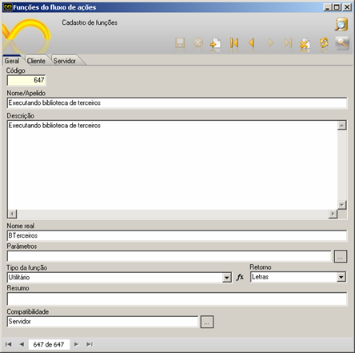
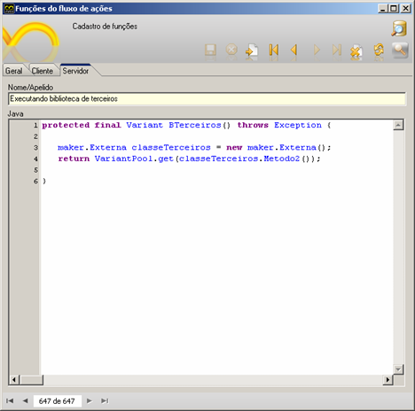
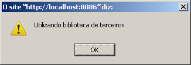
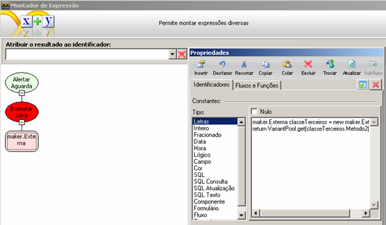
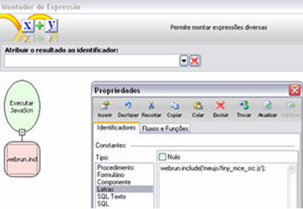
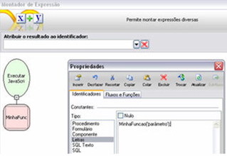
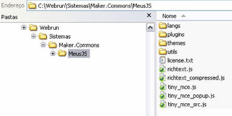
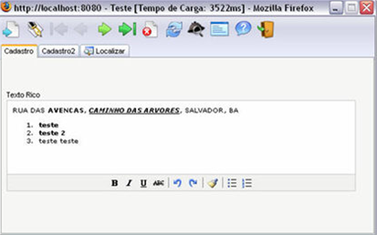

Este tutorial explica quais procedimentos devem ser realizados para adicionar componentes/bibliotecas de terceiros no Maker.

Primeiro passo é obter a biblioteca, para este exemplo será utilizada uma biblioteca recém criada, esta biblioteca conterá uma classe, com o nome "Externa" e dois métodos cujos nomes serão 'Metodo1()' e 'Metodo2()'.

public class Externa &#123;

    public long Metodo1(long num1,long  num2)&#123;

        long soma = (num1*2)+(num2*2);

        return(soma);

    &#125;

    public String Metodo2()&#123;

        String msg = "Utilizando biblioteca de terceiros";

        return(msg);

    &#125;

&#125;

Esta classe foi salva no pacote 'maker'.

Depois de obter o '.jar' , o mesmo deverá ser importado para o Webrun, para isso existem algumas maneiras de realizar a importação.

1º Modo

No diretório onde ficam os arquivos '.wfre' (normalmente pasta /Softwell Solutions/Maker 2.7/Webrun 2/systems) crie uma nova pasta com o nome do sistema que utilizará a biblioteca, dentro desta pasta deverá conter o caminho referente ao caminho do webrun onde ficam as bibliotecas, portanto crie as pastas '/WEB-INF/lib', quando o sistema for carregado a biblioteca será importada.

2º Modo

No diretório onde ficam os arquivos '.wfre' (normalmente pasta /Softwell Solutions/Maker 2.7/Webrun 2/systems) crie uma pasta chamada 'Maker.Commons' dentro deste diretório crie as pastas 'WEB-INF/lib' e adicione a biblioteca dentro desta pasta.

3º Modo

No contexto do webrun, inclua a biblioteca na pasta '/WEB-INF/lib'.

Utilizando um dos modos acima, importe a biblioteca. Após a importação ela estará apta a ser utilizada no Maker.

Neste exemplo será criada uma função na API para utilizar um dos métodos.

No Maker abra a janela de funções (Projeto -> Funções) e clique em novo.

Defina os parâmetros da função:

Na aba servidor escreva o código da função:

Código:

protected final Variant BTerceiros() throws Exception &#123;

maker.Externa classeTerceiros = new maker.Externa();

return VariantPool.get(classeTerceiros.Metodo2());

&#125;

Perceba que para instanciar a classe é necessário passar o nome do pacote 'nome_do_pacote.classe'.

Salve a função e feche a janela de funções.

Agora crie um fluxo que executará esta função.

Neste fluxo deverá conter 1 processamento.

No montador de expressões use a função 'Alertar aguardando Ok' para exibir a mensagem na tela e como parâmetro utilize a função recém criada para executar a biblioteca de terceiros.

Salve o fluxo e vincule a um evento.

Se tudo estiver correto ao executar no Webrun irá ser exibida a seguinte mensagem:

Caso deseje utilizar o Metodo1 segue o script da função:

protected final Variant somaTerceiros(Variant val1 , Variant val2) throws Exception &#123;

long numero1 = val1.getLong();

long numero2 = val2.getLong();

maker.Externa classeTerceiros = new maker.Externa();

return VariantPool.get(classeTerceiros.Metodo1(numero1,numero2));

&#125;

Observação: Caso não deseje criar uma função na API basta utilizar a função 'Executar Java'.

Exemplo:

Existem duas formas de utilizar variáveis do fluxo nas funções Executar Java e Executar Javascript:

1. Por referência - passamos a referência da variável para a função. Para utilizar, no conteúdo da função, você pode usar a seguinte sintaxe:

&lt;%&lt;Nome da variável&gt;%&gt;

Exemplo:

Return VariantPool.get(classeTerceiros.Metodo1(&lt;%val1%&gt;.getLong(),&lt;%val2%&gt;.getLong()));

2. Por valor - passamos o valor íntegro da variável para a função. O sistema simplesmente substitui o valor no conteúdo da função antes de executá-la. Para utilizar, no conteúdo da função, você pode usar a seguinte sintaxe:

&lt;%=&lt;Nome da variável&gt;%&gt;

Exemplo:

return VariantPool.get(classeTerceiros.Metodo1(&lt;%=val1%&gt;,&lt;%=val2%&gt;));

Como referenciar e chamar uma biblioteca Javascript

Para referenciar e utilizar uma biblioteca Javascript, devemos utilizar a função Executar Javascript.

Antes de utilizar a biblioteca, devemos referenciá-la no contexto. Para isso, executaremos o seguinte Javascript:

webrun.include('&lt;caminho relativo da biblioteca&gt;');

Exemplo (1)

webrun.include(MeusJS/biblioteca1.js');

Exemplo (2)

Podemos também criar uma função na API chamada Incluir Javascript. Para isso, acesse o tópico [Cadastro de Funções](../maker_2/fluxos_e_acoes/cadastro_de_funcoes).

Para chamar funções da biblioteca, usamos também a função Executar Javascript.

Exemplo:

Exemplo

Vamos mostrar um exemplo real para auxiliar a compreensão deste tutorial. Faremos um exemplo de como utilizar uma biblioteca de terceiros chamada TinyMCE que permite a edição de textos com formatação rica (negrito, itálico, etc.).

Primeiro vamos baixá-la na internet pelo endereço http://tinymce.moxiecode.com/ na área de downloads.

Depois, vamos descompactar seu conteúdo em um diretório temporário e depois copiar o conteúdo da pasta &lt;diretório temporário&gt;\tinymce\jscripts para a pasta &lt;sistemas&gt;\Maker.Commons\MeusJS\. Assim, deveremos ter algo como ilustrado abaixo:

Faremos agora um fluxo e o colocaremos no evento "Ao Entrar" de um formulário. Esse fluxo transformará um componente Texto Longo que passaremos como parâmetro em Texto Rico. Assim, vamos criar um fluxo com um parâmetro de entrada chamado "Nome do Componente" e dois processamentos. Um fará a importação da biblioteca e outro fará a transformação:

Processamento 1:

Função: Executar Javascript

Conteúdo:

window.tinyMCE_GZ = &#123;loaded: true&#125;;

webrun.include('MeusJS/tiny_mce_src.js');

Processamento 2:

Função: Executar Javascript

Conteúdo:

tinymce.documentBaseURL = window.location.href.replace(/[\?#].*$/, '').replace(/[\/\\][^\/]+$/, '');

if (!/[\/\\]$/.test(tinymce.documentBaseURL))

tinymce.documentBaseURL += '/';

tinymce.documentBaseURL += 'MeusJS/' ;

tinymce.baseURL = new tinymce.util.URI(tinymce.documentBaseURL).toAbsolute(tinymce.documentBaseURL);

tinymce.EditorManager.baseURI = new tinymce.util.URI(tinymce.baseURL);

tinymce.EditorManager.baseURI = new tinymce.util.URI(tinymce.baseURL);

tinymce.dom.Event.domLoaded = true;

tinyMCE.init(&#123; mode : "none", theme : "simple", &#125;);

var comp = $c('&lt;%=Nome do Componente%&gt;');

var name = comp.input.name;

comp.input.id = name;

var oldSetValue = comp.setValue;

comp.setValue = function() &#123;

tinyMCE.get(name).setContent(arguments[0]);

oldSetValue.apply(this, arguments);

&#125;

tinyMCE.execCommand('mceAddControl', true, name);

$c(&lt;%Nome do Componente%&gt;).setVisible(true);

Observação: para criar o processamento acima, necessitou-se, é claro, de conhecimentos avançados de Javascript, conhecimentos da API, do Webrun e de conhecimentos da biblioteca TinyMCE.

Enfim, vamos criar um formulário, criar um componente Texto Longo chamado MakerMemo1 e colocar no evento "Ao Entrar" o fluxo que criamos e atribuir ao parâmetro "Nome do Componente" o valor "MakerMemo1". Deveremos ter o seguinte resultado:

