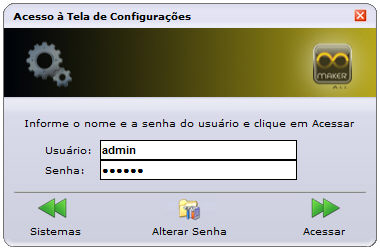
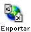
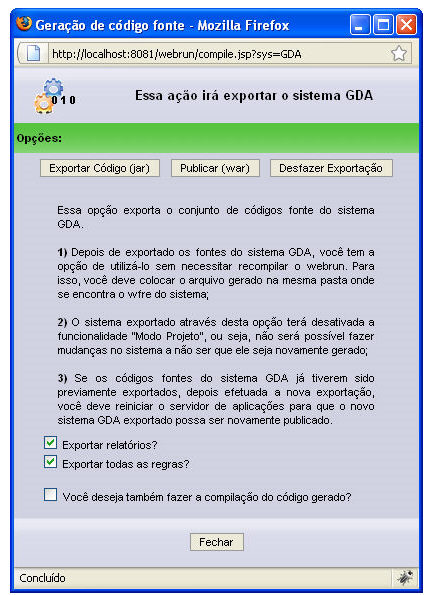
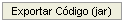
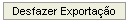

Esta opção exporta o conjunto de códigos-fonte do sistema para um arquivo que será utilizado na pasta systems da instalação do Webrun. Depois de exportadas as fontes do sistema, você tem a opção de utilizá-lo sem necessitar recompilar o webrun. Para isso, você deve colocar o arquivo gerado na mesma pasta onde se encontra o *.wfre do sistema.

O sistema exportado por meio dessa opção terá desativada a funcionalidade do Modo Projeto, ou seja, não será possível fazer mudanças no sistema, a não ser que ele seja novamente gerado.

Se os códigos-fonte do sistema já tiverem sido previamente exportados, depois de efetuada a nova exportação, você deve reiniciar o servidor de aplicações, para que o novo sistema exportado possa ser novamente publicado. Siga as etapas:

1. [Acesse o Webrun](../../webrun_2/acessando_webrun) e selecione o projeto desejado;
2. Clique no botão ;
3. Na tela Acesso a tela de Configurações, informe o usuário admin no campo Usuário, a senha webrun no campo Senha e clique no botão :

   

           Figura 1 - Tela Acesso à Tela de Configurações
4. Na Tela de Configuração, clique no botão ;
5. Na Tela de Configuração do Sistema - XXX, clique no botão . Apresentará a tela abaixo:

   

                         Figura 2 - Tela de geração código fonte
6. Na tela consta as seguintes opções:

   - Exportar relatórios? - Ao ser marcada esta opção, será criada uma pasta reports no .war ou .jar, onde todos os relatórios do sistema serão incluídos e não será mais necessário manter a tabela FR_relatorio.
   - Exportar todas as regras? - Ao ser marcada, esta opção exportará todas as regras independente de estarem vinculadas a formulários ou não.
   - Você deseja também fazer a compilação do código gerado? - Ao ser marcada, esta opção irá compilar o código gerado exportando todas as classes existente no sistema.
7. Na tela Geração de Código Fonte, clique no botão  e confirme a exportação.
8. Uma mensagem de aguarde será exibida na tela.
9. Quando a tela de download for exibida, selecione a opção Salvar e direcione para a pasta systems do Webrun. Renomeie o arquivo JAR para o mesmo nome do WFRE
10. [Reinicie o Webrun](../../webrun_2/atualizacoes_configuracoes_webrun).

Ao clicar [aqui](../../dicas_e_truques/diversos/exemplo_script_da_publicacao_war_jar), pode-se observar a lista de objetos (tabelas, visões, gatilhos e funções) que devem ser mantidos no banco de dados para o perfeito funcionamento do sistema (em tempo de produção).

O botão  irá apagar as classes exportadas que já foram descompactadas no Webrun. Utilize essa opção e delete o arquivo *.jar, quando for gerar outro arquivo *.jar com as atualizações do sistema.

Observações:

1. Não é permitido ter mais de um formulário com o mesmo nome em um sistema, pois a duplicação do mesmo pode acarretar erros ao exportar o código do sistema (Jar).
2. Não é suportado formulários com nome maior que 160 caracteres na exportação de um .jar.
3. Existem restrições para usuários das versões Standard Edition e Professional. Para mais detalhes, acesse o tópico [Recursos e Características das Versões do Maker](../../recursos_e_caracteristicas_das_versoes_do_maker).
4. Um sistema publicado (.jar) não pode conter instância.
