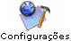
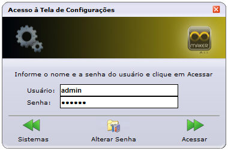
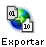
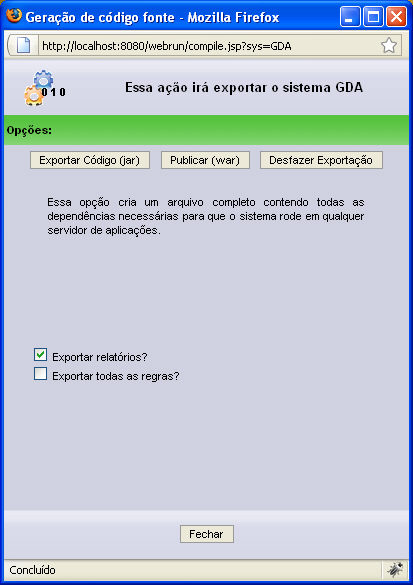
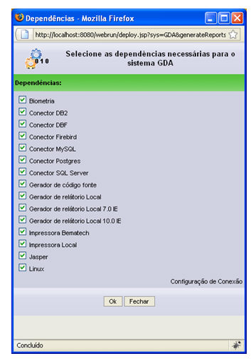
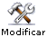

Exporte um sistema para ser utilizado independentemente da instalação do Webrun.

1. [Acesse o Webrun e selecione o projeto desejado;](../../webrun_2/acessando_webrun)
2. Clique no botão ;
3. Na tela Acesso a tela de Configurações, informe o usuário admin no campo Usuário, a senha webrun no campo Senha e clique no botão :

   

             Figura 1 - Tela Acesso à Tela de Configurações
4. Na Tela de Configuração, clique no botão ;
5. Na Tela de Configuração do Sistema - XXX, clique no botão . Apresentará a tela abaixo:

Figura 2 - Tela de geração código fonte

Na tela consta as seguintes opções:

- Exportar relatórios? - Ao ser marcada esta opção, será criada uma pasta reports no .war ou .jar, onde todos os relatórios do sistema serão incluídos e não será mais necessário manter a tabela FR_relatorio.
- Exportar todas as regras? - Ao ser marcada, esta opção exportará todas as regras independente de estarem vinculadas a formulários ou não.

Nesta tela, clique no botão  e a Tela de Dependências será apresentada:

Ao selecionar as opções da Tela de Dependências, são adicionados ou removidos alguns arquivos.

Verifique, abaixo, quais os arquivos referentes a cada opção desta tela:

- - apps/DigitalCapture.jar
  - apps/DigitalCaptureNativeWin.jar
  - apps/SDigitalCapture.jar

- - WEB-INF/lib/db2jcc.jar
  - WEB-INF/lib/db2jcc_license_cu.jar

- - WEB-INF/lib/DBF_JDBC30.jar

- - WEB-INF/lib/jaybird-full-2.1.6.jar

- - WEB-INF/lib/mysql-connector-java-5.1.5-bin.jar

- - WEB-INF/lib/postgresql-8.3dev-601.jdbc3.jar

- - jtds-1.2.1.jar

- - Autodeploy

- - apps/LocalReport.jar
  - apps/LocalReportLibs.jar
  - apps/SLocalReport.jar

- - apps/WebrunReports.cab

- - apps/MakerReports.cab

- - apps/BematechPrinter.jar
  - apps/BematechWin32.jar
  - apps/SBematechPrinter.jar

- - apps/STextPrinter.jar
  - apps/TextPrinter.jar

- - WEB-INF/lib/jasperreports-3.1.2.jar
  - WEB-INF/lib/jfreechart-1.0.10.jar

- - WEB-INF/lib/xalan.jar

6. Ao clicar sobre o OK da Tela de Dependências, aparecerá uma tela de confirmação e em seguida outra tela informando se deseja gerar um ambiente já configurado ou não.
7. Quando a tela de download for apresentada, selecione a opção Salvar e direcione para a pasta deploy do seu Servidor de Aplicação Web (caso utilize Tomcat, direcione para ...\tomcat\webapps; caso utilize JBoss, direcione para ...\jboss\server\default\deploy);
8. Reinicie seu servidor de aplicações e aguarde até que o *.war seja lido. O arquivo gerado contém o nome originado da sigla do sistema, e um contexto com este mesmo nome ficará disponível no servidor de aplicações. Nesta fase, o sistema já aparece no navegador, mas ainda não está acessível;

Ao clicar [aqui, pode-se observar a lista de objetos (tabelas, visões, gatilhos e funções) que devem ser mantidos no banco de dados para o perfeito funcionamento do sistema (em tempo de produção).](../../dicas_e_truques/diversos/exemplo_script_da_publicacao_war_jar)

9. Feito isso, acesse seu sistema por meio do navegador. Uma tela inicial idêntica à do webrun será exibida;
10. Acesse ;
11. Selecione o sistema desejado e clique em ;
12. Na janela que se abrirá, coloque as informações de acesso ao sistema (servidor, nome do banco, usuário, senha) referentes à base de dados criada na etapa 6;
13. Salve as alterações clicando em .

Pronto, o seu sistema feito no Maker já pode ser acessado localmente.

Nota: O tomcat utilizado é o 6.0.

## Pastas geradas, ao publicar um War.

Ao publicar um War, o webrun utiliza o endereço **C:\Documents and Settings\All Users\Softwell\Webrun\..MD5_da_Instância\...\system**, para armazenar informações especificas sobre o sistema publicado. As pastas system, config e reports, existentes na pasta system, são utilizadas para:

- system - armazenar instâncias com os perfis de cada usuário no sistema. [Saiba mais!](../../estrutura_maker_e_webrun/pasta_systems_do_webrun)
- config - armazenar os xmls do sistema. [Saiba mais!](../../estrutura_maker_e_webrun/pasta_config_do_webrun)
- reports - armazenar o gerador de relátorios. [Saiba mais!](../../estrutura_maker_e_webrun/pasta_reports_do_webrun)

Observações:

1. AUX, por se tratar de uma palavra reservada, não é possível exportar sistemas que possuam componentes com esse nome.
2. Para acessar sistemas publicados na versão 2.6 do Webrun, é necessário ter o tomcat 6 ou superior instalado
3. Existem restrições para usuários das versões Standard e Professional. Para mais detalhes, acesse o tópico [Recursos e Características das Versões do Maker;](../../recursos_e_caracteristicas_das_versoes_do_maker)
4. Um sistema publicado (.war) não pode conter instância**;**
5. Se forem mantidas as tabelas do Maker, após o sistema ser publicado, qualquer outro cliente que tenha o Maker poderá reeditar o projeto.
6. Não é possível publicar um sistema a partir de um sistema já publicado. É necessário publicar sempre a partir do projeto do sistema no Webrun.

Publicar o Projeto - Gerador .WAR - Esse exemplo demonstra como publicar o projeto gerando um arquivo .WAR.
