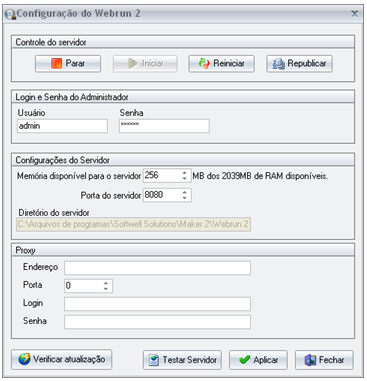

O administrador ou gerente responsável pela instalação do Maker 2.7 deve observar alguns detalhes importantes referentes à configuração do Webrun. Com o botão Iniciar do Windows, acesse a pasta Softwell Solutions, subpasta Webrun2 e desta, a opção Atualizações e Configurações.

A tela está composta por:

- Controle do servidor - quatro botões estão disponíveis para Parar, Iniciar, Reiniciar ou Republicar o serviço do gerenciador de aplicações. Sobre segurança na atualização do Webrun, acessse o tópico [Utilização da pasta Maker.Commons](../dicas_e_truques/webrun/utilizacao_da_pasta_maker_commons);

- Republicar - A funcionalidade do botão Republicar da tela de configurações do Webrun é automatizar a atualização(deploy) do Webrun.war. Como utilizá-lo:
- - Na pasta C:\Arquivos de programas\Softwell Solutions\Maker 2.7\Webrun 2\Update, cole o arquivo "Webrun.war" mais atualizado.Quando o botão Republicar for acionado, serão feitos os seguintes passos automáticos:

- 1. O serviço do Webrun2 será parado;
  2. Serão excluídos o arquivo Webrun.war e a pasta Webrun que estão na pasta webapps do tomcat;
  3. Será copiado Webrun.war que está na pasta Update para pasta webapps do tomcat;
  4. O serviço do Webrun2 será iniciado, promovendo uma atualização(deploy) do novo Webrun.war.
- Login e Senha do Administrador - dois campos estão disponíveis para que o administrador ou o gerente de instalação possa acessar o servidor de aplicações: o campo Usuário (usar admin) e o campo Senha (usar webrun);
- Configurações do Servidor - compostas por três campos:
- =======
- Login e Senha do Administrador - dois campos estão disponíveis para que o administrador ou o gerente de instalação possa acessar o servidor de aplicações: o campo Usuário (usar admin) e o campo Senha (usar webrun);
- Configurações do Servidor - compostas por três campos:

- - Memória disponível para o servidor - permite configurar a quantidade de memória disponível para o servidor de aplicações;

  Observação: O servidor Tomcat aceita até 1020 MB de RAM disponível.

  - Porta do servidor - permite configurar a porta disponível para o servidor de aplicações Webrun;
  - Diretório do servidor - mostra o diretório de instalação do servidor, definido no momento da instalação do Maker 2.
- Proxy - define todos os parâmetros para a execução do download de novas versões do Webrun. Nos campos: Endereço (deve ser informado o endereço utilizado para a conexão com a Internet, normalmente um endereço IP - endereço configurado em um hardware que provê acesso a internet para todos os outros dispositivos conectados à rede); Porta (deve ser informada a porta que será utilizada com o endereço indicado no campo Endereço), Login / Senha (deve ser informado o login / senha que o usuário utiliza para conectar a Internet);
- O botão  , utilizando as configurações acima citadas, verifica atualizações do Webrun para o servidor;
- O botão  abre o navegador com o Webrun em Modo de Execução, caso as configurações estejam corretas;
- Utilize o botão  para efetivar as informações inseridas na tela Configuração do Webrun 2;
- Utilize o botão  para sair da tela.

Encontra-se em http://&lt;endereço do servidor de aplicação&gt;/webrun/changelog.txt as atualizações ocorridas na versão instalada. Como exemplo: http://127.0.0.1:8080/webrun/changelog.txt caso seja local.

Acesse [Como replicar as atualizações para outros computadores](../dicas_e_truques/diversos/como_replicar_atualizacoes_outros_computadores) e saiba mais sobre a estrutura de arquivos e pastas do Webrun referentes às atualizações.
