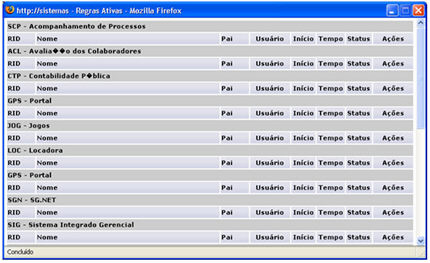
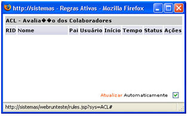

Verifique os fluxos que estão sendo executados no servidor de aplicações, pelo Webrun.

Após ter acessado a tela Acesso à Tela de Configuração, clique no botão , na [Tela de Configuração](tela_configuracoes).

É exibida a tela Regras Ativas.

Caso execute um clique sobre o nome de um dos fluxos, é exibida a mesma tela com o fluxo selecionado e a opção Atualizar Automaticamente disponível para que o usuário configure a execução: automática ou não. Com um clique na opção Atualizar, o fluxo é executado independentemente do tempo padrão de 5 (cinco) segundos (no modo automático).

