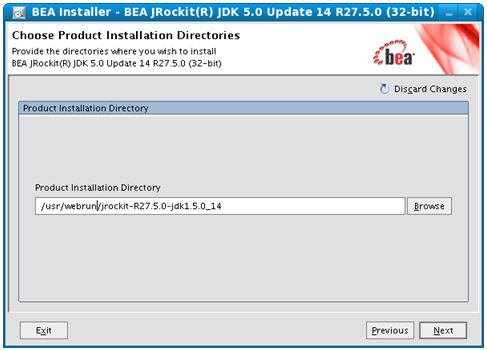

O Webrun funciona perfeitamente dentro do Fedora Core 9, usando as seguintes recomendações:

## Instalador Automático

O objetivo é ter um instalador automático para o Webrun, mas, enquanto ele não existe, a instalação é feita de forma manual.

## Imagens para o VMWare

Fedora Core 9 64 bits

&lt;http://download.softwell.com.br/webrun/linux/webrun.virtual.machine.x64.rar&gt;

## Softwares Necessários

- BEA JRockit JDK

- Wine - Contido na distribuição

- cabextract - Contido na distribuição

- winetricks

&lt;http://www.kegel.com/wine/winetricks&gt;

- Apache Tomcat 6

&lt;http://mirrors.uol.com.br/pub/apache/tomcat/tomcat-6/v6.0.18/bin/apache-tomcat-6.0.18.tar.gz&gt;

## Diretório de Trabalho

Assume-se que o diretório de trabalho será /usr/webrun:

#mkdir /usr/webrun

#cd /usr/webrun

## Instalando a JDK

Faça o download da JDK [5] e coloque na pasta de trabalho. Se preferir, você pode fazer o download pelo terminal:

#cd /usr/webrun

#wget

Inicie o instalador da JDK

#chmod 755 /usr/webrun/jrockit-R27.5.0-jdk1.5.0_14-linux-ia32.bin

#/usr/webrun/jrockit-R27.5.0-jdk1.5.0_14-linux-ia32.bin

Mude a pasta de instalação para dentro da pasta de trabalho conforme a imagem abaixo:

Crie um link simbólico para a pasta da JDK:

#ln -s /usr/webrun/jrockit-R27.5.0-jdk1.5.0_14-linux-ia32 /usr/webrun/jdk

## Instalando o Wine

A instalação do WINE é bem simples, apenas execute como root:

#yum install wine

e, para os pacotes adicionais, execute como root:

#yum install cabextract

#cd /usr/webrun

#wget www.kegel.com/wine/winetricks

#sh winetricks riched20

#sh winetricks mdac28

## Instalando o Tomcat

Faça o download do Apache Tomcat [6] e coloque na pasta de trabalho.

Se preferir, você pode fazer o download pelo terminal:

#cd /usr/webrun

#wget &lt;http://mirrors.uol.com.br/pub/apache/tomcat/tomcat-6/v6.0.18/bin/apache-tomcat-6.0.18.tar.gz&gt;

Descompacte o Apache Tomcat

#cd /usr/webrun

#tar zxf apache-tomcat-6.0.18.tar.gz

Crie um link simbólico para a pasta do tomcat

#ln -s /usr/webrun/apache-tomcat-6.0.18 /usr/webrun/tomcat

## Instalando o Webrun

Copie o Webrun.war do DVD do Maker para a pasta /usr/webrun/tomcat/webapps e execute os comandos:

#rm -Rf /usr/webrun/tomcat/webapps/ROOT

#mv /usr/webrun/tomcat/webapps/webrun.war /usr/webrun/tomcat/webapps/ROOT.war

Crie a pasta de configurações do Webrun

#mkdir /usr/webrun/conf

Copie as pastas especiais do Webrun (config, reports e systems) do DVD do Maker ou de [7] para a pasta /usr/webrun/conf recém-criada

É necessário copiar a DLL winsocks.dll que pode ser obtida em Media:WINSOCK.zip e colocar na pasta /usr/webrun/conf/reports

## Scripts de Inicialização

Descompacte o arquivo de Scripts de inicialização contido no DVD ou em [8] do Maker na pasta /usr/webrun

## Finalização da Instalação

Agora pode iniciar o Webrun executando o script webrun-start.sh e parar usando o webrun-stop.sh:

#/usr/webrun/webrun-start.sh

#/usr/webrun/webrun-stop.sh

Os scripts devem ser executados de dentro da interface gráfica.
