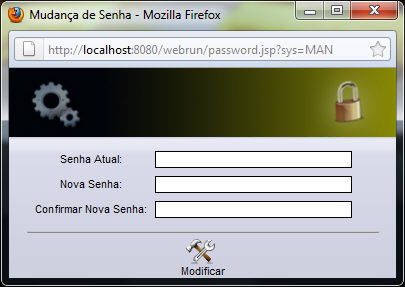

Este recurso, pelo qual se pode editar a senha master para acesso ao sistema atual, está habilitado para usuários com permissão de administrador.

Para acessar este recurso, siga os passos:

1. [Acesse o Webrun](acessando_webrun).
2. [Acesse um sistema com privilégios de administrador](acessando_sistema_webrun).
3. Execute clique duplo no botão  Alterar Senha. Será exibida a seguinte tela:

A tela é composta pelos seguintes campos:

1. Senha atual - informe a senha atual do usuário master;
2. Nova senha - informe a nova senha do usuário master;
3. Repita a senha - reescreva a senha informada no campo anterior;
4. Botão  - após clicar sobre o botão, é efetivada a atualização da senha.
