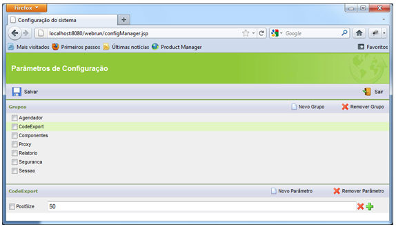
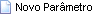

Aqui se definem parâmetros para configurar o número de regras que serão compilados simultaneamente no processo de exportação.

Na tela Parâmetros de Configuração, ao clicar no componente CodeExport, mostra o componente PoolSize:

Observar os seguintes componentes da tela do grupo:

-  - permite criar um novo parâmetro para o grupo;
-  - permite excluir o parâmetro e seus valores. O controle de check ao lado de cada parâmetro será utilizado para esse fim;
-  - Permite excluir um valor do parâmetro. podem existir muitos valores para cada parâmetro;
-  - Permite adicionar um novo valor ao parâmetro. podem existir muitos valores para cada parâmetro.

Abaixo, verifique o principal parâmetro para o grupo CodeExport:

PoolSize - define a quantidade de regras que serão compiladas em paralelo no processo de exportação de código.
