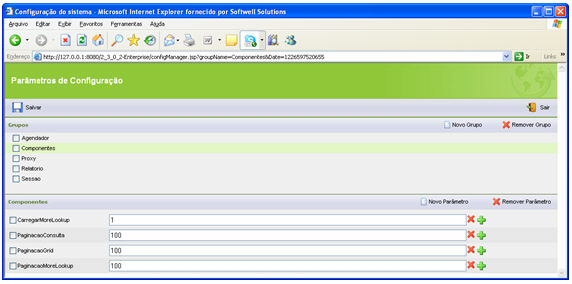
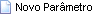

Aqui se definem parâmetros para configurar componentes de formulários:

Na tela Parâmetros de Configuração, ao clicar no componente , mostra os componentes:

-  - permite criar um novo parâmetro para o grupo;
-  - permite excluir o parâmetro e seus valores. O controle de check ao lado de cada parâmetro será utilizado para esse fim;
-  - Permite excluir um valor do parâmetro. podem existir muitos valores para cada parâmetro;
-  - Permite adicionar um novo valor ao parâmetro. podem existir muitos valores para cada parâmetro.

Abaixo, verifique os principais parâmetros para o grupo Componentes:

- CarregarMoreLookup - define se os componentes Lista serão ou não utilizados. Valor-padrão 1 (ativados);
- PaginacaoConsulta - define a quantidade de itens na exibição do conteúdo da lista, na aba localizar;
- PaginacaoGrid - define a quantidade de itens na exibição do componente Grade;
- PaginacaoMoreLookup - define a quantidade de itens na exibição do componente Lista.
